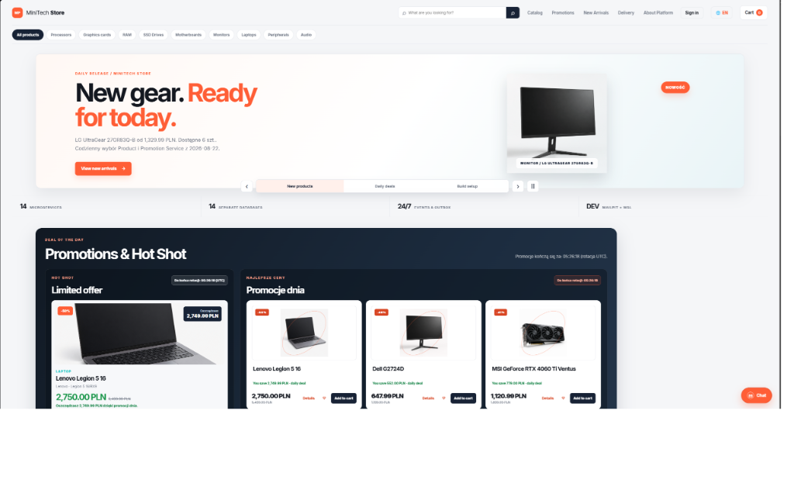
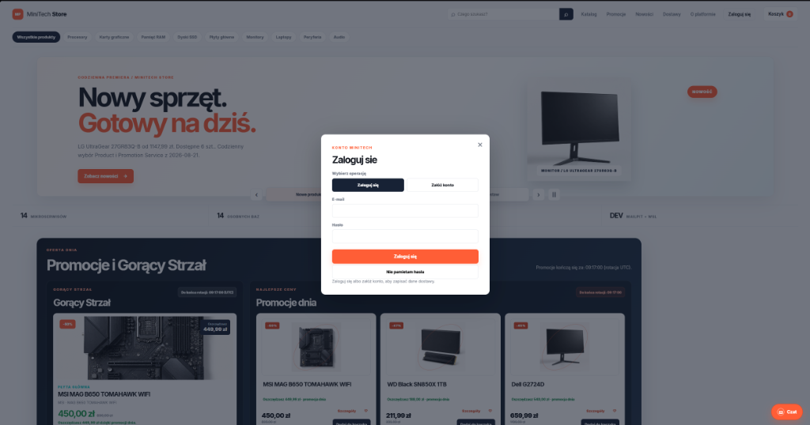
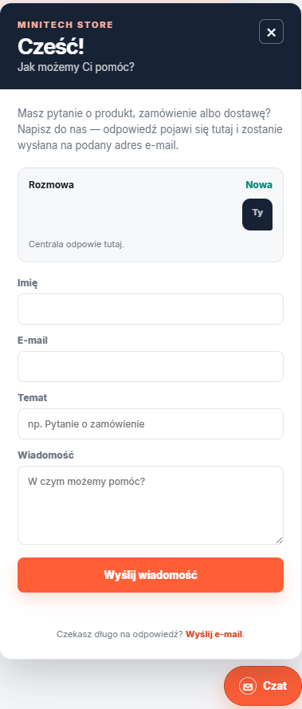
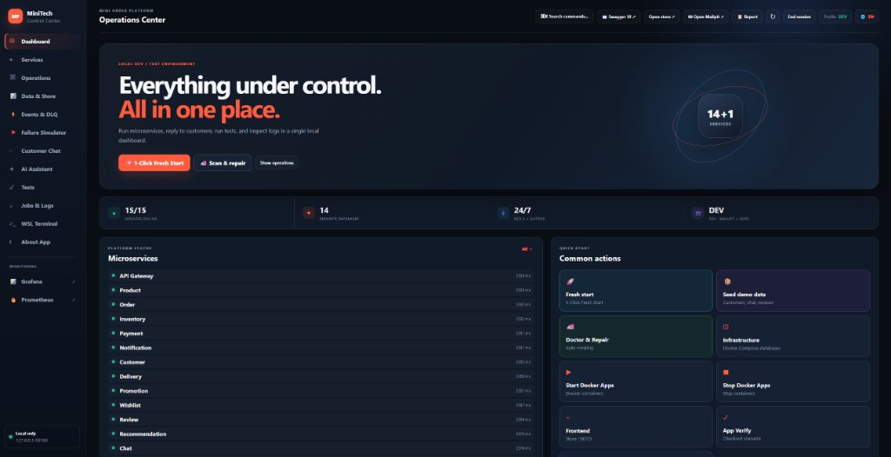
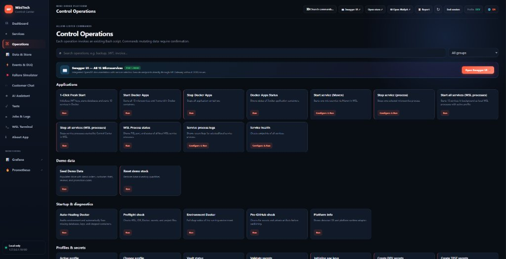
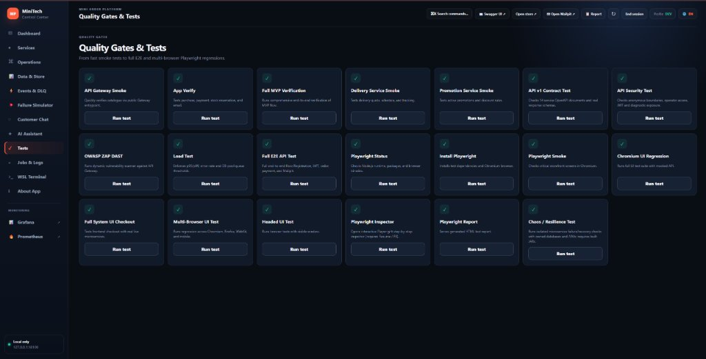
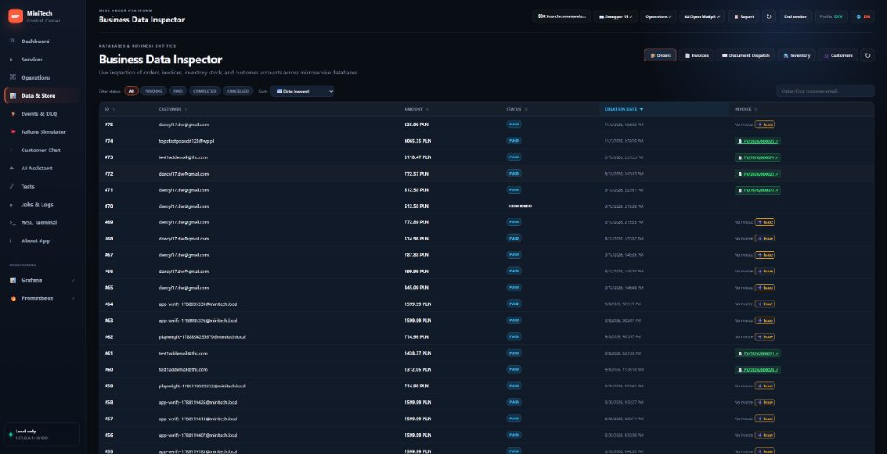

# Mini Order Platform

> The `dev` and `test` profiles are available locally through Control Center on
> WSL/Linux/macOS.
> The `prod` profile is currently unavailable for local execution. The repository
> contains only its Kubernetes/OpenBao/TLS preparation templates.

Local secrets, keys, certificates, kubeconfig files, backups and logs must be
kept in the ignored `gitIgnoreOwn/` directory. The actual SOPS + age vaults for
the `dev` and `test` profiles remain outside the repository. On Windows, the
vault is stored in WSL; on Linux/macOS, it is stored in a directory selected by
the platform adapter.

Control Center contains a separate `Profile prod - preparation (UNAVAILABLE)`
section used only to validate and diagnose the Kubernetes/OpenBao/TLS templates.
The `Profiles and Mailpit` section supports only the local `dev` and `test`
profiles.

This monorepo contains separately deployable microservices for
an order platform. The current local dev/test setup contains 15 application
services (including the API Gateway) and 14 independent PostgreSQL databases.
The API Gateway has no database of its own.

Services share the `platform-security` Maven module. Use `-am` when building a
selected service; Control Center installs this dependency before standalone
launches. Ownership checks, customer/operator/service permissions, guest access
keys and credential configuration are described in
[A01/A02 access control](docs/A01_A02_KONTROLA_DOSTEPU.md).

Checkout enforces the guest limit using server product prices: orders above
PLN 1,000 require an account. Store pickup uses the active Delivery Service
catalog (`GET /deliveries/pickup-locations`); invalid or inactive locations are
rejected. Implementation status and verification are tracked in
[the audit checklist](docs/AUDIT_0.1_POSTEP.md).

For the current stopping point, implemented changes and remaining work, see
[the audit handover for users and AI agents](docs/PRZEKAZANIE_AUDYTU_STAN_I_DALSZE_PRACE.md)
(Polish; security corrections in package 123, 1 November 2026; full A43 remains open).

## Visual Showcase

### 🛒 MiniTech Store (Client Storefront)

The frontend client application (`http://127.0.0.1:18070`) delivers a modern, responsive e-commerce user experience connected directly through the API Gateway:

#### Main Storefront & Promotions

*Storefront featuring daily product rotation, Hot Shot ("Gorący Strzał") deals, category filters, and live cart management.*

#### Customer Authentication & Account Management

*Secure JWT authentication supporting login, account creation, password reset flows, and brute-force protection.*

#### Real-time Customer Support Chat

*Integrated support chat widget connected with Chat Service, Notification Service, and operator replies via Control Center.*

---

### 🛠️ MiniTech Control Center (Operator Dashboard)

The dark-themed web management dashboard (`http://127.0.0.1:18100`) provides comprehensive operational control over the entire microservice ecosystem locally without leaving your browser:

#### 1. Operations Dashboard

*Real-time overview of 15 microservices with latency tracking, 14 independent PostgreSQL databases, Redis Outbox broker status, 1-Click Fresh Start, system diagnostics, and top-bar quick links (Command Palette, Swagger UI, Storefront, Mailpit, Environment Report).*

#### 2. Allow-listed Operations & Secrets Management

*Searchable allow-listed operations organized by category (`Applications`, `Demo data`, `Startup & diagnostics`, `Profiles & secrets`), direct Swagger UI gateway integration, Docker and WSL process lifecycle controls, and SOPS + age encrypted secrets management.*

#### 3. Quality Gates & Test Suite

*One-click test runners: API smoke tests, OpenAPI v1 contract validation, security scans (OWASP ZAP DAST), k6/JMeter load tests, full E2E API checkout, Playwright browser regressions (Chromium, Firefox, WebKit, Mobile), interactive Playwright Inspector, HTML reports, and Chaos Resilience tests.*

#### 4. Business Data Explorer (Business Data Inspector)

*Live cross-database inspector with dedicated subtabs for Orders, Invoices, Document Dispatch, Inventory, and Customers. Supports real-time status filtering (`PENDING`, `PAID`, `COMPLETED`, `CANCELLED`), search, sorting, direct VAT invoice generation (`➕ Issue`), PDF downloads, and SMTP email dispatch.*

## Publishing to GitHub

The repository is prepared for publishing its source code. Before the first
commit, run:

```bash
bash scripts/control-center/control-center.sh github-check
git status --short --ignored
```

Do not push the contents of `gitIgnoreOwn/`, local `.env` files, real
`*.env.sops` files, age/JWT keys, private certificates, kubeconfig files,
database backups, logs, tokens, runtime reports, `target/`, `.m2/` or `.idea/`
directories to GitHub.

The rules are defined in [`.gitignore`](<.gitignore>). The ignored directory
layout and privacy rules are described in
[`gitIgnoreOwn/README.md`](<gitIgnoreOwn/README.md>). Comprehensive project instructions
are available in [`docs/General_Instruction.md`](<docs/General_Instruction.md>) (Polish)
and [`docs/General_Instruction_EN.md`](<docs/General_Instruction_EN.md>) (English).

The SOPS + age vault is stored outside the project by default. On Windows it is
stored in WSL, on Linux in `~/.config/mini-order-platform`, and on macOS in
`~/Library/Application Support/mini-order-platform`.

## Services

| Service | Directory | Port | Status |
| --- | --- | ---: | --- |
| API Gateway | `api-gateway` | 18080 | MVP |
| Product Service | `product-service` | 18081 | MVP |
| Order Service | `order-service` | 18082 | MVP |
| Inventory Service | `inventory-service` | 18083 | MVP |
| Payment Service | `payment-service` | 18084 | MVP |
| Notification Service | `notification-service` | 18086 | MVP |
| Customer Service | `customer-service` | 18087 | MVP |
| Delivery Service | `delivery-service` | 18088 | MVP |
| Promotion Service | `promotion-service` | 18089 | MVP |
| Wishlist Service | `wishlist-service` | 18090 | MVP |
| Review Service | `review-service` | 18091 | MVP |
| Recommendation Service | `recommendation-service` | 18092 | MVP |
| Chat Service | `chat-service` | 18093 | MVP |
| Returns Service | `returns-service` | 18094 | MVP |
| Billing Service | `billing-service` | 18095 | MVP |

Each service directory has its own `pom.xml`, application class, configuration
and tests. The root `pom.xml` is the shared Maven parent and aggregator; it owns
common versions and build settings and does not start an application of its own.
Build a selected service from the repository root with `./mvnw -pl chat-service -am package`.
Before running a module separately, install its build prerequisites with
`./mvnw -pl platform-security -am -DskipTests install`; Control Center does this automatically.
See [A42 — shared Maven parent](docs/A42_WSPOLNY_PARENT_MAVEN.md) for the scope and checks.
Request correlation uses one shared context, filter and HTTP interceptor while
preserving service filter registration and Customer audit metadata. See
[A42.2 — shared correlation](docs/A42_WSPOLNA_KORELACJA.md) for the clean build and checks.
Gateway, Order, Payment and Customer share opt-in HTTP resilience implementation
and configuration. Their retry decisions remain at the call sites; other services
receive no additional Resilience4j runtime libraries. See
[A42.3 — shared HTTP resilience](docs/A42_WSPOLNA_ODPORNOSC_HTTP.md).
The storefront and product page share a native ES module for scoped cart storage,
legacy migration and safe persistence. See
[A42.4 — cart storage module](docs/A42_MODUL_PAMIECI_KOSZYKA.md) for loading and browser checks.
Control Center uses an independent ES module for authenticated JSON and binary
requests, with a private in-memory session and protection against late responses.
See [A42.5 — Control Center API module](docs/A42_MODUL_API_CONTROL_CENTER.md).
Control Center dictionaries, static labels and historical job titles have their
own ES module with a PL/EN completeness check. See
[A42.6 — Control Center translations](docs/A42_MODUL_TLUMACZEN_CONTROL_CENTER.md).
Control Center cursor lists share a separate module that cancels superseded
reads and resets cursors when filters change. See
[A42.7 — Control Center list module](docs/A42_MODUL_LIST_CONTROL_CENTER.md).
The storefront, product details and order details share a JSON HTTP client with
session refresh coordination, consistent errors and guest order headers. See
[A42.8 — shared store HTTP client](docs/A42_WSPOLNY_KLIENT_HTTP_SKLEPU.md).
Invoice PDFs use the same transport with a separate download lifecycle, shared
pending requests and cancellation on logout. See
[A42.9 — invoice downloads](docs/A42_MODUL_POBIERANIA_FAKTUR.md).
Chat uses the shared HTTP client through a capability-only transport, with
read cancellation and protection against late responses from an old conversation.
See [A42.10 — chat transport](docs/A42_MODUL_TRANSPORTU_CZATU.md).
WebAuthn option conversion and credential serialization use a separate module
with bounded binary encoding. See [A42.11 — passkey module](docs/A42_MODUL_PASSKEY.md).
Control Center assistant replies use an independent inert Markdown renderer,
with code blocks protected from further formatting. See
[A42.12 — assistant reply renderer](docs/A42_RENDERER_ODPOWIEDZI_AI_CC.md).
Control Center command search uses a separate module with stable operation IDs,
keyboard navigation and focus handling. See
[A42.13 — command palette](docs/A42_MODUL_PALETY_POLECEN_CC.md).
Control Center stock receipts and invoice corrections share a persistent command
store with cross-tab locks and cleanup tied to the original profile and operation ID.
See [A42.14 — operator commands](docs/A42_MODUL_OPERACJI_OPERATORA_CC.md).
The assistant conversation has one active turn, bounded completed history and
cancellation on reset or session expiry. See
[A42.15 — assistant conversation](docs/A42_KONTROLER_ROZMOWY_ASYSTENTA_CC.md).
Control Center job monitoring uses a single observation with cancelled stale reads,
queued/running polling and one completion notification. See
[A42.16 — job monitor](docs/A42_MONITOR_ZADAN_CC.md).
A42 is complete through A42.21. Storefront features, checkout, account security,
translations and dialogs use native ES modules, with a shared customer session
refresh critical section. Control Center has separate routing, operation, data
and terminal modules; its Python server composes independently testable features
behind one HTTP policy. CI checks import graphs, matching module versions and
thin service facades. See [A42 completion and validation](docs/A42_DOMKNIECIE_MODULOW.md)
for the module map, full browser regression and coordinated deployment files.
Every service except API Gateway owns a separate
PostgreSQL database; no service shares another service's tables.

## Service responsibilities and data ownership

Product Service has its own PostgreSQL database on host port `15433` mapped to
container port `5432`. It exposes the product catalogue at
`http://localhost:18081` and stores SKU, category, manufacturer, model,
technical parameters, price and the `active` status.

Single-product reads load one product and reuse a bounded, database-versioned
ID index. Checkout resolves up to 100 cart lines through one authenticated
product batch call; prices remain uncached. Deploy Product (Flyway V10) before
Order. See [catalog reads and rollout](docs/A27_ODCZYTY_KATALOGU.md).

Order Service has its own PostgreSQL database on host port `15432`. When an
order is created, it obtains the product and price from Product Service and
then reserves the requested quantity through Inventory Service.

Inventory Service has its own PostgreSQL database on host port `15434`. It
handles stock levels, reservations, releasing reservations and confirming
reservations.

The storefront enriches visible catalog cards through availability batches
of up to 100 IDs, with two requests in flight. Stock/history failures do not
block product rendering, and checkout forces a fresh availability read.
Deploy Inventory before the updated frontend bundle; see
[catalog availability](docs/A28_DOSTEPNOSC_KATALOGU.md).

Business lists use bounded cursor pages (`size=1..200`, default 50) and return
`X-Has-More` / `X-Next-Cursor` headers. Store history, Control Center and CLI
provide access to subsequent pages; review summaries use SQL aggregates.
Coordinate service and client deployment; see [A29 pagination](docs/A29_PAGINACJA_LIST.md).

Invoice/correction PDFs share a 32 MiB cache with TTL. ZIP exports read bounded
SQL windows and stream through Gateway without buffering the complete archive.
CC and CLI accept date ranges; exports above 10,000 invoices require a narrower
range. See [A30 document export](docs/A30_PDF_CACHE_EKSPORT.md) for limits and rollout.

HTTP dependencies share propagated deadlines and connect/read/body limits.
Payment, notification, product pricing and saga orchestration perform network
calls outside short state transactions. Recovery jobs have bounded workers
and DB leases; see [A31 HTTP and transactions](docs/A31_HTTP_TRANSAKCJE.md)
for settings, migration requirements and the coordinated rollout.

A32 adds leased Payment/Billing outbox publication, transactional invoice events,
durable consumer inboxes and Redis pending recovery. ACK follows SQL commit;
uncertain SMTP delivery is quarantined for manual review. See
[A32 events and replicas](docs/A32_ZDARZENIA_REPLIKI.md) for migrations, Redis
persistence, safe retention and replica/crash tests.

A33 adds response-schema contracts for all 14 services, strict security/load/chaos
gates and a P1 evidence inventory. Production checks reject unfinished P1 work;
the audit remains partially open. See [A33 quality gates](docs/A33_BRAMKI_JAKOSCI.md)
for QA dependencies, thresholds, reports and remaining acceptance conditions.

A08 coordinates payment commands through SQL across replicas, persists provider
authorization and replays committed outcomes. Identical concurrent commands wait
up to five seconds; changed commands return 409. See [A08 payment replicas](docs/A08_PLATNOSCI_REPLIKI.md)
for the V10 migration, coordinated rollout and two-JVM crash regression. Real
provider integration remains open in A05. A09 adds durable independent follow-up
tasks committed with payment success, automatic retries, dead letters and operator
replay in Control Center. Invoice notifications wait for the PDF document ID.
See [A09 durable payment effects](docs/A09_TRWALE_SKUTKI_PLATNOSCI.md) for Payment V11,
rollout, limits and real dependency/replica crash tests.

A10 separates deferred fulfillment from cash settlement: accepted cash orders
retain confirmed stock, get tracking and remain `COLLECTION_DUE` until an operator
records the exact PLN amount and receipt after handover. Invoice issuance waits
for settlement. Control Center provides cash collection; see [A10 cash fulfillment](docs/A10_POBRANIE_I_REALIZACJA.md)
for Order V15/Payment V12, rollout and two-replica PostgreSQL tests. Internet
payments still require a real provider in production.

A11 implements the audit's MVP cancellation boundary: paid/accepted orders cannot
be falsely cancelled. Unpaid cancellation fences all Payment replicas before
releasing stock, with durable recovery after dependency/process failure.
Control Center provides `order-cancel <order-id>`; refunds remain unavailable.
See [A11 safe cancellation](docs/A11_BEZPIECZNE_ANULOWANIE.md) for Payment V13,
deployment order and the exact supported scope.

A06 completes atomic order/saga recovery with versioned lifecycle transitions,
bounded orphan scans and operator reconciliation. Historical records requiring
verification expose `lifecycleReviewRequired` and cannot start new payments or
business effects. Control Center provides `order-sagas` and `order-reconcile`.
See [A06 order consistency](docs/A06_SPOJNOSC_ZAMOWIEN.md) for Order V16 and rollout.

A21 adds atomic stock receipts with immutable UUID-based results and a movement
ledger. Control Center preserves pending receipt IDs across reply loss/reload.
Absolute stock corrections require an expected version and operation UUID;
legacy unconditional PATCH is rejected. See [A21 stock operations](docs/A21_PRZYJECIA_MAGAZYNOWE.md)
for Inventory V8, CLI commands, compatibility and replica/crash tests.


API Gateway has no database of its own. It is the common entry point at
`http://localhost:18080` and forwards the versioned public API paths
`/api/v1/products`, `/api/v1/orders`, `/api/v1/inventory`,
`/api/v1/payments`, `/api/v1/notifications`, `/api/v1/customers`,
`/api/v1/deliveries`, `/api/v1/promotions`, `/api/v1/wishlists`,
`/api/v1/reviews`, `/api/v1/recommendations`, `/api/v1/chat`,
`/api/v1/returns` and `/api/v1/invoices` to the appropriate services.
The unversioned `/api` paths remain available for local compatibility.

Customer Service has its own PostgreSQL database on host port `15437`. It
handles registration, login, password reset, brute-force protection, security
auditing and delivery-address storage. Checkout supports both guest purchases
and purchases made through an account.

Delivery Service has its own PostgreSQL database on host port `15438`. It
provides delivery methods, cost calculation and estimated delivery time.
Checkout obtains a delivery quote before creating the order. Order Service
requests its own quote using server-resolved basket prices and quantities,
validates the selected method/date and fulfillment type, and stores that quote.
The client-supplied delivery cost is accepted for compatibility but is not used
to price the order. Unsupported delivery time slots are rejected. Delivery
Service must be available when a new order is created.

Promotion Service has its own PostgreSQL database on host port `15439` and runs
at `http://localhost:18089`. It stores the active campaign configuration,
calculates the daily rotation of new products and promotions, and records price
history. Promotion codes can be listed and generated from Control Center. The
frontend validates a code during checkout, Order Service applies the returned
discount to the single order, and the code's `redeemedCount` is increased only
after successful payment. The bestsellers section obtains its ranking of paid
products from Order Service.

Wishlist Service has its own PostgreSQL database on host port `15440` and runs
at `http://localhost:18090`. It stores product identifiers saved by customers.
The frontend provides a heart button on product cards and a `My favourites`
section in the account menu. In the `dev` and `test` profiles, the customer ID
is passed from the frontend session. Before using the `prod` profile, resource
ownership must be enforced based on JWT claims.

Review Service has its own PostgreSQL database on host port `15441` and runs at
`http://localhost:18091`. It verifies that a customer bought the product in a
paid order, saves the review with `PENDING` status and exposes it publicly only
after moderation.

Recommendation Service has its own PostgreSQL database on host port `15442` and
runs at `http://localhost:18092`. It reads the active catalogue from Product
Service and, for a logged-in customer, reads only paid order history from Order
Service. The frontend shows similar products on the product details page. Its
database keeps an optional technical request log and does not copy catalogue or
payment data. Per-request persistence is disabled by default; bounded-cardinality
metrics record successful responses and result counts. A scheduled worker removes
expired diagnostic rows in small transactions (default retention: seven days).
See [A43.1 — recommendation log retention](docs/A43_RETENCJA_LOGU_REKOMENDACJI.md)
for configuration, monitoring and PostgreSQL acceptance.

The frontend also provides a product comparison feature. A maximum of four
products is stored locally in the browser, and the comparison table displays
Product Service data, including technical parameters, price and availability.
This feature does not require an additional database or microservice.

Payment Service has its own PostgreSQL database on host port `15435`. It accepts
payments for orders in `CONFIRMED` status, updates the order to `PAID`, supports
controlled payment-decline simulation and stores notification events in a
durable outbox.

Payment methods are restricted to `CARD`, `BLIK`, `TRANSFER`, `CASH_ON_DELIVERY`
and `CASH_AT_PICKUP`. `PAYMENT_PROVIDER=simulation` is selected by default only
in `dev`/`test`; enabling simulation with `prod` (also alongside `dev`) prevents
startup. Other profiles default to `disabled`: creating a payment returns 503
before changing the order. `PAYMENT_PROVIDER=stripe` enables hosted card Checkout,
canonical provider confirmation, signed webhooks, durable recovery and full refunds.
The selected provider exposes its supported methods through `/payments/config`.
Stripe refunds require an operator and freeze fulfillment; automatic compensation
also restores stock and cancels an unfulfilled failed Checkout. An operator refund
keeps other business effects under review rather than claiming a complete cancellation.
The user must manually add `STRIPE_SECRET_KEY` and `STRIPE_WEBHOOK_SECRET` to both
`dev.env.sops` and `test.env.sops`; external sandbox acceptance is still required.
See [A05 operations and remaining manual steps](docs/A05_STRIPE_CHECKOUT.md).

Billing Service verifies every invoice command against Order Service over an
authenticated internal connection. The order must be `PAID`, `SHIPPED` or
`COMPLETED`; owner, e-mail, PLN currency, line items, shipping, discount and total
must match. Only buyer details are supplied independently. Verification failure
creates no document, and a retry never rewrites an existing invoice. Legacy
documents without items are no longer backfilled from caller-supplied data.

Customer Service requires an independent 32-byte MFA encryption key in every
profile. Control Center provisions it in SOPS and preserves the old derived
key before JWT rotation. Versioned MFA ciphertexts are migrated atomically at
startup; missing decryption keys prevent startup. See the [A22 rotation and
migration procedure](docs/A22_MFA_KLUCZE_ROTACJA.md) before upgrading existing
data. `mfa-rotate dev` retains previous keys for migration; JWT rotation uses
PKCS#8 and preserves previous RSA verification keys.

Refresh tokens rotate once within a login family; replay revokes that family's
refresh tokens. TOTP/recovery consumption is serialized across Customer Service
instances. TOTP setup expires after ten minutes, and recovery-code regeneration
requires a fresh TOTP code. See the [A23 session and MFA contract](docs/A23_SESJE_I_MFA.md)
for API changes, replay behavior and the coordinated upgrade procedure.

Customer Service removes expired authentication records in bounded transactions
after a configurable grace period (default: seven days). Live refresh families
retain replay evidence; active TOTP and unused recovery codes remain protected.
See [A43.2 — authentication data retention](docs/A43_RETENCJA_TOKENOW_I_MFA.md)
for configuration, metrics and PostgreSQL acceptance.

Expired account-verification hashes and old metadata on confirmed accounts are
also cleared in bounded batches. Pending accounts retain resend eligibility and
throttling; confirmation and resend serialize on the customer row. See
[A43.3 — verification marker retention](docs/A43_RETENCJA_WERYFIKACJI_KONT.md).

The security audit log has an independent retention module. Its default
`observe` mode reports old entries without deleting them; an operator can select
the retention period and enable bounded `purge` explicitly. See
[A43.4 — security audit retention](docs/A43_RETENCJA_AUDYTU_BEZPIECZENSTWA.md)
for modes, configuration and metrics.

Billing can compact old, published invoice-event payloads while retaining their
unique event IDs and publication metadata. The default mode only observes;
pending/failed records and leases remain protected. See
[A43.5 — invoice outbox payload retention](docs/A43_RETENCJA_TRESCI_OUTBOXU_FAKTUR.md)
before enabling compaction or upgrading Billing.

Payment can compact recipient/delivery-address copies in old published outbox
records. It defaults to observation and preserves the original deduplication key,
which still contains the recipient email. See
[A43.9 — payment outbox contact retention](docs/A43_RETENCJA_DANYCH_OUTBOXU_PLATNOSCI.md)
for activation, migration and the remaining data lifecycle scope.

Notification can compact old rejected-event diagnostics in its inbox while
keeping event IDs and payload hashes for deduplication. It defaults to observation;
accepted messages and delivery retries remain protected. See
[A43.10 — rejected inbox diagnostics](docs/A43_RETENCJA_ODRZUCONYCH_ZDARZEN_NOTIFICATION.md)
before activating compaction.

Billing has an independent equivalent for rejected payment-event diagnostics:
[A43.11 — Billing rejected inbox](docs/A43_RETENCJA_ODRZUCONYCH_ZDARZEN_BILLING.md).
It also defaults to observation and preserves receipt IDs/hashes. Its mode and
age are separate from published invoice outbox retention.

Notification also supports compacting old confirmed-SENT subjects and bodies,
defaulting to observation. Identity and recipient deduplication remain; API
responses explicitly mark removed content. See
[A43.12 — sent notification content](docs/A43_RETENCJA_TRESCI_WYSLANYCH_POWIADOMIEN.md)
for activation, protected retry states and other copies that remain.

Resolved DLQ copies have a separate observation-first policy, requiring an old
confirmed-SENT parent. Version checks and refreshed replay state protect against
stale writes restoring removed content. See
[A43.13 — resolved DLQ content](docs/A43_RETENCJA_TRESCI_ZAMKNIETYCH_DLQ.md).

The invoice Redis stream has independent observation and bounded retention.
Deleting entries requires an explicit recipient policy and protects unread and
pending messages in every existing group. See
[A43.14 — invoice stream retention](docs/A43_RETENCJA_STREAMU_FAKTUR.md)
before selecting an age, declaring groups or enabling trim.

The reviewed [data lifecycle inventory](scripts/qa/contracts/data-lifecycle.json)
covers database ownership, known Redis namespaces and copied data. CI detects
unreviewed schema/Redis changes without accessing live data. See
[A43.15 — inventory and completeness gate](docs/A43_REJESTR_CYKLU_ZYCIA_DANYCH.md).
The owner-only `GET /api/v1/customers/me/data-export` downloads a
**partial** profile and security summary as JSON, with credential fields excluded,
private/no-store headers and an explicit omissions manifest. See
[A43.16 — account profile export](docs/A43_EKSPORT_PROFILU_KONTA.md).
Customers can also download it from the store profile panel; its label explains
the partial scope. See [A43.17 — store profile download](docs/A43_POBIERANIE_PROFILU_W_SKLEPIE.md).
The separately authenticated Wishlist export provides bounded pages with an
explicit non-snapshot warning; see [A43.18 — Wishlist export](docs/A43_EKSPORT_WISHLISTY.md).
Own review text, ratings and publication statuses can be exported in bounded
pages with moderator notes and order links excluded; see
[A43.19 — review export](docs/A43_EKSPORT_RECENZJI.md).
Retained account-linked recommendation log rows have a separate paged export;
recording remains optional and the response does not claim complete activity
history. See [A43.20 — retained recommendation log export](docs/A43_EKSPORT_LOGU_REKOMENDACJI.md).
Own order headers and item lines have separate bounded exports, with access
secrets/workflow internals excluded and legacy single-line values preserved;
see [A43.21 — order export](docs/A43_EKSPORT_ZAMOWIEN.md).
Shipment export verifies the customer owner through Order on every request;
see [A43.22 — shipment export](docs/A43_EKSPORT_PRZESYLEK.md).
Own returns and complaints have bounded exports of cases, items and safe status
events; see [A43.23 — return export](docs/A43_EKSPORT_ZWROTOW.md).
Stored payment and optional refund data can be exported per owned order,
with no provider calls; see [A43.24 — payment export](docs/A43_EKSPORT_PLATNOSCI.md).
Owned invoice headers, bounded item/correction pages and existing PDF renderings
use authoritative Order ownership; see [A43.25 — invoice export](docs/A43_EKSPORT_FAKTUR.md).
Chat conversation and message exports require the individual conversation token,
without account/email linking; see [A43.26 — chat export](docs/A43_EKSPORT_CZATU.md).
Full cross-service account export/erasure and backup handling remain open.
The [A43 closure plan](docs/A43_PLAN_ZAMKNIECIA.md) defines the remaining
7 stages, A43.35–A43.41, including dependencies and acceptance criteria.
A43.27 is complete locally: order notifications require current Order ownership;
chat reply notifications require the conversation capability. The user selected
customer-directed notifications only. 297 Java, 246 Python and 11 isolated HTTP
check groups passed. See [notification export](docs/A43_EKSPORT_POWIADOMIEN.md).
Own stock reservations/items and coupon reservations/redemptions now have
bounded exports with authoritative Order ownership (A43.28). 238 Java,
246 Python and 10 isolated HTTP check groups passed, without changing stock,
expiry or coupon usage. See [reservation and coupon export](docs/A43_EKSPORT_REZERWACJI_KUPONOW.md).
A43.29 adds safe own security history and MFA metadata. New explicit audit
subjects and strict legacy refresh IDs replace email inference; free-text notes
require manual subject review/redaction. 360 unique Java, 246 Python and seven
HTTP groups passed. See [security data and manual review](docs/A43_OCENA_NOTATEK_I_DANYCH_BEZPIECZENSTWA.md).
A43.30 classifies all 49 tables/562 columns, Redis, copies and 93 omissions.
The selected scope uses existing business exports and manual review for
remaining personal data. CI rejects unreviewed field/projection changes;
a PostgreSQL oracle verifies all 14 database schemas and 22 unique-key
obligations. Event identity migration remains planned for A43.36.
See [technical data classification](docs/A43_KLASYFIKACJA_DANYCH_TECHNICZNYCH.md).
A43.31 adds a resumable account export coordinator with bounded Customer DB
chunks and exactly one hour of availability, cancellation, retries and a
14-owner completeness manifest. READY covers automatic scope; overall
complete remains false for manual, capability and copy boundaries. Store UI
is provided by A43.32. See [coordinator contract](docs/A43_KOORDYNATOR_EKSPORTU.md).
A43.32 adds account export preparation, resume/pause/retry/cancel and JSON/manifest
downloads in the profile, with Polish/English status and explicit partial scope.
Raw chunks preserve decimal/large-ID bytes and verify SHA-256. Session changes
and expiry fence downloads; temporary Blob URLs are revoked, while completed
Downloads copies remain user-managed. Four browser profiles and a real
Customer/Gateway/PostgreSQL fixture passed. See [store download guide](docs/A43_POBIERANIE_EKSPORTU_KONTA.md).

A43.33 adds the confirmed account deletion protocol: password/current MFA,
14 durable service fences and resumable progress. The selected marker keeps
only stable customer/request IDs and block state, without automatic TTL until
A43.40. A separate read-only status capability expires after exactly 168 hours.
WAITING_ADAPTERS never claims erasure: complete=false and dataErased=false.
See [protocol and boundaries](docs/A43_PROTOKOL_USUWANIA_KONTA.md).

A43.34 is complete locally: profile/credential, Wishlist, log and review
cleanup behind a default-off activation flag, retaining reviewed identity
keys. Chat uses a separate capability-only manual erasure request and safe
status, without automatic conversation/notification deletion. Manual
processing remains A43.39.
See [scope and decisions](docs/A43_USUWANIE_PROFILU_I_TRESCI.md).

Gateway rate limiting uses one atomic Redis budget per client IP across API
routes and replicas. Forwarded addresses are accepted only from explicitly
configured proxy IPs/CIDRs; the default trusts no proxy. See the [A24 configuration
and rollout procedure](docs/A24_LIMITOWANIE_ZADAN.md) for trusted proxy chains,
Redis failure policies, timeouts and CORS response headers.

Notification Service has its own PostgreSQL database on host port `15436`. It
stores order and payment notifications. In the `dev` and `test` profiles,
messages are sent through the local Mailpit SMTP server; `simulateFailure` is
still available for controlled failure tests.

Chat Service has its own PostgreSQL database on host port `15443` and runs at
`http://localhost:18093`. It stores customer support messages and operator
replies. The frontend polls the current messages to provide a lightweight live
chat. Control Center can list messages and send a reply; replies are delivered
through Notification Service and appear in Mailpit in the local profiles.

Returns Service has its own PostgreSQL database on host port `15444` and runs
at `http://localhost:18094`. It creates return or complaint requests, exposes a
customer's requests, and supports status changes such as review or resolution.
The operational list and status changes are available from Control Center.

Billing Service has its own PostgreSQL database on host port `15445` and runs
at `http://localhost:18095`. It issues demonstration VAT invoices per paid
order with continuous monthly numbering (`FV/YYYY/MM/...`), stores buyer and
company invoice data, calculates net/VAT/gross values, and generates branded
PDFs with font caching. It also supports credit notes / corrections
(`KOR/YYYY/MM/...`) with value deltas and reason tracking. Control Center can
list, filter, export invoices to a ZIP archive, issue corrections, and download
PDFs.

Redis Event Broker runs on host port `16379`, mapped to container port `6379`.
Payment Service publishes payment events to the `payment-events` stream.
Notification Service (`notification-service` consumer group) consumes events to
queue emails durably before ACK. Billing Service (`billing-service` consumer
group) records payment observations in its own inbox. Invoice issuance still
verifies a paid order through the synchronous API; invoice/correction transactions
save their events to an outbox, published later to `invoice-events`.

Endpoint and service-startup details are available in
[order-service/README.md](<order-service/README.md>).

## Profiles and Mailpit

The `dev` and `test` profiles use Mailpit. SMTP is available locally at
`127.0.0.1:11025`, and the message UI is available at
`http://127.0.0.1:18025`.

The local SOPS vault must contain the following database secrets for each
profile: `PRODUCT_DB_PASSWORD`, `ORDER_DB_PASSWORD`,
`INVENTORY_DB_PASSWORD`, `PAYMENT_DB_PASSWORD`, `NOTIFICATION_DB_PASSWORD`,
`CUSTOMER_DB_PASSWORD`, `DELIVERY_DB_PASSWORD`, `PROMOTION_DB_PASSWORD`,
`WISHLIST_DB_PASSWORD`, `REVIEW_DB_PASSWORD`, `RECOMMENDATION_DB_PASSWORD`,
`CHAT_DB_PASSWORD`, `RETURNS_DB_PASSWORD` and `BILLING_DB_PASSWORD`.
`GRAFANA_ADMIN_PASSWORD` is required for monitoring. Customer authentication
requires either the legacy `CUSTOMER_JWT_SECRET` or the complete RSA/JWKS set
(`CUSTOMER_JWT_ACTIVE_KID`, `CUSTOMER_JWT_PRIVATE_KEY_BASE64` and
`CUSTOMER_JWT_PUBLIC_KEYS_JSON`). Use Control Center's
`secrets-init`, `secrets-setup dev` or `secrets-setup test`, `secrets-edit` and
`secrets-validate` commands, or use the browser's `Create DEV/TEST secrets`
forms under `Operations → Profiles and secrets`. The browser wizard requires
the fourteen database passwords, a Base64 JWT secret of at least 32 decoded
bytes, and the Grafana password; it applies local Mailpit defaults, encrypts
the profile with SOPS + age, and does not start services. Do not put real
values in the repository's example `.env` files.

The technical Spring profile retains the `prod-vault` name for compatibility,
while the production templates target OpenBao. OpenBao has not been deployed in
the current local environment. Production startup from Control Center remains
blocked until the production secret-management integration is completed.

## Starting the project with Control Center

Control Center is the main interface for operating the project. The Bash entry
point detects the environment (`wsl`, Linux or macOS), starts a local dark
operator dashboard, and loads the appropriate platform adapter:

```bash
bash ./scripts/start.sh
```

The dashboard is bound to `http://127.0.0.1:18100` and includes service health,
112 allow-listed operations, customer chat replies, tests, background job logs,
and an embedded WSL terminal. Host/Origin checks and expiring in-memory sessions
protect the local API, including reads and downloads. Tasks and terminals have
capacity and lifetime limits; reloading/stopping CC ends its active tasks and
PTYs, including services running as foreground tasks. See
[CC sessions and limits](docs/A25_CONTROL_CENTER_SESJE.md).
Completed job logs have a separate retention module, defaulting to observation.
It protects retained history and inherited writers, and exposes authenticated
status at `GET /api/jobs/retention`. See
[A43.6 — CC job log retention](docs/A43_RETENCJA_LOGOW_ZADAN_CC.md) before enabling purge.
Job lists skip log reads for successful/active tasks. Failed diagnoses use a
bounded sample and a per-job cache; details show a bounded head/tail with an
omission notice. See [A43.7 — bounded log reads](docs/A43_ODCZYT_LOGOW_I_CACHE_DIAGNOZ_CC.md).
New jobs on supported Linux/WSL hosts also have bounded stdout capture (default
log size: 1 MiB). Detached sinks preserve descendant output across CC reloads;
eight shared slots bound their number. See
[A43.8 — bounded log writes](docs/A43_LIMIT_ZAPISU_LOGOW_CC.md) for modes and limits.
AI keys entered in the
dashboard are stored in a separate SOPS vault per profile/provider. Environment
keys stay in memory; preferences contain no API key. See
[AI key storage and migration](docs/A26_KLUCZE_AI.md). Start the original terminal menu with:

```bash
bash ./scripts/start.sh --cli
```

Check the detected platform with:

```bash
bash scripts/control-center/control-center.sh platform-info
```

The adapter can be selected explicitly for diagnostics, for example with
`MINI_ORDER_PLATFORM=macos` or `MINI_ORDER_PLATFORM=linux`. Normal startup uses
automatic detection.

Alternatively, open a separate WSL window from PowerShell:

```powershell
.\scripts\start.ps1
```

Before the first startup, check the repository and environment:

```bash
bash scripts/control-center/control-center.sh github-check
bash scripts/control-center/control-center.sh environment-check
# optional: show the missing-installation plan; installation requires ACCEPT
bash scripts/control-center/control-center.sh environment-install
```

The complete startup sequence for the `dev` profile is:

```bash
bash scripts/control-center/control-center.sh profile-set dev
bash scripts/control-center/control-center.sh infra-up
bash scripts/control-center/control-center.sh broker-up
bash scripts/control-center/control-center.sh mailpit-up
bash scripts/control-center/control-center.sh app-run-all
bash scripts/control-center/control-center.sh frontend-up
bash scripts/control-center/control-center.sh doctor
```

If secrets do not exist, first run `secrets-init` and `secrets-setup dev`, or use
the web dashboard action `Operations → Profiles and secrets → Create DEV
secrets`. For tests, use the matching `test` setup action and validate the test
vault before starting it. The browser wizard encrypts the profile and does not
start services automatically.
`infra-up` starts all 14 databases, while `app-run-all` starts all 15
application services, including Chat, Returns and Billing. Control Center
automatically loads SOPS + age secrets and sets `SPRING_PROFILES_ACTIVE`; do
not start the infrastructure with an incomplete manual `docker compose up`
command.

Control Center also handles status checks, logs, tests, database backups, JWT,
Mailpit, monitoring, DLQ, E2E tests, OpenAPI, ZAP/DAST and diagnostics. Display
the complete command list with:

```bash
bash scripts/control-center/control-center.sh --list
```

Run the Maven tests for the entire monorepo with:

```bash
./mvnw -B test
./mvnw -B -Pintegration verify
```

Browser regression tests use Playwright. They require Node.js 20+ (Node.js 22
LTS is recommended). Control Center can install the project dependencies and
Chromium, run mocked UI regression without the backend, run a real full-system
checkout, and serve the HTML report:

```bash
bash scripts/control-center/control-center.sh ui-test-status
bash scripts/control-center/control-center.sh ui-test-install
bash scripts/control-center/control-center.sh ui-test-smoke
bash scripts/control-center/control-center.sh ui-test
bash scripts/control-center/control-center.sh ui-test-system
bash scripts/control-center/control-center.sh ui-test-browsers
bash scripts/control-center/control-center.sh ui-test-headed
bash scripts/control-center/control-center.sh ui-test-debug
bash scripts/control-center/control-center.sh ui-test-report
```

The interactive path is `Projects and applications → Testing and API quality →
11–19`. Test artifacts are written under `gitIgnoreOwn/runtime/playwright/`.
The complete test matrix and prerequisites are documented in
[docs/General_Instruction_EN.md](<docs/General_Instruction_EN.md#playwright-ui-tests>).

Run a full diagnostic of the active environment with:

```bash
bash scripts/control-center/control-center.sh doctor
```

Host ports are intentionally different from the occupied ports `5432`, `5400`,
`5300` and `6379`. Redis uses `16379:6379`.

Infrastructure ports are bound only to `127.0.0.1`, so PostgreSQL, Redis and
Mailpit are available locally and are not exposed on network interfaces.

Profiles, Mailpit and further instructions are described in
[docs/General_Instruction_EN.md](<docs/General_Instruction_EN.md>) and
[docs/General_Instruction.md](<docs/General_Instruction.md>).
WSL uses local SOPS + age, while production Vault preparation is documented in
[infra/vault/README.md](<infra/vault/README.md>). The local-only `docs/TODOList.md` file
is deliberately ignored by Git and is not published to GitHub.

## Docker and Kubernetes deployments

Build local images for the microservices and frontend with:

```bash
bash scripts/control-center/control-center.sh images-build
```

Run all 15 microservices and frontend inside Docker containers with a single command:

```bash
bash scripts/control-center/control-center.sh docker-apps-up
# or using standalone script:
bash scripts/start-apps-docker.sh
```

Inspect and stop containerized applications with:

```bash
bash scripts/control-center/control-center.sh docker-apps-status
bash scripts/control-center/control-center.sh docker-apps-logs [service]
bash scripts/control-center/control-center.sh docker-apps-down
```

The 16 Kubernetes application components and their communication dependencies
are listed in [deploy/components.json](deploy/components.json). Generate and
strictly validate their manifests with:

```bash
python3 -m venv gitIgnoreOwn/deploy-venv
gitIgnoreOwn/deploy-venv/bin/python -m pip install -r scripts/qa/requirements.txt
export PATH="$PWD/gitIgnoreOwn/deploy-venv/bin:$PATH"
python3 scripts/deploy/install-validation-tools.py
export PATH="$PWD/gitIgnoreOwn/tools/deploy/bin:$PATH"
python3 scripts/deploy/generate-k8s.py --check
bash scripts/control-center/control-center.sh k8s-validate
```

The locked tool installer targets Linux amd64 (including WSL). Validation checks
rendered Kubernetes schemas, all service/database bindings, restricted pod
settings and the network dependency graph. It does not deploy the templates.
Target configuration, infrastructure labels and remaining acceptance work are
described in [A34.1 — Kubernetes templates](docs/A34_SZABLONY_WDROZENIOWE.md).

The GitHub Actions pipeline scans images with Trivy, signs them with Cosign via
GitHub OIDC and publishes them to GHCR. A manual deployment to a cluster
requires `KUBE_CONFIG_B64` and a previously created
`minitech-store-secrets` Kubernetes secret. Production also requires completed
P1 acceptance, real ingress/SMTP/proxy settings, TLS, database/broker bindings
and preproduction payment/e-mail acceptance. The default template still blocks
release while A05 is deferred. A release validates and dry-runs the same rendered
artifact that it applies; the local `prod` profile remains unavailable.

## Monitoring

Monitoring is started using the separate `docker-compose.monitoring.yaml` file.
Prometheus runs at `http://127.0.0.1:19090`, and Grafana runs at
`http://127.0.0.1:13000`. The images are `prom/prometheus:v3.5.0` and
`grafana/grafana:12.1.1`, respectively. All services expose Micrometer metrics
at `/actuator/prometheus`.

A35.1 adds Alertmanager (`127.0.0.1:19093`), ten alert rules and a business
dashboard. Control Center provides `monitoring-check` and `monitoring-alerts`;
`monitoring-up` validates rules before starting. The default receiver shows local
alerts without sending external messages. See the [A35 scope and runbooks](docs/A35_ALERTY_BIZNESOWE.md)
for acceptance evidence and the remaining tracing/production integration work.

A36.1 adds `platform-backup`, `platform-restore-drill` and `platform-backup-prune`
to CLI/web Control Center. A set covers 14 databases and Redis with an encrypted
completion manifest; restore drills use new containers without networking or
host ports. These are independent snapshots. See the [recovery runbook](docs/A36_ODTWARZANIE_PLATFORMY.md)
for consistency limits, business witnesses and the remaining full A36 acceptance.

Notification Service has a durable DLQ in its database. After retries are
exhausted, inspect an entry with Control Center using `dlq-list` and retry it
with `dlq-replay <id>`.

## Frontend

A37 adds native dialogs, keyboard focus/return handling, checkout and MFA keyboard
support, visible focus and contrast fixes. Accessibility tests cover Chromium,
Firefox, WebKit and mobile Chrome. See [A37 scope and evidence](docs/A37_DOSTEPNOSC_SKLEPU.md)
for tested states and the limits of automated WCAG checks. Photo assets and their
loading/geometry are unchanged by this stage.

The demonstrative MiniTech Store frontend is located in the
[frontend](<frontend>) directory. Start it with:

```bash
bash scripts/control-center/control-center.sh frontend-up
```

The frontend runs at `http://127.0.0.1:18070` and uses API Gateway for the
catalogue, account/JWT, cart and checkout flows. It also supports daily product
and promotion rotation, category-specific filters, price ranges, product
details, wishlist, comparison, recommendations, verified reviews, delivery
quotes and tracking, invoice selection, support chat, returns and complaints.
In `dev` and `test`, payment and e-mail delivery are simulated locally; Mailpit
is the place to inspect registration, order, payment, chat and invoice-related
messages.
