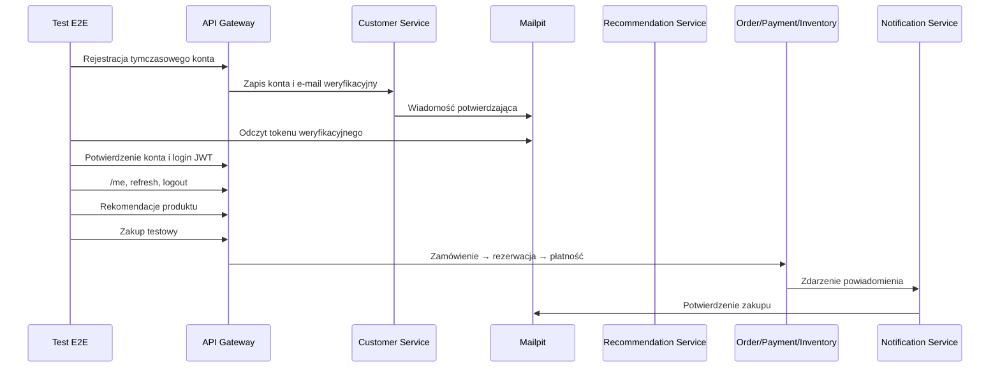
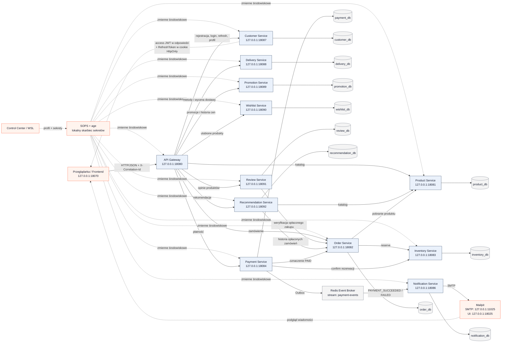
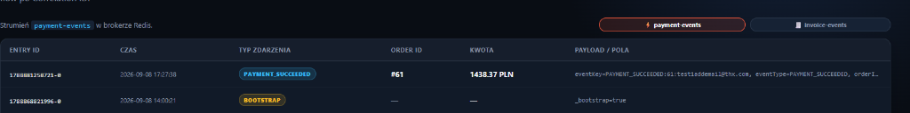
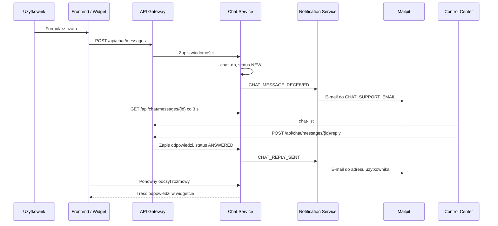

# Mini Order Platform — instrukcja ogólna

> English version: [General_Instruction_EN.md](General_Instruction_EN.md)

> **Status środowisk:** lokalnie dostępne są wyłącznie profile `dev` i `test`.
> Profil `prod` jest obecnie niedostępny do uruchamiania z Control Center.
> Pozostawiono jego szablony Kubernetes/OpenBao/TLS do późniejszego wdrożenia.

Lokalne pliki, sekrety, klucze, certyfikaty, kubeconfig, backupy i logi należy
umieszczać w katalogu `gitIgnoreOwn/`. Katalog jest ignorowany przez Git.

## Spis treści

- [Zacznij tutaj: Control Center](#zacznij-tutaj-control-center)
- [Wymagane serwisy i uruchamianie z Centrali](#wymagane-serwisy-i-uruchamianie-z-centrali)
- [Wymagania przed pierwszym startem](#wymagania-przed-pierwszym-startem)
  - [WSL, Linux i macOS — lista zależności](#wsl-linux-i-macos--lista-zależności)
    - [Minimalna lista wymagana w WSL/Linux](#minimalna-lista-wymagana-w-wsllinux)
    - [Minimalna lista wymagana na macOS](#minimalna-lista-wymagana-na-macos)
- [Z czego składa się aplikacja](#z-czego-składa-się-aplikacja)
- [Przygotowanie repozytorium do GitHub](#przygotowanie-repozytorium-do-github)
- [Kolejność uruchomienia dev/test](#kolejność-uruchomienia-devtest)
- [Testowanie aplikacji: poziomy, przygotowanie i uruchamianie](#testowanie-aplikacji-poziomy-przygotowanie-i-uruchamianie)
- [Przepływ aplikacji](#przepływ-aplikacji)
  - [Jak czytać przepływ](#jak-czytać-przepływ)
- [Założenia](#założenia)
- [API Gateway](#api-gateway)
  - [Routing](#routing)
  - [OpenAPI i Swagger UI](#openapi-i-swagger-ui)
  - [Wersjonowanie API i testy QA](#wersjonowanie-api-i-testy-qa)
- [Etap 6: obrazy Docker i Kubernetes](#etap-6-obrazy-docker-i-kubernetes)
  - [Kubernetes i deployment bez przestoju](#kubernetes-i-deployment-bez-przestoju)
- [Redis Event Broker](#redis-event-broker)
  - [Rola w przepływie zamówienia](#rola-w-przepływie-zamówienia)
  - [Konfiguracja i trwałość](#konfiguracja-i-trwałość)
  - [Obsługa z Control Center](#obsługa-z-control-center)
- [Szczegóły obsługi Control Center](#szczegóły-obsługi-control-center)
- [Profile Spring](#profile-spring)
- [Sekrety](#sekrety)
- [Bezpieczne logowanie](#bezpieczne-logowanie)
  - [Gdzie przechowywane są JWT i RefreshToken](#gdzie-przechowywane-sa-jwt-i-refreshtoken)
  - [Etap 2 — wdrożone punkty bezpieczeństwa 1–5](#etap-2--wdrożone-punkty-bezpieczeństwa-1–5)
  - [MFA TOTP i WebAuthn](#mfa-totp-i-webauthn)
  - [TLS i OpenBao dla prod](#tls-i-openbao-dla-prod)
- [Korelacja logów](#korelacja-logów)
- [Odporność usług: timeouty, Retry, Circuit Breaker i Bulkhead](#odporność-usług-timeouty-retry-circuit-breaker-i-bulkhead)
- [Mailpit](#mailpit)
- [Czat kontaktowy](#czat-kontaktowy)
  - [Co może zrobić użytkownik](#co-może-zrobić-użytkownik)
  - [Przepływ wiadomości i e-maili](#przepływ-wiadomości-i-e-maili)
  - [Obsługa z Control Center](#obsługa-z-control-center-1)
  - [Obsługa skryptowa bez menu Centrali](#obsługa-skryptowa-bez-menu-centrali)
  - [Awaryjny kontakt e-mail](#awaryjny-kontakt-e-mail)
  - [API i diagnostyka](#api-i-diagnostyka)
- [Frontend sklepu](#frontend-sklepu)
- [Porty infrastruktury](#porty-infrastruktury)
- [Backupy PostgreSQL i ciągłość działania](#backupy-postgresql-i-ciągłość-działania)
- [Codzienny workflow](#codzienny-workflow)
- [Monitoring i Dead Letter Queue](#monitoring-i-dead-letter-queue)
- [Materiały scalone z dokumentacji projektu](#materiały-scalone-z-dokumentacji-projektu)
  - [IntelliJ IDEA](#intellij-idea)
    - [Zielona strzałka `MiniTechStore`](#zielona-strzałka-minitechstore)
    - [Uruchomienie wrappera w WSL](#uruchomienie-wrappera-w-wsl)
    - [IntelliJ uruchomiony w Windows](#intellij-uruchomiony-w-windows)
  - [Sekrety i profile — szczegóły](#sekrety-i-profile--szczegóły)
    - [Platformowy katalog SOPS + age](#platformowy-katalog-sops--age)
    - [Przygotowanie sekretów](#przygotowanie-sekretów)
    - [Profil prod: OpenBao i TLS](#profil-prod-openbao-i-tls)
  - [Dokumentacja usług i elementów projektu](#dokumentacja-usług-i-elementów-projektu)
    - [API Gateway](#api-gateway-1)
    - [Product Service](#product-service)
    - [Inventory Service](#inventory-service)
    - [Order Service](#order-service)
    - [Payment Service](#payment-service)
    - [Notification Service](#notification-service)
    - [Customer Service](#customer-service)
    - [Delivery Service](#delivery-service)
    - [Promotion Service](#promotion-service)
    - [Wishlist Service](#wishlist-service)
    - [Review Service](#review-service)
    - [Porównywarka produktów](#porównywarka-produktów)
    - [Recommendation Service](#recommendation-service)
    - [Chat Service](#chat-service-1)
    - [Returns Service](#returns-service)
    - [Billing Service](#billing-service)
    - [Frontend sklepu](#frontend-sklepu-1)
    - [Katalog `gitIgnoreOwn`](#katalog-gitignoreown)
  - [Produkcyjny skarbiec i polityki](#produkcyjny-skarbiec-i-polityki)
    - [OpenBao i TLS dla profilu prod — szczegóły infrastruktury](#openbao-i-tls-dla-profilu-prod--szczegóły-infrastruktury)
    - [Historyczne notatki HashiCorp Vault](#historyczne-notatki-hashicorp-vault)
    - [Polityki Vault](#polityki-vault)

## Zacznij tutaj: Control Center

Control Center jest głównym panelem projektu i powinien być pierwszym miejscem
uruchamiania środowiska. Wykrywa WSL, Linux albo macOS, wybiera profil `dev` albo `test`,
waliduje wymagania, ładuje sekrety z SOPS + age, uruchamia infrastrukturę,
mikroserwisy i frontend oraz udostępnia diagnostykę, testy, logi, backupy,
Mailpit, monitoring, JWT, DLQ i testy bezpieczeństwa. Profil `prod` ma osobny
panel przygotowania, ale lokalnie pozostaje zablokowany.

Uruchom panel z katalogu głównego:

```bash 
bash ./scripts/start.sh
```

Polecenie uruchamia w WSL lokalny, ciemny panel operatora pod adresem
`http://127.0.0.1:18100` i otwiera go w przeglądarce. Panel obejmuje status
usług, operacje infrastrukturalne i biznesowe, testy, logi oraz wygodną obsługę
czatu klientów. Klasyczne menu terminalowe pozostaje dostępne jako
`bash ./scripts/start.sh --cli`; można je też otworzyć wewnątrz panelu w widoku
`Terminal WSL`.

Pierwszą konfigurację sekretów można również wykonać w przeglądarce: wybierz
`Operacje → Profile i sekrety → Utwórz sekrety DEV` albo `Utwórz sekrety TEST`,
wpisz wymagane wartości i zatwierdź utworzenie pliku. Formularz tworzy
brakujące klucze age, szyfruje profil SOPS-em i nie uruchamia usług
automatycznie. Po utworzeniu wykonaj osobno walidację oraz `infra-up`.

W PowerShell można otworzyć osobne okno WSL:

```powershell
.\scripts\start.ps1
```

Najważniejsze komendy centrali:

```bash
bash scripts/control-center/control-center.sh --list
bash scripts/control-center/control-center.sh environment-check
bash scripts/control-center/control-center.sh github-check
bash scripts/control-center/control-center.sh doctor
```

`environment-check` sprawdza narzędzia, JDK 25, Docker daemon, Compose,
konfigurację plików i sekrety aktywnego profilu. `doctor` sprawdza dodatkowo
uruchomione kontenery, aplikacje, Mailpit i opcjonalny monitoring. `github-check`
kontroluje reguły prywatności repozytorium przed pierwszym `git add`.

### Punkty wejścia projektu

Wszystkie punkty wejścia prowadzą do tego samego Control Center. W WSL/Linux/macOS
preferowany jest `bash ./scripts/start.sh`, który uruchamia panel webowy i używa
`scripts/control-center/control-center.sh` jako stabilnego silnika operacji.
Na Windows `./scripts/start.ps1` otwiera osobne okno WSL, a
`scripts/control-center/start.ps1` jest wrapperem pomocniczym dla IntelliJ IDEA.
Nie uruchamiaj kilku paneli jednocześnie — wybierz jeden punkt wejścia, aby uniknąć
równoległego przełączania profilu i konfliktu procesów.

Katalog `gitIgnoreOwn/` przechowuje wyłącznie lokalne dane runtime: logi, cache,
stan języka, pliki robocze i raporty. Prawdziwe sekrety SOPS + age znajdują się
poza repozytorium, w `~/.config/mini-order-platform`; nie należy ich kopiować do
projektu ani dołączać do commitów.

Opcjonalny `environment-install` proponuje instalację wykrytych braków przez
systemowy menedżer pakietów. Instalacja jest wykonywana dopiero po wpisaniu
`ACCEPT`; Enter lub inna wartość anuluje operację. PowerShell nie ma osobnego
instalatora — na Windows należy wejść do WSL, ponieważ instalator działa tylko
w Bashu właściwego środowiska uruchomieniowego projektu.

Język panelu zmienisz przez `8. Ustawienia` → `1. Język`. Opcja `1` ustawia
polski (domyślnie), a opcja `2` angielski. Ustawienie jest lokalne i trafia do
`gitIgnoreOwn/runtime/language`. Można użyć także:

```bash
bash scripts/control-center/control-center.sh language-show
bash scripts/control-center/control-center.sh language-set pl
bash scripts/control-center/control-center.sh language-set en
```

## Wymagane serwisy i uruchamianie z Centrali

Do pełnego działania sklepu w profilu `dev` albo `test` powinny działać trzy
warstwy: infrastruktura, mikroserwisy oraz frontend. Samo uruchomienie API
Gateway nie wystarczy, ponieważ Gateway przekazuje żądania do pozostałych usług.

### Mikroserwisy aplikacyjne

| Serwis | Port lokalny | Rola |
|---|---:|---|
| API Gateway | `18080` | wspólny punkt wejścia dla frontendu |
| Product Service | `18081` | katalog, ceny i parametry produktów |
| Order Service | `18082` | koszyk i zamówienia |
| Inventory Service | `18083` | stany magazynowe i rezerwacje |
| Payment Service | `18084` | płatność, w `dev/test` symulowana |
| Notification Service | `18086` | powiadomienia e-mail i DLQ |
| Customer Service | `18087` | konto klienta, JWT, MFA i profil |
| Delivery Service | `18088` | metody i wycena dostawy |
| Promotion Service | `18089` | promocje i kody rabatowe |
| Wishlist Service | `18090` | lista życzeń |
| Review Service | `18091` | opinie i moderacja |
| Recommendation Service | `18092` | rekomendacje produktów |
| Chat Service | `18093` | formularz kontaktowy i odpowiedzi firmy |
| Returns Service | `18094` | zwroty i reklamacje; osobna `returns_db` |
| Billing Service | `18095` | faktury i dane fakturowe; osobna `billing_db` |

Wszystkie powyższe procesy uruchamia opcja:

`Menu główne → 2. Projekty i aplikacje → 1. Uruchamianie i status → 2. Uruchom wszystkie projekty w tle`.

Ta opcja uruchamia aplikacje przez Maven w tle i zapisuje ich logi w katalogu
runtime. Jeżeli potrzebujesz logów jednego serwisu w konsoli, wybierz:

`Menu główne → 2. Projekty i aplikacje → 1. Uruchamianie i status → 1. Uruchom jeden projekt`.

Następnie wybierz usługę z listy. Status procesów sprawdzisz przez:

`Menu główne → 2. Projekty i aplikacje → 1. Uruchamianie i status → 4. Status procesów projektów`.

### Infrastruktura wymagana przez aplikacje

Przed uruchomieniem mikroserwisów włącz:

1. **Bazy PostgreSQL** — czternaście baz: `product-db`, `order-db`,
   `inventory-db`, `payment-db`, `notification-db`, `customer-db`,
   `delivery-db`, `promotion-db`, `wishlist-db`, `review-db` i
   `recommendation-db`, `chat-db`, `returns-db`, `billing-db`.
2. **Redis Event Broker** — stream zdarzeń płatności, limity i wyzwania MFA.
3. **Mailpit** — lokalny SMTP dla potwierdzeń zamówień, rejestracji i resetu
   hasła.

Włącz je z menu głównego:

- `1. Bazy danych PostgreSQL → 2. Uruchom wszystkie bazy`,
- `3. Redis Event Broker i streamy → 1. Uruchom broker`,
- `4. Profile i Mailpit → 4. Uruchom Mailpit`.

Profil ustaw przed startem przez:

`Menu główne → 4. Profile i Mailpit → 2. Ustaw profil dev` albo
`3. Ustaw profil test`.

### Frontend i monitoring

Frontend uruchom przez:

`Menu główne → 6. Frontend sklepu → 1. Uruchom frontend`.

Sklep będzie dostępny pod `http://127.0.0.1:18070`, a API Gateway pod
`http://127.0.0.1:18080`. Monitoring nie jest wymagany do obsługi sklepu, ale
można go włączyć przez `Menu główne → 5. Monitoring i Dead Letter Queue →
1. Uruchom Prometheus i Grafanę`.

### Zalecana kolejność w panelu

1. `Menu główne → 4` — ustaw `dev` albo `test` i sprawdź sekrety.
2. `Menu główne → 9` — wykonaj kontrolę wymagań przed startem.
3. `Menu główne → 1 → 2` — uruchom wszystkie bazy.
4. `Menu główne → 3 → 1` — uruchom Redis Event Broker.
5. `Menu główne → 4 → 4` — uruchom Mailpit.
6. `Menu główne → 2 → 1 → 2` — uruchom wszystkie mikroserwisy.
7. `Menu główne → 6 → 1` — uruchom frontend.
8. `Menu główne → 2 → 1 → 6` — sprawdź dostępność wszystkich aplikacji.

Zatrzymywanie wykonuj w odwrotnej kolejności: frontend w `Menu 6 → 2`,
mikroserwisy w `Menu 2 → 1 → 3`, a infrastrukturę przez odpowiednie pozycje
menu `1`, `3` i `4`. Do diagnostyki całego środowiska użyj `Menu główne →
12. Doctor środowiska`.

## Wymagania przed pierwszym startem

Przygotuj na Linuxie, w WSL albo na macOS:

- na Windows: WSL2 z dystrybucją Linux oraz runtime Docker udostępniający daemon
  do WSL; Docker Desktop może być takim runtime’em, ale nie jest wymagany,
- na macOS/Linux: kompatybilny runtime Docker z działającym daemonem i obsługą
  linuksowych kontenerów; Docker Desktop nie jest wymagany,
- JDK 25, w tym `java` i `javac`,
- `bash`, `curl`, `python3` oraz `git`,
- `docker` z działającym daemonem i `docker compose`,
- `sops`, `age` i `age-keygen` do lokalnego skarbca sekretów,
- wolne porty aplikacji i infrastruktury opisane w sekcji „Porty”.

Do zwykłego uruchomienia sklepu nie jest wymagany Node.js ani osobny serwer dla
frontendu — frontend jest serwowany przez `scripts/frontend-server.py`.
Testy przeglądarkowe Playwright wymagają natomiast Node.js **20 lub nowszego**
(zalecany Node.js 22 LTS) oraz `pnpm` albo `npm`. Zależności Java pobiera Maven
Wrapper przy pierwszym budowaniu. Brakujące elementy są wskazywane przez
`environment-check`, a opcjonalny instalator może pobrać pakiety obsługiwane
przez wykryty menedżer systemowy.

Detekcję i wybrany adapter można sprawdzić bez uruchamiania usług:

```bash
bash scripts/control-center/control-center.sh platform-info
```

Adapter można wymusić diagnostycznie przez `MINI_ORDER_PLATFORM=macos`,
`MINI_ORDER_PLATFORM=linux` albo `MINI_ORDER_PLATFORM=wsl`.

## WSL, Linux i macOS — lista zależności

WSL (Windows Subsystem for Linux) jest technologią dostępną dla Windows. macOS
nie pobiera ani nie uruchamia WSL. Na macOS skrypty działają z natywnego
Terminala przez Bash; Homebrew lub MacPorts mogą pełnić rolę menedżera pakietów,
ale nie są frameworkiem wymaganym przez aplikację.

| Element | Windows + WSL | Linux | macOS |
|---|---|---|---|
| Powłoka | Bash w dystrybucji WSL2 | Bash | Bash uruchamiany z Terminala; zsh może służyć tylko do wywołania skryptu |
| Instalacja narzędzi | Menedżer pakietów dystrybucji, zwykle `apt` | `apt`, `dnf`, `pacman` lub odpowiednik | Homebrew, MacPorts albo instalacja ręczna |
| Java | JDK 25: `java`, `javac` | JDK 25: `java`, `javac` | JDK 25: `java`, `javac` |
| Python | `python3` | `python3` | `python3` |
| HTTP i repozytorium | `curl`, `git` | `curl`, `git` | `curl`, `git` lub Git przez Xcode Command Line Tools |
| Sekrety | `sops`, `age`, `age-keygen` | `sops`, `age`, `age-keygen` | `sops`, `age`, `age-keygen` |
| Kontenery | `docker`, `docker compose` i dostępny daemon z WSL | `docker`, `docker compose` i działający daemon | `docker`, `docker compose` i runtime dla linuksowych kontenerów; Docker Desktop nie jest wymagany |
| Maven | Maven Wrapper pobiera Maven automatycznie | Maven Wrapper pobiera Maven automatycznie | Maven Wrapper pobiera Maven automatycznie |
| Harmonogram backupów | `cron/crontab` w WSL | `cron/crontab` | `launchd` |

### Minimalna lista wymagana w WSL/Linux

W dystrybucji Linux używanej przez Control Center muszą być dostępne:

- WSL2 z dystrybucją Linux — tylko na Windows; na natywnym Linuxie ten punkt
  nie występuje,
- Bash,
- JDK 25 (`java` i `javac`),
- Python 3 (`python3`),
- `curl`,
- `git`,
- `docker` oraz `docker compose` z działającym daemonem,
- `sops`, `age` i `age-keygen`.

Maven nie wymaga osobnej instalacji, ponieważ używany jest Maven Wrapper. `openssl`
jest potrzebny dodatkowo do operacji związanych z rotacją kluczy JWT i kontrolą TLS.
`cron` jest potrzebny tylko wtedy, gdy użytkownik chce ustawić automatyczne backupy
na Linuxie lub w WSL.

### Minimalna lista wymagana na macOS

Na macOS należy przygotować natywny Terminal oraz:

- Bash — skrypty uruchamiają Bash niezależnie od tego, czy domyślną powłoką
  użytkownika jest zsh,
- JDK 25 (`java` i `javac`),
- Python 3 (`python3`),
- `curl` i `git`,
- `sops`, `age` i `age-keygen`,
- `docker` oraz `docker compose`,
- działający runtime dla linuksowych kontenerów. Może to być Docker Engine
  uruchomiony w maszynie wirtualnej albo inne rozwiązanie zgodne z Docker CLI;
  Docker Desktop jest tylko jedną z możliwości,
- `launchd` jest dostarczany przez macOS i obsługuje harmonogram backupów.

Po przygotowaniu narzędzi uruchom kontrolę:

```bash
bash scripts/control-center/control-center.sh platform-info
bash scripts/control-center/control-center.sh environment-check
# opcjonalnie: pokaz plan i po wpisaniu ACCEPT zainstaluj pakiety systemowe
bash scripts/control-center/control-center.sh environment-install
```

Instalator pokazuje dla każdego braku system, menedżer pakietów, nazwę pakietu
i docelową lokalizację poza repozytorium. Nie instaluje ani nie wybiera za
użytkownika runtime’u linuksowych kontenerów, integracji Docker–WSL ani
konfiguracji uprawnień systemowych. Te elementy trzeba uruchomić lub ustawić
świadomie, a następnie ponowić `environment-check`.

## Z czego składa się aplikacja

| Element | Rola |
|---|---|
| WSL/Linux/macOS | środowisko uruchamiania centrali, Maven i skarbca sekretów |
| Control Center | profile, sekrety, Docker Compose, aplikacje, frontend, testy i diagnostyka |
| Java/JDK 25 + Maven Wrapper | budowanie i uruchamianie serwisów Spring Boot |
| Docker Compose | czternaście baz PostgreSQL, Redis Event Broker i Mailpit |
| API Gateway | jeden punkt wejścia dla frontendu pod portem `18080` |
| Product Service | katalog produktów i ceny; osobna `product_db` |
| Inventory Service | stan magazynowy i rezerwacje; osobna `inventory_db` |
| Order Service | zamówienia, trwała saga i kompensacje; osobna `order_db` |
| Payment Service | symulacja płatności i Outbox; osobna `payment_db` |
| Notification Service | e-maile, retry i DLQ; osobna `notification_db` |
| Customer Service | konta, JWT, RefreshToken, MFA i audyt; osobna `customer_db` |
| Delivery Service | metody dostawy i wycena kosztu; osobna `delivery_db` |
| Promotion Service | dobowa rotacja promocji, rabaty i historia cen; osobna `promotion_db` |
| Wishlist Service | zapisane produkty klienta; osobna `wishlist_db` |
| Review Service | opinie po opłaconym zakupie i moderacja; osobna `review_db` |
| Recommendation Service | rekomendacje katalogu i historii zakupów; osobna `recommendation_db` |
| Chat Service | formularz kontaktowy i odpowiedzi firmy; osobna `chat_db` |
| Returns Service | wnioski o zwrot i reklamacje oraz ich moderacja; osobna `returns_db` |
| Billing Service | faktury VAT i dane nabywcy; osobna `billing_db` |
| Redis | stream `payment-events`, grupy konsumentów, limity i wyzwania MFA |
| Mailpit | lokalny SMTP i panel wiadomości dla `dev`/`test` |
| Frontend | demonstracyjny sklep serwowany z `frontend` pod `18070` |
| Prometheus + Grafana | metryki Micrometer i dashboard lokalny |
| SOPS + age | lokalne szyfrowanie sekretów poza repozytorium |
| Maven/Testcontainers/CI | testy jednostkowe, integracyjne, kontraktowe, E2E i DAST |

## Przygotowanie repozytorium do GitHub

Przed publikacją kodu na GitHubie należy upewnić się, że repozytorium jest czyste i pozbawione prywatnych danych.

Do GitHub mogą trafić kod źródłowy, konfiguracje przykładowe, migracje,
manifesty, testy, dokumentacja i skrypty. Nie mogą trafić:

- `.env.dev`, `.env.test`, `.env.prod` ani rzeczywiste `*.env.sops`,
- klucze age, klucze JWT, certyfikaty prywatne, kubeconfig i hasła,
- backupy baz, logi, raporty runtime, dane Mailpit i lokalne tokeny,
- katalogi `target/`, `.m2/`, `.idea/` oraz zawartość `gitIgnoreOwn/` poza
  opisem i pustymi `.gitkeep`.

Reguły są w [`.gitignore`](../.gitignore), a przeznaczenie katalogu opisano w
sekcji [Katalog `gitIgnoreOwn/`](#katalog-gitignoreown). Przed utworzeniem
commita uruchom:

```bash
bash scripts/control-center/control-center.sh github-check
git status --short --ignored
```

Jeżeli repozytorium Git nie istnieje jeszcze lokalnie, utwórz je dopiero po
przejściu kontroli:

```bash
git init
bash scripts/control-center/control-center.sh github-check
git add .
git status --short
git diff --cached --name-only
git commit -m "Initial Mini Order Platform"
git branch -M main
git remote add origin <adres-repozytorium-GitHub>
git push -u origin main
```

Nie używaj `git add -f` dla plików prywatnych. Jeżeli `git status` pokaże
sekret, log, backup albo plik z `gitIgnoreOwn`, przerwij commit, usuń go z
indeksu i ponownie uruchom `github-check`.

Skarbiec SOPS + age profili `dev` i `test` pozostaje poza repozytorium. Domyślne
lokalizacje wybiera adapter platformy: `~/.config/mini-order-platform` na
Linux/WSL oraz `~/Library/Application Support/mini-order-platform` na macOS.
Pliki `*.example` zawierają wyłącznie wzory i nie są źródłem rzeczywistych haseł.

Kontrola wykonana `2026-08-19` potwierdziła, że `.gitignore` obejmuje katalogi
`target/`, `.m2/`, `.idea/`, `.mini-order-platform/` oraz prywatną zawartość
`gitIgnoreOwn/`. Wygenerowane `target/`, projektowy cache `.m2/` i starszy
katalog runtime `.mini-order-platform/` usunięto. `.idea/` może pozostać lokalnie
jako konfiguracja IntelliJ, ponieważ jest ignorowany. Projekt nie ma jeszcze
katalogu `.git`; inicjalizację wykonuje właściciel po `github-check`.

## Kolejność uruchomienia dev/test

Po sklonowaniu projektu wykonaj tę kolejność. Najpierw przejdź do katalogu repozytorium;
ścieżka zależy od systemu:

```bash
# WSL:
cd "/mnt/c/sciezka/do/Mini Order Platform"

# macOS/Linux:
cd "/sciezka/do/Mini Order Platform"
```

Następnie wykonaj:

```bash
bash scripts/control-center/control-center.sh github-check
bash scripts/control-center/control-center.sh secrets-init
bash scripts/control-center/control-center.sh secrets-setup dev
bash scripts/control-center/control-center.sh secrets-setup test
bash scripts/control-center/control-center.sh profile-set dev
bash scripts/control-center/control-center.sh environment-check
bash scripts/control-center/control-center.sh infra-up
bash scripts/control-center/control-center.sh broker-up
bash scripts/control-center/control-center.sh mailpit-up
bash scripts/control-center/control-center.sh app-run-all
bash scripts/control-center/control-center.sh frontend-up
bash scripts/control-center/control-center.sh doctor
```

Jeżeli sekrety zostały już przygotowane, pomiń `secrets-init` i kreatory. Dla
profilu `test` użyj `profile-set test`, a następnie ponownie wykonaj
`environment-check`. Po uruchomieniu aplikacji `health all` sprawdza endpointy,
a `app-status-all` pokazuje procesy uruchomione przez centralę. Zatrzymanie
wykonuje się przez `app-stop-all`, `frontend-down`, `monitoring-down` i odpowiednie
opcje infrastruktury.

## Testowanie aplikacji: poziomy, przygotowanie i uruchamianie

Projekt ma kilka poziomów testów. Testy można uruchamiać bezpośrednio z katalogu
repozytorium przez Maven i skrypty `scripts/qa`, a także z terminalowego
Control Center. Centrala nie zastępuje testów — jest bezpiecznym punktem ich
uruchamiania, sprawdza wymagania, dobiera profil i pokazuje wynik bez ujawniania
sekretów.

### Co należy przygotować

| Rodzaj testu | Co musi być gotowe | Czy test zmienia dane? |
| --- | --- | --- |
| Jednostkowy / Spring Boot | JDK 25 i Maven Wrapper | Nie; używa kontekstu testowego, zwykle H2/mocków |
| Integracyjny / Testcontainers | JDK 25, Maven Wrapper i działający Docker daemon | Nie w lokalnych bazach projektu; tworzy tymczasowe kontenery |
| Smoke, kontraktowy, bezpieczeństwa, obciążeniowy | API Gateway; zależnie od testu także Product/Customer Service | Zwykle nie |
| Delivery/Promotion/Mailpit smoke | Odpowiedni serwis, jego baza, Redis/Mailpit zgodnie z zakresem | Mailpit smoke wysyła testową wiadomość |
| App Verify | `infra-up`, `broker-up`, `mailpit-up` i wszystkie mikroserwisy, w tym Chat Service | Tak: tworzy zamówienie, zmniejsza magazyn i dodaje e-mail |
| Pełny E2E | Wszystkie mikroserwisy, wszystkie bazy, Redis, Mailpit i API Gateway | Tak: tworzy tymczasowe konto, zamówienie, rezerwację i e-mail |
| Playwright — regresja z mockami | Node.js ≥ 20, zależności z `package.json`, Chromium | Nie zmienia baz; API jest przechwytywane w przeglądarce |
| Playwright — pełny system | Node.js ≥ 20, Chromium, frontend, wszystkie mikroserwisy, Redis i Mailpit | Tak: tworzy prawdziwe zamówienie i e-mail w środowisku lokalnym |
| OWASP ZAP DAST | Docker daemon, działający API Gateway i dostępny obraz ZAP | Nie; zapisuje raport w `gitIgnoreOwn/runtime/zap` |

Przed testami systemowymi wykonaj:

```bash
bash scripts/control-center/control-center.sh environment-check
bash scripts/control-center/control-center.sh secrets-validate dev
bash scripts/control-center/control-center.sh profile-set dev
bash scripts/control-center/control-center.sh infra-up
bash scripts/control-center/control-center.sh broker-up
bash scripts/control-center/control-center.sh mailpit-up
bash scripts/control-center/control-center.sh app-run-all
bash scripts/control-center/control-center.sh health all
```

Jeżeli test ma działać na profilu `test`, ustaw `profile-set test` i ponownie
zweryfikuj sekrety. Standardowe `secrets-validate`, `infra-up` i `app-run-all`
wymagają kompletu haseł wszystkich 14 baz, w tym `CHAT_DB_PASSWORD`,
`RETURNS_DB_PASSWORD` i `BILLING_DB_PASSWORD`. Brak dowolnego wymaganego sekretu
zatrzymuje start celowo, zanim aplikacja połączy się z bazą. Pełna lista znajduje
się w sekcji [Wymagane sekrety dev/test](#wymagane-sekrety-devtest).

### Testy dostępne w aplikacji

#### 1. Testy jednostkowe i testy kontekstu Spring Boot

Obejmują logikę domenową, m.in. JWT i rotację kluczy, TOTP, ponowne wysyłanie
potwierdzeń, odporność HTTP, płatności, Outbox, Notification i moderację opinii.
Każdy serwis ma własne testy w `src/test/java`; testy aplikacyjne sprawdzają
również uruchomienie kontekstu Spring, repozytoriów i migracji testowych.

Uruchomienie z Maven:

```bash
# cały monorepo — profil testowy Maven
./mvnw test

# Windows PowerShell
.\mvnw.cmd test

# pojedynczy serwis wraz z jego zależnościami
./mvnw -pl customer-service -am test
```

Uruchomienie z Centrali:

```bash
bash scripts/control-center/control-center.sh app-test all
bash scripts/control-center/control-center.sh app-test customer
```

W menu: `Projekty i aplikacje → 2. Testy i jakość API → 1. Testy jednego projektu`
albo `2. Testy całego monorepo`. `app-test` wymusza profil `test` i nie wymaga działających
usług HTTP.

#### Uruchamianie testów z IntelliJ IDEA

Możesz uruchomić testy także z IDE:

1. Otwórz okno **Maven** i wybierz projekt główny `Mini Order Platform`.
2. Dla testów jednostkowych uruchom `Lifecycle → test` albo kliknij prawym
   przyciskiem klasę/test w `src/test/java` i wybierz **Run**.
3. Dla testów integracyjnych uruchom cel Maven `verify` z profilem
   `integration`, np. w terminalu IDE: `./mvnw -Pintegration verify`.
4. Przed testami `*IT` sprawdź, czy działa Docker daemon; Testcontainers
   uruchomi własne, tymczasowe kontenery.

Uruchamianie klasy `*IT` jako zwykłego testu JUnit może pominąć profil Maven
`integration`. Dla pełnego wyniku używaj celu `verify` z tym profilem.

#### 2. Testy integracyjne PostgreSQL, Redis i Mailpit

Profil Maven `integration` uruchamia testy `*IT` z Testcontainers:

- `CustomerRepositoryPostgresIT` sprawdza repozytorium Customer Service i
  migracje Flyway na PostgreSQL,
- `OrderSagaPostgresIT` sprawdza zapis oraz zmianę stanu sagi zamówienia,
- `InfrastructureContainersIT` sprawdza uruchomienie Redis i Mailpit.

Uruchomienie:

```bash
./mvnw -Pintegration verify
```

Zwykłe `./mvnw test` nie uruchamia testów `*IT`. Test integracyjny tworzy
tymczasowe kontenery, więc nie korzysta z haseł ani wolumenów lokalnych baz
projektu. Wymaga jednak działającego Dockera.

#### 3. Smoke test

Smoke jest szybkim testem „czy najważniejszy punkt wejścia działa”. Polecenie
`smoke` wykonuje żądanie katalogu przez API Gateway:

```text
Frontend/klient → API Gateway → Product Service → odpowiedź z katalogiem
```

Sprawdza routing Gateway, dostępność Product Service i odpowiedź katalogu. Nie
jest pełnym testem zakupu — nie sprawdza płatności, magazynu, powiadomień ani JWT.

```bash
bash scripts/control-center/control-center.sh smoke
```

W Centrali: `Projekty i aplikacje → 2. Testy i jakość API → 3. Smoke przez API Gateway`.

#### 4. App Verify — test scenariusza MVP

`app-verify` jest rozszerzonym smoke testem przepływu zamówienia. Sprawdza:

1. zdrowie wszystkich mikroserwisów,
2. metody i wycenę dostawy,
3. utworzenie zamówienia,
4. płatność w trybie `dev/test`,
5. potwierdzenie rezerwacji przez Inventory Service,
6. zmniejszenie dostępnej ilości,
7. zapis dostawy i ceny,
8. wysłanie powiadomienia przez Notification Service,
9. pojawienie się wiadomości w Mailpit.

```bash
bash scripts/control-center/control-center.sh app-verify
```

W Centrali: `Projekty i aplikacje → 2. Testy i jakość API → 4. App Verify`. Domyślnie test używa
produktu `4` w ilości `1`. Można podać inne wartości:

```bash
APP_VERIFY_PRODUCT_ID=4 APP_VERIFY_QUANTITY=1 \
  bash scripts/control-center/control-center.sh app-verify
```

Ten test zmienia stan lokalnego magazynu i tworzy zamówienie demonstracyjne.
Po testach można przywrócić dane domenowe poleceniem:

```bash
bash scripts/control-center/control-center.sh demo-reset
```

Operacja resetu wymaga wpisania `RESET`; nie usuwa produktów ani kont klientów.

#### 5. Pełny E2E

Pełny E2E sprawdza rzeczywisty przepływ użytkownika i przekracza granice
pojedynczego serwisu:



E2E weryfikuje rejestrację, potwierdzenie konta przez Mailpit, logowanie JWT,
`/customers/me`, RefreshToken, wylogowanie serwerowe, rekomendacje oraz pełny
zakup z płatnością, magazynem i e-mailem. Tokeny i hasła nie są wypisywane.

```bash
bash scripts/control-center/control-center.sh e2e
```

W Centrali: `Projekty i aplikacje → 2. Testy i jakość API → 8. Pełny E2E`. Skrypt generuje unikalne,
tymczasowe konto `e2e-...@minitech.local`, a po zakończeniu usuwa pliki
tymczasowe z dysku. Zamówienie i wiadomość pozostają w lokalnych bazach/Mailpit,
dlatego po serii testów można wykonać `demo-reset`.

#### 6. Testy interfejsu Playwright

Projekt używa **Playwright**, a nie Cypress. Jeden framework wystarcza do
testów Chromium, Firefox, WebKit, widoku mobilnego, nagrań, zrzutów, trace i
raportu HTML; równoległe utrzymywanie Cypress dublowałoby fixture’y i
scenariusze. Konfiguracja znajduje się w `playwright.config.ts`, testy w
`e2e/tests`, a wspólne mocki API w `e2e/fixtures/store.fixture.ts`.

Zestaw obejmuje 25 scenariuszy: 24 regresje z mockowanym API oraz jeden pełny
scenariusz systemowy:

| Grupa | Liczba | Co jest sprawdzane |
| --- | ---: | --- |
| Smoke | 3 | start strony bez błędów JS, katalog → szczegóły → koszyk, logo prowadzące do strony głównej |
| Katalog | 5 | wyszukiwanie po nazwie/producent/SKU, producenci i parametry zależne od kategorii, cena od–do, parametr techniczny, sortowanie i brak wyników |
| Logowanie i rejestracja | 3 | przyjazny komunikat 401, zgodność powtórzonego hasła, poprawne logowanie i menu konta |
| Koszyk i sesja | 5 | ilości i usuwanie, koszyk gościa po odświeżeniu, rozdzielenie koszyka gościa/konta, odtworzenie sesji i koszyka konta, automatyczne wylogowanie po 30 minutach bezczynności |
| Checkout | 4 | zakup gościa poniżej 1000 zł, wymagane konto powyżej 1000 zł, odbiór osobisty bez kosztu dostawy, faktura firmowa i walidacja NIP |
| Czat | 2 | wysłanie i odtworzenie rozmowy, odpowiedź Centrali, zamknięcie Escape i awaryjny e-mail |
| Dostępność/responsywność | 2 | reguły semantyczne Axe WCAG A/AA oraz brak poziomego przewijania przy 390 px; kontrast kolorów pozostaje osobnym audytem wizualnym |
| Pełny system | 1 | prawdziwy Gateway, Product, Inventory, Order, Payment, Notification i wiadomość w Mailpit |

Pierwsza instalacja w WSL:

```bash
# sprawdzenie wymagań
bash scripts/control-center/control-center.sh ui-test-status

# instalacja zależności i Chromium
bash scripts/control-center/control-center.sh ui-test-install
```

Jeśli WSL ma Node.js 18, Centrala zatrzyma instalację i poprosi o Node.js 22
LTS. Po aktualizacji Node polecenie `ui-test-install` można uruchomić ponownie.

Najczęściej używane warianty:

```bash
# trzy najszybsze scenariusze krytyczne, API mockowane
bash scripts/control-center/control-center.sh ui-test-smoke

# pełne 24 testy regresji w Chromium, bez uruchamiania backendu
bash scripts/control-center/control-center.sh ui-test

# jeden test przez rzeczywiste usługi i Mailpit
bash scripts/control-center/control-center.sh ui-test-system

# wszystkie 24 testy w Chromium, Firefox, WebKit i emulacji mobilnej
bash scripts/control-center/control-center.sh ui-test-browsers

# warianty interaktywne
bash scripts/control-center/control-center.sh ui-test-headed
bash scripts/control-center/control-center.sh ui-test-debug
bash scripts/control-center/control-center.sh ui-test-report
```

Regresja z mockami sama uruchamia statyczny frontend na `127.0.0.1:18070` i
nie wymaga baz ani sekretów. `ui-test-system` wymaga wcześniejszego
`infra-up`, `broker-up`, `mailpit-up`, `app-run-all`, `frontend-up` i
pozytywnego `health all`. Test tworzy zakup gościa o wartości poniżej 1000 zł i
sprawdza Mailpit, dlatego zmienia lokalne dane.

Te same operacje są w menu:
`Projekty i aplikacje → Testy i jakość API → pozycje 11–19`.
Raport HTML, zrzuty, nagrania i trace są zapisywane wyłącznie w
`gitIgnoreOwn/runtime/playwright/`, więc nie trafiają do GitHuba. Bez Centrali
można użyć `pnpm run test:ui:smoke`, `pnpm run test:ui` oraz
`pnpm run test:ui:browsers`.

#### 7. Contract, security, load i DAST

| Test | Co sprawdza | Uruchomienie z Centrali |
| --- | --- | --- |
| Contract | Zgodność OpenAPI Gateway z kontraktem publicznego API v1 | `contract-test` / menu `Testy i jakość API → 5` |
| Security | Ochronę JWT, błędny Bearer, ograniczenie Actuator i brak nazw sekretów w OpenAPI | `security-test` / menu `Testy i jakość API → 6` |
| Load | 100 żądań katalogu przy równoległości 10; parametry można zmienić | `load-test` / menu `Testy i jakość API → 7` |
| Resilience (Chaos) | Izolację awarii mikroserwisu (np. payment) oraz kontrolowaną degradację | `resilience-test` / w przeglądarce kafel `Chaos / Test odporności` |
| OWASP ZAP DAST | Aktywny skan API Gateway w kontenerze ZAP | `zap-dast` w menu `Profile i Mailpit` |

Bezpośrednio przez skrypty:

```bash
bash scripts/qa/contract-test.sh
bash scripts/qa/security-test.sh
LOAD_REQUESTS=100 LOAD_CONCURRENCY=10 bash scripts/qa/load-test.sh
bash scripts/qa/resilience-test.sh
bash scripts/qa/zap-dast.sh
```

`contract-test`, `security-test` i `load-test` zwykle nie zmieniają danych.
DAST zapisuje raporty HTML/JSON do `gitIgnoreOwn/runtime/zap`; wynik jest
niezaliczony, gdy znajdzie alert średni lub wysoki. Jedynym wyjątkiem
sygnaturowym jest dokładnie `/actuator/health`, gdy odpowiedź zawiera wyłącznie
`status` oraz opcjonalne `groups`. Parser raportu sam sprawdza JSON i odrzuca
wyjątek, jeśli pojawią się `components`, `details` albo inna ścieżka.

#### 8. Testy obszarów domenowych i pomocnicze

```bash
bash scripts/control-center/control-center.sh delivery-smoke
bash scripts/control-center/control-center.sh promotion-smoke
bash scripts/control-center/control-center.sh mailpit-smoke
bash scripts/control-center/control-center.sh jwt-smoke
bash scripts/control-center/control-center.sh health all
```

`delivery-smoke` sprawdza metody i wycenę dostawy, `promotion-smoke` aktywną
kampanię i cenę promocyjną, a `mailpit-smoke` wysyła kontrolną wiadomość przez
Notification Service. `jwt-smoke` wymaga istniejącego, aktywnego i
potwierdzonego konta oraz interaktywnie pobiera hasło; sprawdza login, `/me`,
refresh i logout. `health all` jest diagnostyką dostępności, a nie testem
biznesowym.

### Wynik ostatniego pełnego przebiegu lokalnego

W dniu `2026-08-19` wykonano:

- `./mvnw test`: **49 testów, 0 failures, 0 errors, 0 skipped**,
- `./mvnw -Pintegration verify`: **3 testy integracyjne, 0 failures/errors**,
- smoke, contract, security, load `100/100`, delivery, promotion, Mailpit:
  **zaliczone**,
- App Verify i pełny E2E: **zaliczone**,
- regresja bezpieczeństwa API Gateway: **6/6 testów zaliczonych**,
- OWASP ZAP: **zaliczony**; ZAP rozpoznał sygnaturę Actuator, a polityka
  potwierdziła minimalną odpowiedź status-only bez `components` i `details`.
  Raport znajduje się w `gitIgnoreOwn/runtime/zap/`.

Dodatkowo w dniu `2026-08-20` wykonano regresję Playwright w Chromium:
**24/24 scenariusze zaliczone**. Obejmuje ona również dobowe zasilanie banera
z rotacji produktów i automatyczne wylogowanie po 30 minutach bezczynności.
Osobny test `@full-system` jest uruchamiany
przez `ui-test-system`, ponieważ tworzy prawdziwe zamówienie i wiadomość w
Mailpit.

## Przepływ aplikacji



### Jak czytać przepływ

1. Control Center uruchamiany w WSL/Linux/macOS wybiera profil i ładuje sekrety z lokalnego
   skarbca SOPS + age. Wartości są przekazywane procesom, ale nie są zapisywane
   w repozytorium.
2. Frontend komunikuje się z mikroserwisami przez API Gateway. Do żądań jest
   dołączany `X-Correlation-Id`, dzięki czemu ta sama operacja może być
   odnaleziona w logach kolejnych usług.
3. Katalog jest pobierany z Product Service. Przy zakupie Order Service
   sprawdza produkt i rezerwuje jego ilość w Inventory Service. Delivery Service
   wycenia wybraną metodę dostawy na podstawie wartości koszyka i kodu pocztowego.
4. Płatność przechodzi przez Payment Service. Po udanej płatności usługa
   oznacza zamówienie jako opłacone i potwierdza rezerwację w Inventory Service.
   Order Service zapisuje w zamówieniu wybraną metodę dostawy oraz jej koszt,
   aby cena z chwili zakupu nie zmieniła się po późniejszej rotacji oferty.
5. Payment Service zapisuje zdarzenie w swojej bazie Outbox, a następnie
   publikuje je do Redis Stream. Notification Service odbiera zdarzenie,
   zapisuje powiadomienie i wysyła e-mail przez SMTP do Mailpit.
6. Przy logowaniu Customer Service zwraca access JWT, a RefreshToken umieszcza
   w ciasteczku `HttpOnly`. Access JWT pozostaje tylko w pamięci frontendu;
   szczegóły opisano w sekcji „Bezpieczne logowanie”.

## Założenia

Projekt jest monorepo mikroserwisów. Każdy serwis ma własny projekt Maven i własną bazę PostgreSQL:

- `api-gateway` — punkt wejścia, bez własnej bazy,
- `product-service` — katalog produktów,
- `inventory-service` — stany magazynowe i rezerwacje,
- `order-service` — koszyk i zamówienia,
- `payment-service` — płatności i outbox zdarzeń,
- `notification-service` — powiadomienia i wysyłka wiadomości.
- `customer-service` — konta klientów, logowanie, profile i adresy dostawy.
- `delivery-service` — metody dostawy, czas realizacji i wycena kosztu.
- `promotion-service` — dobowa rotacja promocji, rabaty i historia cen.
- `wishlist-service` — zapisane produkty klienta, bez kopiowania katalogu.
- `review-service` — opinie klientów, weryfikacja opłaconego zakupu i moderacja.
- `recommendation-service` — rekomendacje podobnych produktów i oferty na podstawie historii zakupów.
- `chat-service` — wiadomości kontaktowe klientów i odpowiedzi firmy przez e-mail.

Redis Event Broker obsługuje zdarzenia na streamie `payment-events`. Mailpit jest lokalnym serwerem SMTP przeznaczonym dla profili `dev` i `test`.

Wszystkie porty publikowane przez Docker Compose są przypięte do `127.0.0.1`. Nie są wystawione na zewnętrzne interfejsy sieciowe.

## API Gateway

API Gateway jest wspólnym punktem wejścia do backendu dla frontendu. Nie jest
serwerem, który wyświetla frontend — statyczny frontend działa osobno na
`http://127.0.0.1:18070`. Frontend wysyła żądania API do Gateway na porcie
`18080`, a Gateway przekazuje je do właściwego mikroserwisu.

Przepływ wygląda tak:

```text
Przeglądarka :18070
        |
        v
API Gateway :18080
        |
        +--> Product Service      :18081
        +--> Order Service        :18082
        +--> Inventory Service    :18083
        +--> Payment Service      :18084
        +--> Notification Service :18086
        +--> Customer Service     :18087
        +--> Delivery Service     :18088
        +--> Promotion Service    :18089
        +--> Wishlist Service     :18090
        +--> Review Service       :18091
        +--> Recommendation Service :18092
        +--> Chat Service           :18093
```

### Routing

| Żądanie frontendu | Usługa docelowa |
|---|---|
| `/api/products/**` | Product Service |
| `/api/orders/**` | Order Service |
| `/api/inventory/**` | Inventory Service |
| `/api/payments/**` | Payment Service |
| `/api/notifications/**` | Notification Service |
| `/api/customers/**` | Customer Service |
| `/api/deliveries/**` | Delivery Service |
| `/api/promotions/**` | Promotion Service |
| `/api/wishlists/**` | Wishlist Service |
| `/api/reviews/**` | Review Service |
| `/api/recommendations/**` | Recommendation Service |
| `/api/chat/**` | Chat Service |
| `/api/returns/**` | Returns Service |
| `/api/invoices/**` | Billing Service |

Gateway działa jako proxy HTTP: przekazuje metodę, ścieżkę po usunięciu
prefiksu `/api`, parametry zapytania, body oraz nagłówki żądania. Przekazuje
również `Authorization` i ciasteczko `HttpOnly`, dlatego logowanie i sesja
klienta mogą działać przez jeden adres API. Gateway nie przechowuje danych i
nie posiada własnej bazy PostgreSQL.

Gateway nie zastępuje logiki mikroserwisów. Nie zapisuje produktów ani zamówień,
nie wykonuje płatności i nie przechowuje JWT. Walidację JWT oraz obsługę
RefreshToken wykonuje Customer Service, a reguły zamówień, magazynu i płatności
pozostają w odpowiednich usługach.

Dodatkowo Gateway obsługuje CORS dla frontendu oraz nadaje żądaniom nagłówek
`X-Correlation-Id`. Poprawny identyfikator podany przez klienta jest zachowany;
jeśli go nie ma, Gateway generuje nowy i przekazuje go dalej. Dzięki temu jedna
operacja może być śledzona w logach wszystkich usług.

### OpenAPI i Swagger UI

Każdy mikroserwis posiada automatycznie generowaną dokumentację OpenAPI oraz interfejs Swagger UI. Wszystkie 15 mikroserwisów zostało zintegrowanych w **jednym zagregowanym Swagger UI** na porcie API Gateway:

```text
Główny zagregowany Swagger UI: http://127.0.0.1:18080/swagger-ui.html
```

W prawym górnym rogu okna Swagger UI znajduje się rozwijane menu (*Select a definition*), które pozwala przełączać specyfikację na dowolny serwis platformy (`Product Service`, `Order Service`, `Payment Service`, `Customer Service`, `Billing Service`, `Delivery Service`, `Review Service` itd.) oraz testować endpointy bez błędów CORS bezpośrednio przez bramę.

Indywidualne bezpośrednie adresy Swagger UI mikroserwisów:

```text
Gateway      http://127.0.0.1:18080/swagger-ui.html (Zagregowany dla 15 usług)
Product      http://127.0.0.1:18081/swagger-ui.html
Order        http://127.0.0.1:18082/swagger-ui.html
Inventory    http://127.0.0.1:18083/swagger-ui.html
Payment      http://127.0.0.1:18084/swagger-ui.html
Notification http://127.0.0.1:18086/swagger-ui.html
Customer     http://127.0.0.1:18087/swagger-ui.html
Delivery     http://127.0.0.1:18088/swagger-ui.html
Promotion    http://127.0.0.1:18089/swagger-ui.html
Wishlist     http://127.0.0.1:18090/swagger-ui.html
Review       http://127.0.0.1:18091/swagger-ui.html
Recommend    http://127.0.0.1:18092/swagger-ui.html
Chat         http://127.0.0.1:18093/swagger-ui.html
Returns      http://127.0.0.1:18094/swagger-ui.html
Billing      http://127.0.0.1:18095/swagger-ui.html
```

Surowy dokument JSON znajduje się pod `/v3/api-docs`. Dokument Gateway opisuje
publiczny punkt wejścia, a dokumenty pozostałych usług opisują ich wewnętrzne
kontrakty. Gateway zachowuje dotychczasowe `/api/**` i udostępnia równoległą,
wersjonowaną ścieżkę `/api/v1/**`, dzięki czemu frontend nie wymaga natychmiastowej
zmiany.

Schemat `bearerAuth` opisuje nagłówek `Authorization: Bearer <access-token>`.
Chronione endpointy Customer Service są oznaczone wymaganiem JWT w dokumentacji.
W profilu `prod` OpenAPI i Swagger UI są wyłączone przez `application-prod.yaml`.
Można nimi zarządzać przez `SPRINGDOC_API_DOCS_ENABLED` i
`SPRINGDOC_SWAGGER_UI_ENABLED` w profilach lokalnych.

Adresy wszystkich dokumentacji można wyświetlić z centrali:

```bash
bash scripts/control-center/control-center.sh api-docs-urls
```

### Wersjonowanie API i testy QA

Nowe integracje powinny korzystać z `http://127.0.0.1:18080/api/v1`. Stare
`/api/**` pozostaje chwilowo dla zgodności z obecnym frontendem. Gateway zwraca
dla tej ścieżki nagłówki `Deprecation: true` oraz `Link` do `/api/v1`; dla nowej
ścieżki zwraca `API-Version: v1`. Dzięki temu migracja klienta nie wymaga
jednoczesnej zmiany wszystkich usług.

Testy można uruchamiać z Control Center:

```bash
bash scripts/control-center/control-center.sh contract-test
bash scripts/control-center/control-center.sh security-test
bash scripts/control-center/control-center.sh zap-dast
LOAD_REQUESTS=100 LOAD_CONCURRENCY=10 bash scripts/control-center/control-center.sh load-test
bash scripts/control-center/control-center.sh e2e
```

`contract-test` porównuje uruchomiony dokument OpenAPI Gateway z kontraktem
`scripts/qa/contracts/api-gateway-v1.json`. `security-test` sprawdza ochronę
profilu klienta JWT, odrzucenie niepoprawnego tokenu, ograniczenie Actuator oraz
brak nazw sekretów w OpenAPI. `e2e` wykonuje pełny przepływ rejestracji,
potwierdzenia konta z Mailpit, logowania, refresh/logout oraz scenariusz zakupu.
`zap-dast` uruchamia pełny aktywny skan OWASP ZAP API Gateway w kontenerze
Docker. Raport HTML i JSON trafia do `gitIgnoreOwn/runtime/zap`; skan kończy się
błędem przy alertach średniego lub wysokiego ryzyka. Dopuszczenie sygnatury
Actuator wymaga minimalnej odpowiedzi `/actuator/health` bez danych komponentów;
jest to sprawdzane automatycznie, a nie wyciszane bezwarunkowo.

Test integracyjny PostgreSQL korzysta z Testcontainers i jest uruchamiany przez:

```bash
./mvnw -Pintegration verify
```

Wymaga działającego Dockera. Zwykłe `./mvnw test` nie uruchamia testów `*IT`.

## Etap 6: obrazy Docker i Kubernetes

Architektura kontenerowa platformy opiera się na ściśle wyizolowanych obrazach Docker, zaprojektowanych zgodnie z dobrymi praktykami bezpieczeństwa (kontenery bez uprawnień roota, minimalna waga, brak zbędnych narzędzi deweloperskich w obrazach produkcyjnych).

### 1. Mikroserwisy backendowe (`deploy/docker/service.Dockerfile`)

Wszystkie 15 mikroserwisów Spring Boot (API Gateway oraz 14 mikroserwisów domenowych) korzysta z **jednego, uniwersalnego szablonu Dockerfile** opartego na zaawansowanym wzorcu **Multi-Stage Build** (budowanie wieloetapowe):

* **Etap 1 — Builder (`maven:3.9-eclipse-temurin-25 AS build`):**
  * Korzysta z argumentu `--build-arg SERVICE_MODULE=<nazwa>` (np. `product-service`, `order-service`), co pozwala jednym plikiem budować dowolną usługę z monorepo.
  * Kopiuje nadrzędny plik `pom.xml`, wrapper `./mvnw` oraz pliki `pom.xml` wszystkich podmodułów, dzięki czemu Maven prawidłowo buduje drzewo zależności reaktora (Maven Reactor).
  * Kopiuje kod źródłowy wyłącznie wskazanego mikroserwisu (`${SERVICE_MODULE}/src`).
  * Wykorzystuje pamięć podręczną kompilatora Docker BuildKit (`--mount=type=cache,target=/root/.m2/repository`), zapobiegając ponownemu pobieraniu bibliotek przy kolejnych budowaniach.
  * Kompiluje produkcyjny plik JAR (`./mvnw package -DskipTests`) i umieszcza go w `/tmp/app.jar`.
* **Etap 2 — Runtime (`eclipse-temurin:25-jre`):**
  * Zaczyna się od czystego, odchudzonego środowiska uruchomieniowego Java 25 JRE — **bez kompilatora `javac`, bez kodu źródłowego i bez Mavena**. Zmniejsza to rozmiar obrazu z ~900 MB do poniżej 200 MB oraz drastycznie ogranicza potencjalne podatności CVE.
  * Instaluje pakiet fontów `fonts-dejavu-core`, niezbędny m.in. dla Billing Service do generowania dokumentów PDF (faktur).
  * Kopiuje z etapu budowania wyłącznie wynikowy plik `app.jar`.
  * **Zasada najniższych uprawnień (Non-Root):** proces aplikacji uruchamiany jest na dedykowanym użytkowniku bez uprawnień roota (`USER 10001:10001`).
  * **Ochrona pamięci kontenera:** predefiniowane flagi `JAVA_TOOL_OPTIONS="-XX:MaxRAMPercentage=75.0 -XX:+ExitOnOutOfMemoryError"` zapobiegają nagłemu zabijaniu procesu przez OOM-killer jądra Linuksa bez pozostawienia śladu w logach.

### 2. Frontend sklepu (`deploy/docker/frontend.Dockerfile`)

Obraz kontenera frontendu jest **całkowicie odmienny** od backendu:
* **Obraz bazowy:** `nginx:1.29-alpine` — ultralekka dystrybucja Alpine Linux ze zoptymalizowanym serwerem HTTP Nginx (waga ~30-40 MB).
* **Brak Javy i środowiska Node.js:** Ponieważ interfejs sklepu został zrealizowany w architekturze Vanilla JS (czysty HTML5, CSS3 i JavaScript bez ciężkich bundlerów), kontener nie wymaga środowisk uruchomieniowych takich jak Node.js czy JDK.
* **Zawartość obrazu:** Kopiuje statyczny katalog `frontend/` bezpośrednio do `/usr/share/nginx/html/` oraz wstrzykuje plik konfiguracyjny [deploy/docker/nginx.frontend.conf](file:///c:/Dysk%20D/stuff/Mini%20Order%20Platform/deploy/docker/nginx.frontend.conf) odpowiedzialny za routing SPA, kompresję gzip i nagłówki bezpieczeństwa.

### 3. Zestawienie kontenerów w platformie

| Kategoria | Obraz bazowy | Rola i zawartość | Uprawnienia | Port wewnętrzny | Port na hoście |
|---|---|---|:---:|:---:|:---:|
| **15 Mikroserwisów Backend** | `eclipse-temurin:25-jre` | Skompilowany Spring Boot JAR (`app.jar`) + DejaVu fonts | `10001:10001` (non-root) | `8080` | `18080`–`18095` |
| **Frontend Sklepu** | `nginx:1.29-alpine` | Serwer Nginx + statyczne pliki HTML/CSS/JS | `nginx` | `8080` | `18070` |
| **14 Baz PostgreSQL** | `postgres:16-alpine` | Silnik bazy danych PostgreSQL per mikroserwis | `postgres` | `5432` | `15432`–`15446` |
| **Broker Redis** | `redis:7-alpine` | Redis Streams (`payment-events`, `invoice-events`) + cache | `redis` | `6379` | `16379` |
| **Poczta Mailpit** | `axllent/mailpit` | Serwer przechwytywania wiadomości SMTP i Web UI | `mailpit` | `1025` / `8025` | `18025` |
| **Telemetria (Prometheus / Grafana)** | `prom/prometheus` / `grafana/grafana` | Scraping metryk JVM i dashboardy analityczne | `nobody` / `grafana` | `9090` / `3000` | `19090` / `13000` |

### 4. Budowanie i sieć kontenerów

Lokalne zbudowanie wszystkich obrazów aplikacji:

```bash
bash scripts/control-center/control-center.sh images-build
```

Można wskazać własny prefix rejestru i tag:

```bash
IMAGE_PREFIX=ghcr.io/<organizacja>/mini-order-platform \
IMAGE_TAG=dev \
bash scripts/deploy/build-images.sh
```

Wewnątrz mostka sieciowego Docker Compose (`compose.apps.yaml`) wszystkie mikroserwisy nasłuchują na standardowym porcie `8080` i komunikują się wzajemnie po wewnętrznych nazwach domenowych DNS (np. `http://product-service:8080`, `http://order-service:8080`). Mapowanie na zewnętrzne porty deweloperskie (`18070` dla frontendu, `18080` dla API Gateway oraz `18081`–`18095` dla serwisów) pozwala operatorowi na bezpośrednie testy i diagnostykę z poziomu systemu operacyjnego hosta.

### Kubernetes i deployment bez przestoju

Manifesty znajdują się w:

```text
deploy/k8s/base/
deploy/k8s/overlays/prod/
```

Przed wdrożeniem trzeba utworzyć sekret `minitech-store-secrets` na podstawie
`deploy/k8s/base/secret.example.yaml`, korzystając z OpenBao, SOPS albo innego
menedżera sekretów. Pliku z prawdziwymi wartościami nie należy dodawać do
repozytorium.

Walidacja bez kontaktu z klastrem:

```bash
bash scripts/control-center/control-center.sh k8s-validate
```

Manifesty są przygotowane dla klastra z usługami PostgreSQL i Redis dostępnymi
pod nazwami z `deploy/k8s/base/configmap.yaml`. W środowisku produkcyjnym są to
zwykle bazy zarządzane lub osobny StatefulSet/operator; obecny projekt nie
przenosi lokalnych wolumenów PostgreSQL z Docker Compose do produkcji.

Każdy Deployment ma dwie repliki, `startupProbe`, `readinessProbe` i
`livenessProbe`. Strategia `RollingUpdate` używa `maxUnavailable: 0`, dlatego
nowa wersja musi przejść readiness probe, zanim stara replika zostanie
wyłączona. Status wdrożenia można sprawdzić poleceniem:

```bash
bash scripts/control-center/control-center.sh k8s-status
kubectl -n minitech-store rollout status deployment/api-gateway
```

Pipeline znajduje się w `.github/workflows/ci.yml`. Po testach buduje piętnaście
obrazów aplikacji backendowych oraz obraz frontendu. Każdy obraz jest najpierw ładowany lokalnie,
skanowany przez Trivy pod kątem naprawionych luk `HIGH` i `CRITICAL`, a pipeline
zatrzymuje się przy ich wykryciu. Po pomyślnym skanowaniu obrazy są publikowane
do GHCR i podpisywane bezkluczowo przez Cosign z użyciem GitHub OIDC. W workflow
można ręcznie uruchomić deployment (`workflow_dispatch`, `deploy=true`), jeżeli
w GitHub Actions skonfigurowano sekret `KUBE_CONFIG_B64`, a w klastrze istnieje
sekret `minitech-store-secrets`. Pipeline aktualizuje tag obrazów i czeka na
rollout każdej repliki.

Weryfikacja podpisu obrazu wymaga Cosign oraz dostępu do GHCR. Przykład dla
gałęzi `main`:

```bash
cosign verify \
  --certificate-identity-regexp 'https://github.com/<owner>/<repo>/.github/workflows/ci.yml@refs/heads/main' \
  --certificate-oidc-issuer 'https://token.actions.githubusercontent.com' \
  ghcr.io/<owner>/mini-order-platform/recommendation-service:<commit-sha>
```

## Redis Event Broker

Redis w tym projekcie nie jest bazą danych żadnego mikroserwisu i nie przechowuje
produktów, zamówień, płatności ani kont klientów. Jest wspólnym brokerem zdarzeń
asynchronicznych pomiędzy Payment Service i Notification Service.

### Rola w przepływie zamówienia

1. Payment Service zapisuje informację o zdarzeniu najpierw w swojej bazie
   PostgreSQL, w tabeli Outbox. Dzięki temu udana płatność nie zależy od chwilowej
   dostępności Redisa.
2. Publisher Payment Service odczytuje nieopublikowane wpisy Outbox i publikuje
   je do Redis Stream `payment-events`.
3. Zdarzenie zawiera między innymi `eventType`, `orderId`, `amount`, odbiorcę,
   opcjonalny adres dostawy oraz `correlationId`.
4. Notification Service odbiera zdarzenia przez consumer group
   `notification-service`, zapisuje powiadomienie w swojej bazie i wysyła
   wiadomość przez SMTP do Mailpit.
5. Po poprawnym przetworzeniu rekord jest potwierdzany (`ACK`). Jeżeli wystąpi
   błąd techniczny, rekord pozostaje niepotwierdzony i może zostać ponowiony.
   Błędy wysyłki e-mail są dodatkowo obsługiwane trwale przez retry i tabelę DLQ
   Notification Service.

Redis przenosi zatem zdarzenie między usługami, ale nie jest źródłem prawdy dla
stanu zamówienia. Źródłem prawdy pozostają osobne bazy PostgreSQL: Payment DB
przechowuje Outbox, a Notification DB przechowuje powiadomienia i DLQ.

### Konfiguracja i trwałość

Kontener `event-broker` używa obrazu `redis:7-alpine`, nasłuchuje lokalnie na
`127.0.0.1:16379` i zapisuje dane AOF w wolumenie Docker
`event-broker-data`. AOF chroni stream przed utratą przy zwykłym restarcie
kontenera. Usunięcie tego wolumenu oznacza utratę lokalnych rekordów streamu i
metadanych consumer group; nie usuwa jednak danych z baz PostgreSQL.

Najważniejsze parametry to:

- `REDIS_URL` — adres Redisa; domyślnie lokalny port `16379`,
- `PAYMENT_EVENT_STREAM` — nazwa streamu, domyślnie `payment-events`,
- `NOTIFICATION_CONSUMER_GROUP` — grupa odbiorcza, domyślnie
  `notification-service`,
- `NOTIFICATION_CONSUMER_NAME` — nazwa konkretnego konsumenta.

### Obsługa z Control Center

```bash
bash scripts/control-center/control-center.sh broker-up
bash scripts/control-center/control-center.sh broker-status
bash scripts/control-center/control-center.sh stream-info
bash scripts/control-center/control-center.sh stream-read 20
bash scripts/control-center/control-center.sh broker-cli XLEN payment-events
bash scripts/control-center/control-center.sh broker-down
```

`broker-reset-group notification-service` usuwa wyłącznie metadane grupy
konsumentów; nie kasuje rekordów streamu. Opcja `Zatrzymaj wszystkie bazy` w
menu baz wykonuje `docker compose down` dla infrastruktury głównego Compose,
więc zatrzymuje również kontener Redisa i Mailpit, ale pozostawia wolumeny.

### Zdarzenia inicjalizujące BOOTSTRAP w Redis Streams

W podglądzie strumieni zdarzeń (np. `payment-events`) obok standardowych zdarzeń biznesowych (`PAYMENT_SUCCEEDED`, `INVOICE_ISSUED`) pojawia się techniczne zdarzenie oznaczone etykietą **`BOOTSTRAP`**.



#### Dlaczego występuje zdarzenie BOOTSTRAP?
W silniku Redis Streams polecenie tworzenia grupy konsumenckiej:
```redis
XGROUP CREATE payment-events billing-service 0-0
```
zwraca błąd `ERR no such key`, jeżeli wskazany strumień fizycznie jeszcze nie istnieje w pamięci Redisa (np. przy pierwszym starcie nowego środowiska, zanim zostanie zrealizowana jakakolwiek płatność).

#### Mechanizm działania w kodzie mikroserwisów
Aby rozwiązać problem braku strumienia, mikroserwisy konsumujące (`Notification Service` oraz `Billing Service`) w metodzie inicjalizacyjnej `ensureConsumerGroup()`:
1. **Wysyłają rekord techniczny:** Serwis dodaje do strumienia minimalistyczny wpis z polem `{"_bootstrap": "true"}`. Sprawia to, że Redis alokuje strukturę strumienia w pamięci i na dysku AOF.
2. **Rejestrują grupę konsumentów:** Po utworzeniu klucza strumienia bezpiecznie wywołują `XGROUP CREATE` bez ryzyka błędu `ERR no such key`.
3. **Idempotentne potwierdzenie (ACK):** W procesorze zdarzeń rekord z flagą `_bootstrap=true` jest natychmiast potwierdzany (`XACK`) i pomijany w logice domenowej (brak wysyłki e-maila czy faktury, stąd pola *ORDER ID* i *KWOTA* posiadają wartości `—`).

W graficznym panelu Centrali (widok *Zdarzenia i DLQ*) zdarzenie to jest automatycznie wykrywane i prezentowane z żółtą etykietą **`BOOTSTRAP`**, co jednoznacznie odróżnia je od rzeczywistych transakcji płatniczych.

## Szczegóły obsługi Control Center

W trybie graficznym (Centrala Web na porcie `18100`) panel integruje m.in.: zarządzanie kontenerami, podgląd metryk zasobów (RAM/CPU), eksplorator danych biznesowych (zamówienia, faktury z ciągłą numeracją i korektami KOR, magazyn, klienci), diagnostykę zdarzeń Redis Streams i DLQ, symulator awarii (Chaos Engineering) oraz wbudowanego **Asystenta AI**.

> [!NOTE]
> Asystent AI bez wpięcia do zewnętrznego agenta działa w domyślnym trybie wbudowanym (offline) w oparciu o przyciski z najczęściej zadawanymi pytaniami umieszczone na górze widoku. Aby korzystać z asystenta jak ze swobodnego czatu konwersacyjnego LLM, należy w Ustawieniach AI podpiąć zewnętrznego agenta lub lokalny model (np. Ollama z komputera lub zewnętrzny klucz API).

Na Windows preferowany sposób pracy to WSL. Na Linuxie i macOS uruchom Control
Center z natywnego Terminala, w katalogu głównym projektu:

```bash
# WSL:
cd "/mnt/c/sciezka/do/Mini Order Platform"

# Linux/macOS:
cd "/sciezka/do/Mini Order Platform"

bash ./scripts/start.sh
```

W PowerShell można otworzyć centralę w osobnym oknie WSL:

```powershell
.\scripts\start.ps1
```

W menu głównym:

- `0` cofa do poprzedniego menu,
- `exit` lub `quit` zamyka panel,
- menu `Profile i Mailpit` przełącza profil oraz zarządza Mailpit,
- uruchomienie aplikacji z menu używa aktywnego profilu.

Panel `Profil prod - przygotowanie (NIEDOSTEPNY)` jest osobna pozycja menu glownego
przeznaczona wylacznie do walidacji i diagnostyki Kubernetes, OpenBao oraz TLS.
Panel `Profile i Mailpit` obsluguje tylko lokalne profile `dev` i `test`.

## Profile Spring

Dostępne profile:

- `dev` — domyślny profil lokalny,
- `test` — profil testowy, używany również przez testy Maven,
- `prod` — profil przygotowany pod środowisko produkcyjne; wymaga zewnętrznych zmiennych środowiskowych.

Profil można zmienić z poziomu centrali:

```bash
bash scripts/control-center/control-center.sh profile-show
bash scripts/control-center/control-center.sh profile-set dev
bash scripts/control-center/control-center.sh profile-set test
```

`app-run` odczytuje profil zapisany w `gitIgnoreOwn/runtime/active-profile` i ustawia `SPRING_PROFILES_ACTIVE`. `app-test` zawsze wymusza profil `test`. Plik runtime jest lokalny i nie powinien być commitowany.

Historyczny launcher Windows uruchamiający usługi w osobnych oknach:

```powershell
.\scripts\start-dev.ps1 -Profile dev
.\scripts\start-dev.ps1 -Profile test
```

Nie jest to kanoniczna ścieżka cross-platform i nie jest rozwijana jako
środowisko PowerShell. Na Windows korzystaj z WSL oraz `scripts/start.ps1` jako mostu
do WSL; instalator środowiska również działa wyłącznie w Bashu WSL.

Profil `prod` jest obecnie niedostępny lokalnie. Control Center blokuje jego
ustawienie, uruchomienie aplikacji i lokalną infrastrukturę. Dostępne są tylko
walidacje szablonów, np. `openbao-validate` i `k8s-validate`.

## Sekrety

Profile `dev` i `test` korzystają z lokalnego skarbca SOPS + age poza repozytorium.
Na Windows skarbiec znajduje się w WSL, a na macOS w katalogu Application Support.
Control Center ładuje je automatycznie przy `app-run`, `infra-up` i uruchamianiu
monitoringu.

Pełna lista wymaganych wartości znajduje się w sekcji
[Wymagane sekrety dev/test](#wymagane-sekrety-devtest), a instrukcja
ich tworzenia i edycji w sekcji [Przygotowanie sekretów](#przygotowanie-sekretów).
Szczegóły obsługi kreatora i komend SOPS z poziomu Centrali:

```bash
bash scripts/control-center/control-center.sh secrets-init
bash scripts/control-center/control-center.sh secrets-setup dev
bash scripts/control-center/control-center.sh secrets-setup test
bash scripts/control-center/control-center.sh secrets-edit dev
bash scripts/control-center/control-center.sh secrets-edit test
bash scripts/control-center/control-center.sh secrets-validate dev
bash scripts/control-center/control-center.sh secrets-validate test
bash scripts/control-center/control-center.sh secrets-status
bash scripts/control-center/control-center.sh secrets-ensure-auth dev
bash scripts/control-center/control-center.sh secrets-ensure-auth test
```

W przeglądarkowej Centrali dostępne są kafelki **Sekrety DEV** i **Sekrety TEST**.
Otwierają bezpieczny formularz, który pokazuje wyłącznie nazwy pól — aktualne
wartości nie są odczytywane ani wyświetlane. Puste pola pozostawiają dotychczasowe
wartości bez zmian, a zapis trafia bezpośrednio do zaszyfrowanego pliku SOPS.
Profil `prod` nie jest dostępny w tym edytorze. Terminal WSL pozostaje trybem
zaawansowanym dla pełnego kreatora SOPS i operacji wymagających edytora terminalowego.

## Bezpieczne logowanie

### Gdzie przechowywane sa JWT i RefreshToken

W aplikacji rozdzielamy dwa tokeny oraz sekret podpisujacy JWT:

| Element | Miejsce przechowywania | Czy trafia do bazy? |
|---|---|---|
| Access JWT | Tylko pamiec strony frontendowej (`state.accessToken`) | Nie |
| RefreshToken | Przegladarka: ciasteczko `HttpOnly`; Customer Service: tabela `refresh_tokens` jako hash SHA-256 | Tylko hash, nigdy wartosc jawna |
| `CUSTOMER_JWT_SECRET` albo klucze RSA JWT | Lokalny skarbiec SOPS (`dev`/`test`), a docelowo zewnętrzny Secret Manager dla `prod` | Nie jako token |

Access JWT jest zwracany przez logowanie lub odswiezenie sesji w polu
`accessToken`. Frontend uzywa go w naglowku `Authorization: Bearer ...`, ale
nie zapisuje go w `localStorage`, `sessionStorage` ani w bazie. Po odswiezeniu
strony access token znika i frontend probuje uzyskac nowy przez endpoint
`/customers/refresh`.

RefreshToken jest generowany losowo po logowaniu. Jego jawna wartosc jest
ustawiana przez Customer Service w ciasteczku `MINITECH_REFRESH_TOKEN` z
flagami `HttpOnly` i `SameSite=Lax`. JavaScript nie moze odczytac tego
ciasteczka; przegladarka dolacza je automatycznie do wywolania refresh.

W bazie `customer_db`, w tabeli `refresh_tokens`, przechowywane sa tylko:
`customer_id`, `token_hash`, `expires_at`, `revoked_at` i `created_at`. Przy
`/customers/refresh` serwer wyszukuje hash, uniewaznia stary rekord i tworzy
nowy RefreshToken. Przy `/customers/logout` rekord jest oznaczany jako
uniewazniony, a ciasteczko usuwane z przegladarki.

Domyslne czasy zycia to 15 minut dla Access JWT i 7 dni dla RefreshToken.
Access JWT nie ma osobnego rekordu w bazie, dlatego jego wczesniejsze
uniewaznienie odbywa sie przez krotki TTL, wylogowanie RefreshToken oraz
ponowne odrzucenie sesji przy odswiezaniu. Sekret `CUSTOMER_JWT_SECRET` sluzy
tylko do podpisywania i weryfikowania JWT; sama wartosc tokenow nie jest tam
zapisywana.

Frontend dodatkowo wymusza 30-minutowy limit bezczynności. Znacznik ostatniej
aktywności jest zapisany w `localStorage` pod kluczem
`minitech-auth:last-activity` i nie zawiera tokenu ani danych klienta. Ruch
myszy/dotyku lub klawiatury aktywnego użytkownika odnawia ten znacznik. Po 30
minutach bezczynności frontend wywołuje `/customers/logout`, usuwa lokalny
znacznik, przełącza się na koszyk gościa i wymaga ponownego logowania. Ponowne
otwarcie aplikacji nie przywróci starej sesji, jeżeli znacznika brakuje albo jest
starszy niż 30 minut, nawet gdy 7-dniowe ciasteczko refresh nie osiągnęło jeszcze
technicznego terminu ważności.

Customer Service korzysta z krótkotrwałego access tokenu JWT oraz rotowanego
refresh tokenu. Access JWT jest przechowywany tylko w pamięci frontendu.
Refresh token jest przechowywany w bazie wyłącznie jako hash i przekazywany do
przeglądarki jako ciasteczko `HttpOnly`, `SameSite=Lax`.

Logowanie wystawia sesję przez `POST /api/customers/login`, odświeżenie przez
`POST /api/customers/refresh`, a wylogowanie przez `POST /api/customers/logout`.
Rejestracja jest dostępna przez `POST /api/customers/register`, potwierdzenie
przez `GET /api/customers/verify?token=...`, a ponowienie linku przez
`POST /api/customers/verification/resend` z polem `{ "email": "..." }`.
Endpointy `GET /api/customers/me`, `GET /api/customers/{id}` i
`PUT /api/customers/{id}/address` wymagają ważnego JWT oraz kontroli właściciela.
Zakup gościa pozostaje dostępny bez logowania.

### Etap 2 — wdrożone punkty bezpieczeństwa 1–5

Reset hasła jest dostępny przez:

```text
POST /api/customers/password-reset/request
POST /api/customers/password-reset/confirm
```

Pierwszy endpoint zawsze zwraca ogólną odpowiedź, aby nie ujawniać istnienia
konta. Dla aktywnego konta Customer Service zapisuje w `customer_db` wyłącznie
hash losowego tokenu. Token jest jednorazowy, domyślnie ważny 15 minut, a link
jest wysyłany przez Notification Service do Mailpit. Frontend obsługuje także
ustawienie nowego hasła po otwarciu adresu `?reset=...`.

Logowanie ma ochronę brute-force. Customer Service zapisuje w Redis licznik
nieudanych prób oraz czasową blokadę. Domyślnie po 5 nieudanych próbach konto
jest blokowane na 15 minut. Po poprawnym logowaniu licznik jest usuwany.

API Gateway stosuje limit Redis dla adresu klienta, metody i ścieżki API.
Domyślnie jest to 120 żądań na 60 sekund w `dev`/`test`. Po przekroczeniu
klient otrzymuje HTTP 429 oraz nagłówki `X-RateLimit-*` i `Retry-After`.
W profilu produkcyjnym limiter działa w trybie fail-closed.

JWT może przejściowo działać ze starszym `CUSTOMER_JWT_SECRET` (HS256), ale
docelowy mechanizm rotacji korzysta z RSA:

```text
CUSTOMER_JWT_ACTIVE_KID
CUSTOMER_JWT_PRIVATE_KEY_BASE64
CUSTOMER_JWT_PUBLIC_KEYS_JSON
```

Control Center generuje nowy klucz prywatny PKCS#8, dopisuje publiczny klucz do
listy poprzednich kluczy i zapisuje wszystko zaszyfrowane w SOPS:

```bash
bash scripts/control-center/control-center.sh jwt-rotate dev
bash scripts/control-center/control-center.sh jwt-status
```

Nowe access tokeny mają algorytm `RS256` i nagłówek `kid`. Customer Service
weryfikuje także poprzednie klucze publiczne. Publiczne klucze są dostępne bez
sekretów pod `GET /api/customers/.well-known/jwks.json`.

Dziennik bezpieczeństwa znajduje się w tabeli `audit_events` bazy Customer
Service. Rejestruje m.in. rejestrację, potwierdzenie konta, reset hasła,
logowanie udane/nieudane/zablokowane, refresh i logout. Nie zapisuje haseł,
AccessTokenów ani jawnych RefreshTokenów. Wgląd z WSL:

```bash
bash scripts/control-center/control-center.sh audit-list
```

### MFA TOTP i WebAuthn

Customer Service obsługuje dwa dodatkowe mechanizmy uwierzytelniania: TOTP oraz
passkey/WebAuthn. Są to drugie składniki logowania — najpierw podajesz hasło,
a następnie potwierdzasz dostęp urządzeniem lub kodem.

#### Czym jest TOTP?

TOTP (Time-based One-Time Password) to jednorazowy, sześciocyfrowy kod
wyliczany z tajnego klucza i aktualnego czasu. Aplikacja Authenticator na
telefonie lub komputerze generuje nowy kod co 30 sekund. MiniTech akceptuje
także niewielkie odchylenie zegara (poprzedni lub następny przedział), ale ten
sam przedział czasowy nie może zostać użyty ponownie.

Przy włączaniu TOTP aplikacja pokazuje lokalnie wygenerowany kod QR z adresem
`otpauth://`. Zeskanuj go w aplikacji Google Authenticator, Microsoft
Authenticator, Aegis lub innej zgodnej aplikacji. Jeśli skanowanie nie działa,
użyj wyświetlonego ręcznie klucza konfiguracyjnego. QR nie korzysta z
zewnętrznego generatora i nie wysyła sekretu poza aplikację. Klucz jest
sekretem — nie publikuj go, nie wysyłaj innym osobom i nie umieszczaj w Git.

#### Włączenie TOTP w sklepie

1. Otwórz sklep przez dokładny adres `http://localhost:18070` i zaloguj się.
2. Kliknij przycisk konta, a następnie otwórz „Bezpieczeństwo konta”.
3. Kliknij „Włącz TOTP”.
4. Zeskanuj pokazany kod QR w aplikacji Authenticator. W razie problemu
   przepisz ręcznie klucz TOTP znajdujący się pod kodem QR.
5. Wpisz bieżący sześciocyfrowy kod i kliknij „Potwierdź TOTP”.
6. Zapisz wyświetlone kody odzyskiwania poza aplikacją, najlepiej w
   menedżerze haseł lub innym bezpiecznym miejscu.

Konfigurację rozpoczętą przyciskiem „Włącz TOTP” trzeba potwierdzić w ciągu
10 minut. Po tym czasie rozpocznij ją ponownie.

Kody odzyskiwania są jednorazowe. Można użyć ich zamiast kodu TOTP podczas
logowania, gdy telefon lub aplikacja Authenticator są niedostępne. Po
włączeniu TOTP nie da się ponownie odczytać sekretu z panelu; przy problemie
z konfiguracją rozpocznij rejestrację ponownie. Jeśli sekret został ujawniony,
potraktuj go jako przejęty i wyłącz TOTP, a potem skonfiguruj je od nowa.

Logowanie z TOTP wygląda tak: wpisujesz e-mail i hasło, czekasz na ekran
„Potwierdź logowanie”, przepisujesz aktualny kod z Authenticatora i zatwierdzasz.
Jeśli kod jest odrzucany mimo poprawnego wpisania, włącz automatyczną datę i
godzinę na urządzeniu generującym kod.

#### Czym jest passkey?

Passkey to poświadczenie oparte na kryptografii klucza publicznego. Klucz
prywatny pozostaje w przeglądarce, systemowym menedżerze poświadczeń lub
urządzeniu (np. Windows Hello, PIN, odcisk palca albo rozpoznawanie twarzy).
Do Customer Service trafia tylko klucz publiczny i metadane zapisane w tabeli
`user_credentials` bazy `customer_db`. Serwer nigdy nie otrzymuje klucza
prywatnego.

#### Dodanie i użycie passkey

1. Otwórz sklep przez `http://localhost:18070` — nie przez adres IP
   `http://127.0.0.1:18070`.
2. Zaloguj się i przejdź do „Bezpieczeństwo konta”.
3. Kliknij „Dodaj passkey”.
4. Zaakceptuj monit przeglądarki lub systemu i potwierdź tożsamość PIN-em,
   odciskiem palca albo inną metodą urządzenia.
5. Przy kolejnym logowaniu podaj hasło, a następnie zaakceptuj monit passkey.

Passkey nie wymaga instalowania pakietu w WSL. Potrzebujesz tylko przeglądarki
obsługującej WebAuthn oraz skonfigurowanego mechanizmu zabezpieczeń urządzenia.
Wyzwania rejestracji i logowania WebAuthn są jednorazowe i wygasają po 5
minutach.

#### Błąd „This is an invalid domain”

Ten błąd na lokalnym środowisku zwykle oznacza, że sklep został otwarty przez
`127.0.0.1`, podczas gdy aplikacja jest skonfigurowana dla `localhost`. WebAuthn
wiąże passkey z nazwą domeny, dlatego wykonaj następujące czynności:

1. Zamknij kartę sklepu.
2. Otwórz `http://localhost:18070`.
3. Wykonaj ponownie logowanie i rejestrację passkey.

Nie używaj `file://` ani nie mieszaj `localhost` z `127.0.0.1` podczas jednego
procesu rejestracji. Domyślna konfiguracja dev/test to:

```ini
CUSTOMER_WEBAUTHN_RP_ID=localhost
CUSTOMER_WEBAUTHN_ALLOWED_ORIGINS=http://localhost:18070
```

Jeżeli ktoś świadomie chce używać adresu `127.0.0.1`, oba parametry muszą
zostać zmienione na tę samą nazwę i Customer Service trzeba uruchomić ponownie.
Passkey zarejestrowany dla `localhost` nie jest automatycznie passkey dla
`127.0.0.1`.

#### Przechowywanie i operacje MFA

Sekret TOTP jest szyfrowany AES-GCM przed zapisem w `customer_db`. Kody
odzyskiwania są przechowywane wyłącznie jako hashe i mogą być użyte tylko raz.
W `dev` i `test` klucz szyfrowania może być wyprowadzony z istniejącego materiału
JWT, więc nie trzeba dodawać nowej wartości do skarbca. W `prod` wymagany jest
osobny `CUSTOMER_MFA_ENCRYPTION_KEY_BASE64` dostarczony przez OpenBao.

Wyzwanie po haśle jest krótkotrwałe i zapisane w Redisie:

```text
POST /api/customers/login
        │
        ├─ TOTP ── POST /api/customers/mfa/login/verify ── sesja JWT
        └─ WebAuthn ── navigator.credentials.get() ── POST .../webauthn/login/verify
```

Status konfiguracji konta: `GET /api/customers/mfa/status`. Rejestracja TOTP i
passkey wymaga ważnego Access Tokenu. Panel sklepu udostępnia włączanie i
wyłączanie TOTP, potwierdzenie TOTP oraz dodanie passkey. Wyłączenie TOTP wymaga
podania aktualnego 6-cyfrowego kodu z aplikacji Authenticator. Backend udostępnia ponadto:

```text
POST /api/customers/mfa/totp/disable              wyłączenie po podaniu kodu TOTP
POST /api/customers/mfa/recovery-codes/regenerate unieważnienie starych i wydanie nowych kodów
```

Operacje zarządzania MFA wymagają nagłówka `Authorization: Bearer <AccessToken>`.
Nie wklejaj tokenu ani kodów do repozytorium, logów lub zgłoszeń. W produkcji
`rp-id` i `allowed-origins` muszą odpowiadać dokładnej domenie HTTPS.

### TLS i OpenBao dla prod

Profil `prod` jest przygotowany pod HTTPS Ingress oraz OpenBao, ale samo
uruchomienie klastra wymaga ręcznej konfiguracji operatora. Szablony znajdują
się w `infra/openbao/`, a manifesty Kubernetes w
`deploy/k8s/overlays/prod/`. OpenBao powinien działać z TLS, Raft/Integrated
Storage, Kubernetes Auth i osobną polityką least-privilege dla każdego serwisu.
Sekrety mają być dostarczane do `minitech-store-secrets` przez CSI/operatora;
nie należy commitować certyfikatów, kluczy unseal ani tokenów.

Control Center udostępnia bezpieczne diagnostyki bez wyświetlania sekretów:

```bash
bash scripts/control-center/control-center.sh openbao-validate
OPENBAO_ADDR=https://openbao.example:8200 OPENBAO_CACERT=/secure/ca.crt \
  bash scripts/control-center/control-center.sh openbao-status
TLS_CHECK_HOST=minitech.example bash scripts/control-center/control-center.sh tls-status
```

## Korelacja logów

Każde żądanie przechodzące przez API Gateway otrzymuje nagłówek
`X-Correlation-Id`. Jeżeli klient poda poprawny identyfikator, Gateway go
zachowuje; dla braku lub niepoprawnej wartości generuje nowy identyfikator.
Nagłówek jest przekazywany do usług przez `RestClient`, a wartość trafia do
MDC jako `correlationId`.

W płatności identyfikator jest zapisywany razem ze zdarzeniem Outbox i
przekazywany w Redis Stream do Notification Service. Dzięki temu można śledzić
jedną operację także po asynchronicznym przejściu Payment → Notification.

Przykład żądania z własnym identyfikatorem:

```bash
curl -i -H 'X-Correlation-Id: checkout-demo-001' \
  http://127.0.0.1:18080/api/products
```

Odpowiedź zawiera ten sam nagłówek. Logi usług mają format z fragmentem
`[corr=checkout-demo-001]`. Logi procesów uruchomionych przez Control Center
znajdują się w `gitIgnoreOwn/runtime/logs/`, np.:

```bash
bash scripts/control-center/control-center.sh app-logs order
bash scripts/control-center/control-center.sh app-logs payment
bash scripts/control-center/control-center.sh app-logs notification
```

Sekret podpisujący JWT znajduje się w SOPS jako `CUSTOMER_JWT_SECRET`. Dla
istniejących profili można go wygenerować bez wyświetlania wartości:

```bash
bash scripts/control-center/control-center.sh secrets-ensure-auth dev
bash scripts/control-center/control-center.sh secrets-ensure-auth test
```

Po utworzeniu plików można też użyć kafelka **Sekrety DEV** albo **Sekrety TEST**
w przeglądarkowej Centrali. Formularz aktualizuje tylko wpisane pola i nie zapisuje
wartości sekretów w historii zadań ani logach. Zmianę `CUSTOMER_JWT_SECRET` należy
traktować jako operację zaawansowaną; rotację kluczy RSA wykonuje się osobną operacją
JWT.

Control Center udostępnia również bezpieczną diagnostykę JWT. `jwt-status` nie
wyświetla sekretu ani tokenów: sprawdza aktywny profil, obecność i poprawność
`CUSTOMER_JWT_SECRET` oraz dostępność Customer Service i API Gateway.

```bash
bash scripts/control-center/control-center.sh profile-set dev
bash scripts/control-center/control-center.sh jwt-status
bash scripts/control-center/control-center.sh jwt-smoke
# opcjonalnie podaj e-mail konta; hasło zostanie pobrane bez echa terminala
bash scripts/control-center/control-center.sh jwt-smoke user@example.com
```

`jwt-smoke` wykonuje kolejno: login, `GET /customers/me`, odświeżenie refresh
tokenu, logout oraz próbę ponownego odświeżenia. Oczekiwany wynik po logout to
HTTP 401. Konto używane w teście musi być potwierdzone linkiem z Mailpit.
Komunikat `HTTP 401` podczas pierwszego loginu oznacza odrzucone dane
logowania albo nieaktywne konto; nie oznacza automatycznie braku potwierdzenia.
W menu `Projekty i aplikacje` są to: `3. Bezpieczeństwo i konta → 1` dla
statusu JWT oraz `→ 2` dla smoke JWT. Polecenia uruchamiaj w terminalu WSL,
przy uruchomionym Customer Service i API Gateway.

Kreator `secrets-setup` wpisuje hasła bez echa terminala i szyfruje je przed
zapisem. Nie wyświetla wartości sekretów. Przy istniejących bazach należy podać
ich aktualne hasła, ponieważ zmiana zmiennej `*_DB_PASSWORD` nie zmienia hasła
w istniejącym wolumenie PostgreSQL.

Szablony zmiennych znajdują się w `.env.dev.example` i `.env.test.example`.
Przygotowanie profilu `prod` opisano w sekcji
[OpenBao i TLS dla profilu prod](#openbao-i-tls-dla-profilu-prod) oraz w
`deploy/k8s/overlays/prod/`. OpenBao i TLS nie są uruchamiane automatycznie
lokalnie.

## Odporność usług: timeouty, Retry, Circuit Breaker i Bulkhead

Etap 1 korzysta z bibliotek Resilience4j `2.3.0` dodanych bezpośrednio do
projektów Maven. Nie trzeba dodawać nowego kontenera ani instalować dodatkowej
usługi w WSL. Wystarczą obecne: JDK, Maven, Docker Compose oraz uruchomione
serwisy.

Mechanizm obejmuje wywołania HTTP, które mogą blokować proces zamówienia:

```text
Frontend -> API Gateway -> Product / Order / Inventory / Payment / Customer
                              |             |
                         timeout + retry + circuit breaker + bulkhead
```

Aktualne wartości domyślne dla profili `dev` i `test`:

| Mechanizm | Wartość |
|---|---:|
| connect timeout | 1000 ms |
| read timeout API Gateway | 15000 ms |
| Retry | 3 próby |
| pierwszy backoff | 200 ms |
| mnożnik backoffu | 2.0 |
| Circuit Breaker | 20 wywołań, minimum 5, próg 50% |
| czas stanu OPEN | 10 s |
| Bulkhead | 50 równoległych wywołań, bez czekania |

Na poziomie API Gateway automatyczne Retry obejmuje tylko bezpieczne odczyty
`GET`, `HEAD` i `OPTIONS`. Operacje zmieniające stan (`POST`, `PUT`, `PATCH`,
`DELETE`) nie są automatycznie ponawiane przez proxy, ponieważ poprzednia próba
mogła zakończyć się po stronie usługi mimo utraty odpowiedzi. Ich bezpieczne
ponowienie realizuje klient z tym samym `Idempotency-Key`. Klienci wewnętrzni
stosują własne, ograniczone retry dla przejściowych błędów sieciowych i HTTP 5xx.
Błędy klienta 4xx nie są ponawiane. Circuit Breaker otwiera się, gdy zależność jest niedostępna, a
Bulkhead odrzuca nadmiarowe wywołania bez blokowania wątku. Wszystkie trzy
mechanizmy wystawiają metryki Micrometer do `/actuator/prometheus`.

Parametry można zmienić przez zmienne środowiskowe, np.:

```bash
RESILIENCE_HTTP_READ_TIMEOUT_MS=5000
RESILIENCE_RETRY_MAX_ATTEMPTS=4
RESILIENCE_CB_FAILURE_RATE_THRESHOLD=60
RESILIENCE_BULKHEAD_MAX_CONCURRENT_CALLS=100
```

Diagnostykę wykonuje centrala bez ujawniania sekretów:

```bash
bash scripts/control-center/control-center.sh resilience-status
```

W menu `Projekty i aplikacje` jest to `2. Testy i jakość API → 9`. Raport pokazuje dostępność
Gateway, Order, Payment i Customer oraz liczbę serii metryk Resilience4j.

Testy awarii Resilience4j znajdują się w
`order-service/src/test/java/org/demo/orderservice/config` i sprawdzają
ponowienia, otwarcie Circuit Breaker oraz odrzucenie przez Bulkhead.

Idempotencja zamówienia jest przekazywana nagłówkiem `Idempotency-Key`, a
Payment Service akceptuje ten klucz z nagłówka lub z pola body. Frontend generuje
klucz dla jednego checkoutu i używa go ponownie przy bezpiecznym powtórzeniu
żądania. Order Service zapisuje osobny proces w tabeli `order_sagas`, zapisuje
stan oczekiwania na rezerwację lub kompensację, a scheduler wznowi operację po
restarcie. Błąd przejściowy nie usuwa stanu retry; trwały konflikt magazynu
kończy sagę jako `FAILED`, a udana płatność kończy ją jako `COMPLETED`. Status
można sprawdzić przez `GET /orders/{id}/saga`.

## Mailpit

Profile `dev` i `test` używają SMTP Mailpit:

| Funkcja | Adres |
| --- | --- |
| SMTP | `127.0.0.1:11025` |
| Panel WWW | `http://127.0.0.1:18025` |

Uruchomienie z centrali:

```bash
bash scripts/control-center/control-center.sh mailpit-up
bash scripts/control-center/control-center.sh mailpit-status
bash scripts/control-center/control-center.sh mailpit-smoke
bash scripts/control-center/control-center.sh mailpit-send
bash scripts/control-center/control-center.sh mailpit-list 20
bash scripts/control-center/control-center.sh mailpit-search 'subject:Payment'
bash scripts/control-center/control-center.sh mailpit-clear
```

Lub bezpośrednio przez Compose:

```bash
docker compose up -d event-broker mailpit
```

Wiadomości nie są wysyłane do prawdziwych odbiorców — można je obejrzeć w panelu Mailpit.

`mailpit-smoke` sprawdza API Mailpit, wysyła unikalną wiadomość przez Notification Service i wyszukuje ją w Mailpit. Przed uruchomieniem tej komendy muszą działać `notification-db`, `event-broker`, `mailpit` oraz Notification Service.

`mailpit-send` uruchamia kreator wysyłki wiadomości w terminalu. Podaj odbiorcę,
temat i treść, a centrala wyśle e-mail przez Notification Service do Mailpit.
To lokalny test SMTP — wiadomość obejrzysz w panelu Mailpit, ale nie zostanie
wysłana do prawdziwego odbiorcy.

`mailpit-list`, `mailpit-search` i `mailpit-clear` służą do przeglądania,
wyszukiwania i czyszczenia lokalnej skrzynki. Czyszczenie wymaga potwierdzenia
`DELETE`.

Pełny, automatyczny test przepływu MVP uruchomisz poleceniem:

```bash
bash scripts/control-center/control-center.sh app-verify
```

Test sprawdza zdrowie wszystkich mikroserwisów i Mailpit, pobiera metody oraz
wycenę z Delivery Service, a następnie tworzy jedno zamówienie demonstracyjne
z wybraną dostawą i sprawdza kolejno: płatność, potwierdzenie magazynu,
zmniejszenie dostępnej ilości, zapis kosztu dostawy, powiadomienie i Mailpit. Do żądań
dodawany jest `X-Correlation-Id`, który można odszukać w logach.

Domyślnie używany jest produkt `4` w ilości `1`. Można zmienić te wartości bez
interakcji:

```bash
APP_VERIFY_PRODUCT_ID=4 APP_VERIFY_QUANTITY=1 \
  bash scripts/control-center/control-center.sh app-verify
```

`app-verify` tworzy rzeczywiste zamówienie testowe i zmniejsza stan magazynowy.
Po testach demonstracyjnych można przywrócić dane poleceniem
`bash scripts/control-center/control-center.sh demo-reset`. Interaktywna
wersja pozostaje dostępna jako `verify-mvp`.

Reset demonstracyjnych danych wykonuje:

```bash
bash scripts/control-center/control-center.sh demo-reset
```

Operacja wymaga wpisania `RESET`. Produkty i konta klientów pozostają bez zmian.

Diagnostykę całego lokalnego środowiska wykonuje:

```bash
bash scripts/control-center/control-center.sh doctor
```

Jeśli SMTP zwróci błąd, Notification Service zapisuje powiadomienie jako `FAILED` i planuje maksymalnie trzy ponowienia z narastającym opóźnieniem. Po zapisaniu retry zdarzenie Redis może zostać potwierdzone, ponieważ dalsza próba jest obsługiwana trwale z bazy Notification Service.

## Frontend sklepu

Frontend demonstracyjny znajduje się w katalogu `frontend`. Nie wymaga osobnego
frameworka ani buildu — jest serwowany przez `scripts/frontend-server.py` bez
cache i korzysta z API Gateway.

```bash
bash scripts/control-center/control-center.sh frontend-up
bash scripts/control-center/control-center.sh frontend-status
```

Panel jest dostępny pod `http://127.0.0.1:18070`. Frontend prowadzi zakup w trzech
krokach na tej samej karcie przeglądarki: `Koszyk` → `Dostawa i płatność` →
`Podsumowanie`. Kliknięcie `Przejdź do koszyka` w podglądzie otwiera osobny
widok koszyka na górze strony, bez przewijania do sekcji na stronie głównej.
W widoku koszyka użytkownik zmienia ilości i wybiera `Przejdź do dostawy`.
Logo MiniTech Store w pasku procesu wraca do strony głównej. Do wartości 1 000 zł
konto nie jest wymagane i można wybrać zakup jako gość. Powyżej 1 000 zł frontend
wymaga zalogowania albo rejestracji; po zalogowaniu dane adresowe i e-mail są
pobierane z profilu Customer Service. Przycisk `Przejdź do podsumowania` otwiera
trzeci krok z pozycjami, adresem, metodą płatności oraz rozbiciem netto/VAT/brutto.
Dopiero `Złóż i opłać zamówienie` wysyła żądanie do Order i Payment Service.

Frontend umożliwia też rejestrację/logowanie przez Customer Service. Nowa rejestracja wymaga
potwierdzenia linku wysłanego do Mailpit; link jest ważny 5 minut i może być użyty
tylko raz. Jeżeli link wygasł albo wiadomość nie dotarła, sekcja `Załóż konto`
udostępnia `Wyślij ponownie link`. Customer Service zwraca zawsze ogólną odpowiedź, aby
nie ujawniać istnienia adresu, a lokalny limit wynosi 3 ponowienia na godzinę
i minimum 60 sekund między kolejnymi wysyłkami. Nowy link unieważnia poprzedni.
Frontend zapisuje adres dostawy w
Order Service, tworzy zamówienie przez `POST /api/orders` i wywołuje symulowaną
płatność przez `POST /api/payments`. Potwierdzenie płatności z adresem dostawy
można następnie sprawdzić w Mailpit.

Koszyk gościa i koszyki zalogowanych klientów są rozdzielone w pamięci
przeglądarki. Każde konto korzysta z własnego zakresu, identyfikowanego przez
`customerId`. Po wylogowaniu frontend natychmiast przełącza się na koszyk gościa,
więc produkty poprzedniego użytkownika nie są widoczne. Ponowne zalogowanie na
to samo konto przywraca jego niedokończony koszyk. Koszyk gościa nadal działa,
ponieważ zamówienia do 1 000 zł mogą być składane bez konta.

Strona główna nie wyświetla pełnego katalogu. Zawiera baner, promocje, nowe
produkty i bestsellery. Pełna lista produktów jest dostępna na osobnej stronie
`http://127.0.0.1:18070/catalog.html`; wejście do niej prowadzi z przycisku
`Katalog`, paska kategorii albo sekcji „Przeglądaj katalog”. Nagłówek obu stron
ma wspólną wyszukiwarkę z lupą. Wpisanie zapytania i zatwierdzenie wyszukiwania
otwiera katalog z parametrem `search`, a wybranie kategorii otwiera katalog z
odpowiednim parametrem `category`.

Katalog obsługuje wyszukiwanie, filtrowanie po kategorii, producencie, zakresie
ceny oraz parametrze technicznym (np. `type=DDR5` albo `capacity=32GB`) i
sortowanie po cenie, nazwie i dostępności. Lista producentów jest zależna od
wybranej kategorii — po wybraniu RAM pokazują się tylko producenci przypisani
do produktów RAM, a nie pełna lista producentów z całego katalogu. Parametry
techniczne są zależne od
wybranej kategorii: np. CPU pokazuje rdzenie, wątki, gniazdo i taktowanie,
płyta główna — gniazdo, chipset i format, SSD — pojemność, interfejs i prędkość
odczytu, a monitor — rozmiar, rozdzielczość, odświeżanie i panel. Przy opcji
`Wszystkie` filtr parametru jest nieaktywny; po zmianie kategorii poprzedni
parametr i jego wartość są czyszczone, aby nie zawężać katalogu niepasującym
kryterium. Karty list produktowych pokazują duże zdjęcie, nazwę, oszczędność,
cenę oraz akcje zakupu. Kategorię, producenta, model, SKU, parametry techniczne
i dokładną dostępność przeniesiono do widoku produktu, aby karta katalogowa nie
powtarzała szczegółowych danych i przeznaczała więcej miejsca na zdjęcie.
Nazwa produktu, zdjęcie i przycisk `Szczegóły`
otwierają `frontend/product.html?id=...`, gdzie Product Service udostępnia pełną
specyfikację techniczną i bieżący stan magazynowy. Zalogowany klient może z menu
konta otworzyć `Moje zamówienia`; historia jest pobierana z Order Service po
`customerId` i pokazuje status, datę, pozycje oraz sumę zamówienia. Przycisk
`Szczegóły zamówienia` otwiera osobną stronę `frontend/order-detail.html`, gdzie
znajdują się adres, dostawa, pozycje i akcja `Dodaj opinię` dla opłaconych
produktów.

Na stronie głównej znajdują się sekcje `Promocje` i `Nowe produkty`. Promotion
Service wylicza dla nich wspólną dobową rotację w UTC, a Product Service zwraca pola
`regularPrice`, `discountPercent`, `promotional`, `newProduct` oraz
`rotationDate`. Promocje mają rabat od 5% do 50%, a cena `price` jest ceną
obowiązującą również podczas tworzenia zamówienia. Dzięki temu cena widoczna
w katalogu, szczegółach produktu i zamówieniu jest spójna. Po zmianie dnia
zestaw promowanych i nowych produktów zmienia się automatycznie, bez osobnego
zadania cron; wynik i historia cen są zapisywane w `promotion_db`.

Sekcja `Nowe produkty` jest prezentowana jako przewijana taśma kart w stylu
sklepu internetowego: strzałki przewijają kolejne pozycje, a użytkownik może
również przesuwać taśmę myszą lub dotykiem. Taśma przewija się automatycznie co
5 sekund, wraca na początek po dojściu do końca i zatrzymuje się po najechaniu
kursorem albo ustawieniu fokusu klawiatury. Sekcja `Promocje` pozostaje układem
kart, aby jednocześnie pokazać najważniejsze przeceny. Pod sekcją wyświetlany
jest licznik do końca bieżącej dobowej rotacji UTC; po zmianie dnia oferta jest
przeliczana dla nowego okna.

W tej samej rotacji działa sekcja `Gorący strzał`, która wybiera trzy oferty z
największym rabatem i pokazuje je rotacyjnie co kilka sekund. Wyróżniona karta
pokazuje kwotę oszczędności, cenę regularną, najniższą cenę z 30 dni, liczbę
dostępnych i zarezerwowanych sztuk oraz odliczanie do końca dnia UTC. Sekcja
znajduje się w jednym układzie z `Promocjami dnia`: oferta wyróżniona jest po
lewej, a pozostałe promocje po prawej. Użytkownik może przełączać oferty
strzałkami lub kropkami; rotacja zatrzymuje się po najechaniu kursorem albo
ustawieniu fokusu klawiatury. Na stronie szczegółów produktu widoczna jest
również najniższa cena odnotowana w historii Promotion Service z ostatnich 30
dni. Jest to informacja historyczna — cena zakupu nadal jest zapisywana jako
migawka w Order Service.

Po wejściu na stronę produktu frontend zapisuje maksymalnie osiem ostatnio
oglądanych identyfikatorów w `localStorage` przeglądarki. Strona główna pokazuje
z nich sekcję `Ostatnio oglądane` oraz proste rekomendacje z tej samej kategorii.
Nie są to dane konta ani dane wysyłane do backendu; wyczyszczenie danych witryny
usuwa tę historię.

Nad sekcjami sklepu znajduje się szeroki baner ofertowy `Oferta MiniTech Store`,
dopasowany do jasnej szaty graficznej projektu. Baner zawiera trzy slajdy:
codzienną premierę nowych produktów, promocje dnia oraz zestaw podzespołów.
Slajdy zmieniają się automatycznie co 6,5 sekundy; można je również obsługiwać
strzałkami, zakładkami tematycznymi albo zatrzymać przyciskiem pauzy. Zatrzymanie
następuje także po najechaniu kursorem lub przejściu fokusem klawiatury na baner.
Grafiki banera są lokalnymi zdjęciami sprzętu bez ludzi i nie wymagają zewnętrznego
CDN. Produkt, zdjęcie, cena, dostępność oraz link na każdym slajdzie są wybierane
z dobowej rotacji Product/Promotion Service. Wybór jest wspólny dla wszystkich
użytkowników w danym dniu UTC. O północy UTC frontend ponownie pobiera katalog,
więc baner, „Nowe produkty” i „Promocje dnia” zmieniają się bez ręcznego
odświeżania strony.

Katalog demonstracyjny zawiera obecnie 105 produktów: po 10 dodatkowych pozycji
w każdej z 9 kategorii widocznych w pasku nawigacji. Product Service zwraca dla
produktu również `imageUrl`, a frontend korzysta z własnych lokalnych grafik
PNG/SVG w `frontend/assets/products`, bez zależności od zewnętrznego CDN. Karty
katalogu korzystają z lokalnych zdjęć produktowych bez ludzi, twarzy i dłoni;
migracja Flyway `V6__switch_catalog_to_product_photos.sql` przełącza wszystkie
9 kategorii na właściwe zdjęcia. Nowe pozycje mają początkowo dostępność 5–15
sztuk, a `inventory-reset` i `demo-reset` w Control Center odtwarzają te ilości.

Nad stroną główną znajduje się przewijany pasek kategorii dopasowany do jasnej
szaty MiniTech Store. Kliknięcie kategorii ustawia filtr katalogu i przewija do
listy produktów. Na urządzeniach mobilnych pasek można przewijać poziomo.

```bash
bash scripts/control-center/control-center.sh frontend-down
bash scripts/control-center/control-center.sh frontend-logs
```

## Porty infrastruktury

Porty hosta zostały odseparowane od zajętych portów użytkownika:

| Element | Port hosta |
| --- | ---: |
| Product DB | `127.0.0.1:15433` |
| Order DB | `127.0.0.1:15432` |
| Inventory DB | `127.0.0.1:15434` |
| Payment DB | `127.0.0.1:15435` |
| Notification DB | `127.0.0.1:15436` |
| Customer DB | `127.0.0.1:15437` |
| Delivery DB | `127.0.0.1:15438` |
| Promotion DB | `127.0.0.1:15439` |
| Wishlist DB | `127.0.0.1:15440` |
| Review DB | `127.0.0.1:15441` |
| Recommendation DB | `127.0.0.1:15442` |
| Redis Event Broker | `127.0.0.1:16379` |
| Mailpit SMTP | `127.0.0.1:11025` |
| Mailpit Web | `127.0.0.1:18025` |
| Frontend | `127.0.0.1:18070` |
| Delivery Service | `127.0.0.1:18088` |
| Promotion Service | `127.0.0.1:18089` |
| Wishlist Service | `127.0.0.1:18090` |
| Review Service | `127.0.0.1:18091` |
| Recommendation Service | `127.0.0.1:18092` |
| Chat Service | `127.0.0.1:18093` |
| Chat DB | `127.0.0.1:15443` |
| Returns Service | `127.0.0.1:18094` |
| Returns DB | `127.0.0.1:15444` |
| Billing Service | `127.0.0.1:18095` |
| Billing DB | `127.0.0.1:15445` |

## Backupy PostgreSQL i ciągłość działania

Każdy serwis ma osobną bazę PostgreSQL, dlatego backup można wykonać dla jednej
bazy albo dla wszystkich czternastu baz. Backup jest tworzony przez `pg_dump` w
kontenerze i szyfrowany kluczem `age` przed zapisaniem na dysku. Pliki nie
trafiają do repozytorium. Domyślny katalog to:

```text
gitIgnoreOwn/backups/<profil>/<baza>/
```

Najpierw utwórz osobne klucze szyfrowania backupów:

```bash
bash scripts/control-center/control-center.sh backup-key-init dev
bash scripts/control-center/control-center.sh backup-key-init test
```

Klucze prywatne znajdują się w platformowym katalogu skarbca, ale są oddzielne od
kluczy SOPS. Utrata klucza prywatnego oznacza brak możliwości odczytania backupu.

Ręczny backup jednej bazy lub wszystkich baz:

```bash
bash scripts/control-center/control-center.sh db-backup inventory
bash scripts/control-center/control-center.sh db-backup all
bash scripts/control-center/control-center.sh db-backup-list all
```

Domyślna retencja wynosi 14 dni. Można ją zmienić przez
`MINI_ORDER_PLATFORM_BACKUP_RETENTION_DAYS`, a katalog przez
`MINI_ORDER_PLATFORM_BACKUP_DIR` (domyślnie `gitIgnoreOwn/backups`). Czyszczenie dotyczy wyłącznie zaszyfrowanych
plików backupu aktywnego profilu:

```bash
bash scripts/control-center/control-center.sh db-backup-prune
bash scripts/control-center/control-center.sh db-backup-prune 30
```

Test odtworzenia nie modyfikuje działającej bazy. Najnowszy backup wskazanej
bazy jest odszyfrowywany do potoku i odtwarzany w jednorazowym, izolowanym
kontenerze `postgres:16-alpine`. Po weryfikacji kontener jest usuwany:

```bash
bash scripts/control-center/control-center.sh db-restore-test inventory
# albo wskazany plik:
bash scripts/control-center/control-center.sh db-restore-test \
  /home/<użytkownik>/.local/share/mini-order-platform/backups/dev/inventory-db/20260813T020000Z.dump.age
```

Automatyczny backup można ustawić przez adapter platformy. Na WSL/Linux używany
jest `cron/crontab`, a na macOS `launchd`. Harmonogram wykonuje backup wszystkich
baz codziennie o wskazanej godzinie i stosuje retencję:

```bash
bash scripts/control-center/control-center.sh backup-schedule-install 2
bash scripts/control-center/control-center.sh backup-schedule-status
bash scripts/control-center/control-center.sh backup-schedule-remove
```

Na WSL/Linux do działania harmonogramu potrzebny jest aktywny demon cron, np.
`sudo apt install -y cron` oraz `sudo service cron start`. Na macOS harmonogram
jest rejestrowany w `launchd` przez Control Center i nie wymaga instalowania crona.
Harmonogram korzysta z aktywnego profilu zapisanej centrali. W lokalnym dev/test
jest to rozwiązanie backupowe, nie HA.

Obecny Compose zapewnia trwałość przez wolumeny PostgreSQL i AOF Redisa, ale
nie zapewnia wysokiej dostępności: działa jedna instancja każdej bazy i jeden
broker. Produkcyjne HA wymagałoby co najmniej zarządzanego PostgreSQL z
replikacją/failoverem oraz Redis Sentinel/Cluster lub usługi zarządzanej.
Nie uruchamiam takiej topologii w pojedynczym WSL, ponieważ nie byłaby realnym
testem HA.

Backupy są szyfrowane at-rest przez `age`. Szyfrowanie pól danych, TLS do baz i
brokera oraz przechowywanie kluczy w zewnętrznym KMS/OpenBao pozostają wymaganiami
profilu produkcyjnego.

## Codzienny workflow

1. Uruchom `bash ./scripts/start.sh` w WSL.
2. W menu `Profile i Mailpit` wybierz `dev` i uruchom Mailpit.
3. W menu baz uruchom PostgreSQL, a w menu aplikacji uruchamiaj potrzebne serwisy.
4. Po wywołaniu płatności sprawdź zdarzenie w Redis Stream i wiadomość w Mailpit.
5. Testy uruchamiaj przez `app-test` albo `mvn test`; testy używają profilu `test`.

W menu `Projekty i aplikacje` opcja `Uruchom wszystkie projekty w tle` uruchamia
wszystkie piętnaście aplikacji przez aktywny profil i skarbiec WSL. Status, logi i
zatrzymanie są dostępne w tym samym menu. Równoważne komendy to:

```bash
bash scripts/control-center/control-center.sh app-run-all
bash scripts/control-center/control-center.sh app-status-all
bash scripts/control-center/control-center.sh app-logs inventory
bash scripts/control-center/control-center.sh app-stop-all
```

Szczegółowe zadania i odłożone decyzje znajdują się w
[TODOList.md](TODOList.md).

## Monitoring i Dead Letter Queue

Monitoring działa jako osobny Compose w pliku `docker-compose.monitoring.yaml`, niezależnie od baz, Redis i Mailpit. Obrazy są przypięte do wersji:

- Prometheus: `prom/prometheus:v3.5.0`, `http://127.0.0.1:19090`,
- Grafana: `grafana/grafana:12.1.1`, `http://127.0.0.1:13000`.

Porty `9090`, `3000`, `8082` i `8083` nie są używane. Prometheus pobiera metryki Micrometer z `/actuator/prometheus` wszystkich piętnastu aplikacji backendowych. Grafana ma automatycznie skonfigurowane źródło Prometheus i dashboard Mini Order Platform.

Uruchamianie z WSL:

```bash
bash scripts/control-center/control-center.sh monitoring-up
bash scripts/control-center/control-center.sh monitoring-status
```

Po trzeciej rzeczywistej nieudanej próbie wysyłki powiadomienie trafia do trwałej tabeli `notification_dead_letters` w bazie Notification Service. Otwarte wpisy można sprawdzić i ponowić:

```bash
bash scripts/control-center/control-center.sh dlq-list
bash scripts/control-center/control-center.sh dlq-replay <id>
```

Bezpośrednie endpointy Notification Service to `GET /notifications/dead-letter` oraz `POST /notifications/dead-letter/{id}/replay`. Wpis pozostaje w historii jako `RESOLVED` po udanym replay.

---

## Materiały scalone z dokumentacji projektu

Poniższe sekcje zawierają treści przeniesione z dokumentów pomocniczych `docs/`
oraz README poszczególnych części projektu. Ten plik jest teraz głównym źródłem
instrukcji uruchamiania, konfiguracji, obsługi i planowania projektu. Główny
plik repozytorium `README.md` pozostaje krótkim opisem projektu.

## IntelliJ IDEA

IntelliJ może uruchamiać serwisy przez wrapper, który korzysta z tego samego
Control Center co WSL. Nie trzeba tworzyć jawnego pliku `.env` ani wpisywać
hasła do konfiguracji Run/Debug.

### Zielona strzałka `MiniTechStore`

Projekt ma konfigurację nadrzędną `MiniTechStore`. Po ponownym wczytaniu projektu
w IntelliJ wybierz w prawym górnym rogu `MiniTechStore` i kliknij zieloną
strzałkę. Konfiguracja uruchamia `MiniTechStoreEnvironment`, które:

- ustawia profil `dev`,
- uruchamia wszystkie piętnaście aplikacji backendowych przez Control Center,
- korzysta z sekretów WSL/SOPS,
- przed Compose sprawdza kompletność sekretów, w tym `RECOMMENDATION_DB_PASSWORD` i `CHAT_DB_PASSWORD`,
- przed startem mikroserwisów uruchamia lokalną infrastrukturę Compose:
  PostgreSQL, Redis/event-broker oraz Mailpit,
- czeka na gotowość wszystkich endpointów przed komunikatem o gotowym środowisku,
- pozostaje aktywne w oknie Run,
- zatrzymuje procesy centrali po kliknięciu czerwonego Stop.

Monitoring nie jest wymagany do uruchomienia aplikacji. Jeżeli ma być używany,
uruchom go osobno z Control Center opcją `monitoring-up`.

### Uruchomienie wrappera w WSL

```bash
bash scripts/control-center/ide-run.sh inventory dev
```

Aliasami są: `gateway`, `product`, `order`, `inventory`, `payment`,
`notification`, `customer`, `delivery`, `promotion`, `wishlist`, `review`,
`recommendation` oraz `chat`. Drugi argument może być `dev` albo `test`.

### IntelliJ uruchomiony w Windows

PowerShell jest tylko mostem do WSL. Właściwe skrypty, Maven i procesy Java
działają w WSL:

```powershell
.\scripts\control-center\ide-run.ps1 -Service inventory -Profile dev
```

W IntelliJ utwórz konfigurację typu `Shell Script` i ustaw:

```text
Script path:       C:\Dysk D\stuff\Mini Order Platform\scripts\control-center\ide-run.ps1
Interpreter path:  C:\Windows\System32\WindowsPowerShell\v1.0\powershell.exe
Interpreter opts:  -NoProfile -ExecutionPolicy Bypass -File
Script options:    -Service inventory -Profile dev
Working directory: C:\Dysk D\stuff\Mini Order Platform
```

Dla innych usług zmień tylko `-Service`. Wrapper:

1. przelicza ścieżkę projektu na WSL,
2. uruchamia `ide-run.sh`,
3. przekazuje profil do Control Center,
4. odszyfrowuje SOPS tylko na czas procesu Maven/Spring,
5. uruchamia właściwy mikroserwis z `DB_PASSWORD` ustawionym w pamięci.

Wartości sekretów nie są zapisywane w konfiguracji IntelliJ. Konfiguracja typu
`Shell Script` pokazuje log aplikacji w oknie Run, ale nie zapewnia automatycznie
debuggera Java IntelliJ. Do zwykłego uruchamiania używaj wrappera; debugowanie
zdalne można dodać później przez JDWP.

## Sekrety i profile — szczegóły

Profile `dev` i `test` są dostępne lokalnie. Profil `prod` jest obecnie
niedostępny do uruchamiania z Control Center; w repozytorium pozostają tylko
szablony OpenBao, TLS i Kubernetes.

Katalog `gitIgnoreOwn/` służy do przechowywania lokalnych plików, których nie
wolno commitować: `.env.*`, `*.env.sops`, kluczy age/JWT, certyfikatów,
`kubeconfig`, backupów i logów. Istniejący skarbiec SOPS + age dla dev/test
pozostaje poza repozytorium.

### Platformowy katalog SOPS + age

Control Center wybiera katalog zależnie od wykrytej platformy:

```text
Linux/WSL:  ~/.config/mini-order-platform/
macOS:      ~/Library/Application Support/mini-order-platform/
Windows:    %APPDATA%/mini-order-platform/  (wariant Git Bash)
├── keys/
│   ├── dev.agekey
│   └── test.agekey
└── secrets/
    ├── dev.env.sops
    └── test.env.sops
```

`age` przechowuje klucze prywatne, a SOPS szyfruje pliki dotenv. Control Center
nie wyświetla wartości sekretów. Podczas `app-run`, `infra-up` i
`monitoring-up` plik jest odszyfrowywany tymczasowo i usuwany po zakończeniu
operacji.

W repozytorium znajdują się wyłącznie szablony `.env.dev.example` i
`.env.test.example`.

### Przygotowanie sekretów

Control Center sprawdza obecność komend `sops`, `age` i `age-keygen`. Po ich
zainstalowaniu można użyć:

```bash
bash scripts/control-center/control-center.sh secrets-init
bash scripts/control-center/control-center.sh secrets-setup dev
bash scripts/control-center/control-center.sh secrets-setup test
bash scripts/control-center/control-center.sh secrets-edit dev
bash scripts/control-center/control-center.sh secrets-edit test
bash scripts/control-center/control-center.sh secrets-validate dev
bash scripts/control-center/control-center.sh secrets-validate test
bash scripts/control-center/control-center.sh secrets-status
bash scripts/control-center/control-center.sh secrets-ensure-auth dev
bash scripts/control-center/control-center.sh secrets-ensure-auth test
```

`secrets-setup` jest kreatorem uruchamianym w terminalu. Utworzy brakujące
klucze, poprosi o hasła DB i Grafany bez echa terminala, zapisze wartości do
tymczasowego pliku z prawami `600`, a następnie zaszyfruje go do SOPS. Wartości
nie są wypisywane. Jest to alternatywa dla webowego kreatora pierwszej
konfiguracji. Formularz webowy wymaga czternastu haseł baz,
`GRAFANA_ADMIN_PASSWORD` oraz `CUSTOMER_JWT_SECRET` jako Base64 z minimum 32
bajtami po dekodowaniu. Pozostałe ustawienia Mailpit i Grafany mają wartości
domyślne opisane w instrukcji Centrali.

Webowy kreator przekazuje wartości do dedykowanego procesu przez standardowe
wejście w postaci Base64. Nie zapisuje ich w URL-u, argumentach procesu,
logach zadań ani odpowiedzi API. Jawny plik tymczasowy jest usuwany po
szyfrowaniu. Jeśli zaszyfrowany plik już istnieje, webowy kreator odmawia jego
nadpisania; użyj wtedy formularza edycji albo terminalowego `secrets-edit`.

Przy już istniejących wolumenach PostgreSQL w kreatorze trzeba wpisać aktualne
hasła użytkowników baz. Samo ustawienie nowych zmiennych `*_DB_PASSWORD` w
Compose nie zmienia hasła w istniejącej bazie.

`secrets-validate` sprawdza, czy plik można odszyfrować i czy zawiera wymagane
zmienne, ale nigdy nie pokazuje ich wartości. `secrets-status` wykonuje ten sam
test dla profili, dla których istnieją klucz i zaszyfrowany plik.

### Wymagane sekrety dev/test

Pełne uruchomienie środowiska wymaga haseł wszystkich 14 baz PostgreSQL:

| Mikroserwis | Wymagana zmienna |
| --- | --- |
| Product Service | `PRODUCT_DB_PASSWORD` |
| Order Service | `ORDER_DB_PASSWORD` |
| Inventory Service | `INVENTORY_DB_PASSWORD` |
| Payment Service | `PAYMENT_DB_PASSWORD` |
| Notification Service | `NOTIFICATION_DB_PASSWORD` |
| Customer Service | `CUSTOMER_DB_PASSWORD` |
| Delivery Service | `DELIVERY_DB_PASSWORD` |
| Promotion Service | `PROMOTION_DB_PASSWORD` |
| Wishlist Service | `WISHLIST_DB_PASSWORD` |
| Review Service | `REVIEW_DB_PASSWORD` |
| Recommendation Service | `RECOMMENDATION_DB_PASSWORD` |
| Chat Service | `CHAT_DB_PASSWORD` |
| Returns Service | `RETURNS_DB_PASSWORD` |
| Billing Service | `BILLING_DB_PASSWORD` |

Ponadto wymagane są:

| Obszar | Wymaganie |
| --- | --- |
| Grafana | `GRAFANA_ADMIN_PASSWORD` |
| JWT Customer Service | `CUSTOMER_JWT_SECRET` albo kompletny zestaw RS256: `CUSTOMER_JWT_ACTIVE_KID`, `CUSTOMER_JWT_PRIVATE_KEY_BASE64` i `CUSTOMER_JWT_PUBLIC_KEYS_JSON` |

Kreator początkowo prosi o `CUSTOMER_JWT_SECRET`. Później polecenie
`jwt-rotate dev` albo `jwt-rotate test` może przygotować zestaw RS256 z `kid`
i JWKS.
Walidacja akceptuje jeden z tych dwóch wariantów JWT.

`MAIL_PASSWORD` i `MAIL_USERNAME` mogą pozostać puste w profilach `dev/test`,
ponieważ lokalny Mailpit nie wymaga uwierzytelnienia SMTP. `MAIL_HOST`,
`MAIL_PORT`, `MAIL_FROM`, `MAIL_SMTP_AUTH`, `MAIL_SMTP_STARTTLS_ENABLE`,
`GRAFANA_ADMIN_USER` i `CHAT_SUPPORT_EMAIL` są konfiguracją zapisywaną przez
kreator, ale nie są hasłami wymaganymi przez `secrets-validate`.

Wszystkie hasła baz z tabeli są wymagane przez standardowe `secrets-validate`,
`infra-up` i `app-run-all`. Jeżeli walidacja pokazuje brak którejś wartości,
uruchom istniejący edytor SOPS dla właściwego profilu:

```bash
bash scripts/control-center/control-center.sh secrets-edit dev
bash scripts/control-center/control-center.sh secrets-edit test
```

Po zapisaniu pliku ponów `secrets-validate dev` albo `secrets-validate test`.
Wartości nie zostaną wyświetlone — status pokaże wyłącznie `OK` lub `BRAK`.

Nie zmieniaj haseł pozostałych baz, jeżeli ich wolumeny już istnieją — zmiana
wartości w skarbcu nie zmienia hasła użytkownika w działającej bazie.

`CUSTOMER_JWT_SECRET` jest sekretem podpisującym access tokeny JWT Customer
Service. Dla istniejącego profilu można wygenerować go automatycznie przez
`secrets-ensure-auth`; wartość zostanie zaszyfrowana przez SOPS i nie zostanie
wyświetlona.

Katalog z kluczami powinien mieć prawa `700`, a klucze `600`. Klucze prywatne
trzeba zarchiwizować offline. Utrata klucza oznacza utratę dostępu do
zaszyfrowanego pliku.

### Profil prod: OpenBao i TLS

Docelowym skarbcem dla profilu `prod` jest OpenBao, a nie lokalny SOPS vault.
OpenBao powinien udostępniać KV v2 po TLS, uwierzytelniać workloady przez
Kubernetes Auth i dostarczać sekrety do Kubernetes przez CSI/operatora.
Aplikacje nie powinny otrzymywać tokena root.

W `prod` Customer Service wymaga osobnego
`CUSTOMER_MFA_ENCRYPTION_KEY_BASE64` do szyfrowania sekretów TOTP. Wartość nie
może być współdzielonym sekretem JWT. Konfiguracja WebAuthn wymaga
`CUSTOMER_WEBAUTHN_RP_ID` i `CUSTOMER_WEBAUTHN_ALLOWED_ORIGINS` zgodnych z
domeną HTTPS.

Do sprawdzenia przygotowania i połączenia użyj:

```bash
bash scripts/control-center/control-center.sh openbao-validate
OPENBAO_ADDR=https://openbao.example:8200 OPENBAO_CACERT=/secure/ca.crt \
  bash scripts/control-center/control-center.sh openbao-status
TLS_CHECK_HOST=minitech.example bash scripts/control-center/control-center.sh tls-status
```

Ręcznie w środowisku produkcyjnym trzeba jeszcze wykonać
inicjalizację/seal OpenBao, utworzyć polityki, skonfigurować CSI oraz wystawić
certyfikat TLS. Te kroki nie są wykonywane automatycznie przez Control Center.

## Dokumentacja usług i elementów projektu

### API Gateway

Wspólny punkt wejścia do usług MiniTech Store. Gateway nie posiada własnej bazy
danych i działa lokalnie pod `http://localhost:18080`.

Routing:

- `/api/products/**` → Product Service `18081`,
- `/api/orders/**` → Order Service `18082`,
- `/api/inventory/**` → Inventory Service `18083`,
- `/api/payments/**` → Payment Service `18084`,
- `/api/notifications/**` → Notification Service `18086`.
- `/api/customers/**` → Customer Service `18087`,
- `/api/deliveries/**` → Delivery Service `18088`.
- `/api/promotions/**` → Promotion Service `18089`.

Adresy usług można zmienić przez `PRODUCT_SERVICE_URL`, `ORDER_SERVICE_URL`,
`INVENTORY_SERVICE_URL`, `PAYMENT_SERVICE_URL`, `NOTIFICATION_SERVICE_URL`,
`CUSTOMER_SERVICE_URL`, `DELIVERY_SERVICE_URL` i `PROMOTION_SERVICE_URL`.
Gateway obsługuje nagłówek `X-Correlation-Id`: zachowuje poprawną wartość
przekazaną przez klienta albo generuje nowy identyfikator, przekazuje go do
usługi docelowej i zwraca w odpowiedzi. W logach jest dostępny jako
`[corr=...]`.

### Product Service

Katalog produktów MiniTech Store. Usługa posiada własną bazę PostgreSQL i nie
przechowuje stanu magazynowego. Działa pod `http://localhost:18081`.

```bash
bash scripts/control-center/control-center.sh app-run product
```

Endpointy:

- `GET /products` — lista produktów,
- `GET /products/{id}` — szczegóły produktu,
- `POST /products` — dodanie produktu,
- `PATCH /products/{id}` — częściowa zmiana produktu.

Przykład produktu:

```json
{
  "sku": "SSD-SAM-990PRO-2TB",
  "name": "Samsung 990 PRO 2TB",
  "category": "SSD",
  "manufacturer": "Samsung",
  "model": "990 PRO",
  "technicalParameters": {
    "capacity": "2TB",
    "interface": "PCIe 4.0 NVMe"
  },
  "price": 699.99,
  "active": true
}
```

Stan magazynowy i rezerwacje są odpowiedzialnością Inventory Service.

### Inventory Service

Mikroserwis stanu magazynowego i rezerwacji. Posiada własną bazę PostgreSQL i
nie odczytuje tabel Product Service. Działa pod `http://localhost:18083`.

Endpointy:

- `GET /inventory/items/{productId}` — stan produktu,
- `POST /inventory/items` — dodanie stanu magazynowego,
- `PATCH /inventory/items/{productId}` — ustawienie dostępnej ilości,
- `POST /inventory/reservations` — rezerwacja produktów dla zamówienia,
- `POST /inventory/reservations/{id}/release` — zwolnienie rezerwacji,
- `POST /inventory/reservations/{id}/confirm` — potwierdzenie rezerwacji.

Odpowiedź `GET /inventory/items/{productId}` zawiera również
`soldQuantity`, czyli trwałą liczbę sztuk sprzedanych po potwierdzonych
płatnościach.

Rezerwacja jest idempotentna względem `orderId`. Równoległe rezerwacje tego
samego produktu są zabezpieczone blokadą pesymistyczną w bazie. Po udanej
płatności Payment Service wywołuje endpoint `confirm`, który zmniejsza stan
dostępny definitywnie i usuwa ilość z puli zarezerwowanej.

Demo stan magazynowy można przywrócić:

```bash
bash scripts/control-center/control-center.sh inventory-reset
```

Operacja działa dla profili `dev` i `test`, ustawia ilości 5–15 sztuk,
zeruje demonstracyjny licznik `Sprzedano` oraz oznacza otwarte rezerwacje jako
`RELEASED`. Nie usuwa historii zamówień.

### Koszyk a rezerwacja produktu

Te pojęcia są rozdzielone:

- `Dodaj do koszyka` lub `Kup teraz` z sekcji `Gorący Strzał` zapisuje pozycję
  tylko w lokalnym koszyku przeglądarki (`localStorage`). Koszyk gościa i koszyki
  poszczególnych kont mają osobne klucze, dlatego wylogowanie nie ujawnia
  produktów poprzedniego użytkownika. Sam wpis w koszyku nie blokuje produktu.
- Rezerwacja powstaje dopiero po wysłaniu finalizacji, gdy Order Service tworzy
  zamówienie i wywołuje `POST /inventory/reservations`.
- Przy rezerwacji `availableQuantity` maleje, a `reservedQuantity` rośnie.
- Po udanej płatności Payment Service wywołuje `confirm`: ilość z rezerwacji
  staje się definitywnie sprzedana, `reservedQuantity` maleje, a ilość dostępna
  pozostaje zmniejszona.
- Przy błędzie płatności, anulowaniu albo wygaśnięciu rezerwacji wywoływane jest
  `release`: ilość wraca do `availableQuantity`.

Domyślny czas rezerwacji wynosi 15 minut (`900` sekund). Zadanie porządkowe
sprawdza wygasłe rezerwacje co 60 sekund. Wartości można zmienić przez
`INVENTORY_RESERVATION_TTL_SECONDS` i
`INVENTORY_RESERVATION_CLEANUP_FIXED_DELAY_MS` w profilu uruchomieniowym.

Na karcie produktu:

- `Pozostało` oznacza aktualną liczbę dostępnych sztuk,
- `Sprzedano` oznacza sztuki z potwierdzonych sprzedaży,
- kliknięcie `Kup teraz` nadal dodaje produkt do koszyka — nie tworzy jeszcze
  rezerwacji.

Obecny projekt nie ma osobnego przycisku `Zarezerwuj na 15 minut`. Rezerwacja
jest częścią procesu składania zamówienia i działa także dla gościa. Prawdziwa
rezerwacja niezależna od zakupu wymagałaby dodatkowego widoku, tokenu rezerwacji,
obsługi jej anulowania oraz wyświetlania czasu pozostałego do wygaśnięcia.

### Order Service

Mikroserwis obsługujący zamówienia. Działa niezależnie i przechowuje dane w
osobnej bazie PostgreSQL pod `http://localhost:18082`.

```bash
bash scripts/control-center/control-center.sh app-run order
```

Product Service powinien udostępniać `GET /products/{id}` pod adresem
`http://localhost:18081`; adres można zmienić przez `PRODUCT_SERVICE_URL`.

Endpointy:

- `POST /orders` — utworzenie zamówienia,
- `GET /orders` — lista zamówień,
- `GET /orders/customer/{customerId}` — historia zamówień klienta,
- `GET /orders/{id}` — szczegóły zamówienia,
- `PATCH /orders/{id}/status` — zmiana statusu.

`POST /orders` przyjmuje cały koszyk w polu `items`. Każdy element ma
`productId` i `quantity`; odpowiedź zawiera te pozycje z migawką SKU, nazwy i
ceny. Starszy kontrakt z pojedynczymi polami `productId` i `quantity` jest
jeszcze akceptowany dla kompatybilności, ale frontend używa modelu
wielopozycyjnego.

Przykład:

```json
POST http://localhost:18082/orders
{
  "items": [
    { "productId": 15, "quantity": 2 },
    { "productId": 53, "quantity": 1 }
  ],
  "customerEmail": "customer@example.com",
  "deliveryAddress": {
    "firstName": "Jan",
    "lastName": "Kowalski",
    "street": "Testowa 1",
    "postalCode": "00-001",
    "city": "Warszawa",
    "country": "Polska"
  }
}
```

### Payment Service

Niezależny serwis płatności z własną bazą PostgreSQL. Działa pod
`http://localhost:18084`.

Utworzenie płatności:

```http
POST /payments
Content-Type: application/json
```

```json
{
  "orderId": 1,
  "paymentMethod": "CARD",
  "simulateFailure": false,
  "notificationRecipient": "customer@example.com"
}
```

Payment Service pobiera zamówienie z Order Service. Nowa płatność wymaga statusu
`CONFIRMED`. Po symulowanej autoryzacji Payment Service ustawia zamówienie na
`PAID` i zapisuje płatność we własnej bazie. Jeżeli odpowiedź została przerwana
po zmianie statusu zamówienia, ponowienie dla zamówienia już `PAID` nie wykonuje
drugiego obciążenia. Serwis odtwarza spójny rekord płatności, idempotentnie
potwierdza magazyn i kończy dostawę, kod rabatowy, fakturę oraz powiadomienie.

Jeżeli podano `notificationRecipient`, Payment Service zapisuje zdarzenie w
trwałej tabeli outbox własnej bazy. Publisher publikuje je do Redis Stream
`payment-events`, stosując ponowienia z backoffem. Niedostępność brokera nie
cofa płatności. Interwał można zmienić przez
`OUTBOX_PUBLISHER_FIXED_DELAY_MS`.

Zdarzenie Outbox zawiera również `correlationId`. Adres Redis można zmienić
przez `REDIS_URL`, a nazwę streamu przez `PAYMENT_EVENT_STREAM`.

Ustawienie `simulateFailure` na `true` zapisuje płatność ze statusem `FAILED`
i zwraca HTTP `402 Payment Required`. Kolejna próba dla tego samego zamówienia
może być wykonana z `simulateFailure: false`.

Pozostałe endpointy:

- `GET /payments`,
- `GET /payments/{id}`,
- `GET /payments/order/{orderId}`.

Parametry konfiguracyjne to `SERVER_PORT` (domyślnie `18084`), `DB_URL`
(domyślnie `jdbc:postgresql://localhost:15435/payment_db`) oraz
`ORDER_SERVICE_URL`.

### Notification Service

Niezależny serwis powiadomień z własną bazą PostgreSQL na porcie
`15436:5432`. Działa pod `http://localhost:18086`.

Profile `dev` i `test` wysyłają wiadomości przez lokalny SMTP Mailpit
(`127.0.0.1:11025`); można je oglądać w panelu `http://127.0.0.1:18025`.
Profil `prod` ma przygotowaną ścieżkę providera zewnętrznego, ale integracja z
konkretnym API mailowym jest zaplanowana na późniejszy etap.

Utworzenie powiadomienia:

```http
POST /notifications
Content-Type: application/json
```

```json
{
  "eventType": "PAYMENT_SUCCEEDED",
  "sourceId": 1,
  "recipient": "customer@example.com",
  "channel": "EMAIL",
  "subject": "Payment confirmed",
  "message": "Payment for order 1 was confirmed.",
  "simulateFailure": false
}
```

Obsługiwane zdarzenia to `ORDER_CREATED`, `PAYMENT_SUCCEEDED`,
`PAYMENT_FAILED` i `ORDER_STATUS_CHANGED`. Serwis zapewnia idempotencję dla
tego samego typu zdarzenia, identyfikatora źródłowego i odbiorcy.
`simulateFailure: true` zapisuje status `FAILED` i zwraca HTTP `503`; błędy
symulowane nie są automatycznie ponawiane. Rzeczywiste błędy providera są
zapisywane w bazie i ponawiane maksymalnie trzy razy z narastającym backoffem.

Notification Service odbiera zdarzenia płatności z Redis Stream
`payment-events` przez consumer group `notification-service`. Odbiornik można
skonfigurować przez `REDIS_URL`, `PAYMENT_EVENT_STREAM`,
`NOTIFICATION_CONSUMER_GROUP`, `NOTIFICATION_CONSUMER_NAME` i
`NOTIFICATION_CONSUMER_FIXED_DELAY_MS`.

Customer Service używa tego samego API do wysłania wiadomości
`CUSTOMER_REGISTERED` z linkiem potwierdzającym rejestrację. W profilu `dev`
wiadomość jest dostarczana przez SMTP Mailpit.

Pozostałe endpointy:

- `GET /notifications`,
- `GET /notifications/{id}`,
- `GET /notifications/source/{sourceId}`.

Parametry retry można zmienić przez `NOTIFICATION_RETRY_ENABLED`,
`NOTIFICATION_RETRY_FIXED_DELAY_MS`, `NOTIFICATION_RETRY_MAX_ATTEMPTS`,
`NOTIFICATION_RETRY_INITIAL_BACKOFF_MS` i
`NOTIFICATION_RETRY_MAX_BACKOFF_MS`. Po wyczerpaniu maksymalnie trzech
rzeczywistych prób dostawy powiadomienie jest zapisywane w tabeli
`notification_dead_letters` jako otwarty wpis DLQ. Dostępne są endpointy
`GET /notifications/dead-letter` oraz
`POST /notifications/dead-letter/{id}/replay`.

### Customer Service

Customer Service przechowuje konta klientów oraz domyślny adres dostawy. Posiada
własną bazę PostgreSQL (`customer-db`) i działa lokalnie na porcie `18087`.

Endpointy przez API Gateway:

- `POST /api/customers/register` — rejestracja z adresem dostawy; konto wymaga potwierdzenia e-mail,
- `GET /api/customers/verify?token=...` — jednorazowe potwierdzenie konta,
- `POST /api/customers/verification/resend` — ponowienie linku aktywacyjnego bez ujawnienia, czy adres istnieje,
- `POST /api/customers/login` — logowanie i wydanie access JWT,
- `POST /api/customers/refresh` — rotacja refresh tokenu i wydanie nowego JWT,
- `POST /api/customers/logout` — serwerowe unieważnienie refresh tokenu,
- `GET /api/customers/me` — profil zalogowanego klienta,
- `GET /api/customers/{id}` — odczyt własnego profilu,
- `PUT /api/customers/{id}/address` — zmiana własnego adresu,
- `PUT /api/customers/{id}/profile` — zmiana imienia, nazwiska, adresu oraz opcjonalnego numeru telefonu.

Po zalogowaniu menu konta w frontendzie udostępnia zakładkę „Profil”. E-mail jest
wyświetlany jako nieedytowalny identyfikator konta, a pozostałe dane można zapisać
przyciskiem „Zapisz dane profilu”. Zmiana hasła pozostaje osobną operacją resetu
hasła.

Hasła są przechowywane jako hash BCrypt. Access JWT jest krótkotrwały i
przechowywany tylko w pamięci frontendu. Rotowany refresh token jest wysyłany
jako ciasteczko `HttpOnly`, a w bazie przechowywany wyłącznie jako hash.
Endpointy profilu i adresu wymagają JWT oraz sprawdzenia właściciela zasobu.

Po rejestracji Customer Service zapisuje tylko hash jednorazowego tokenu i
wywołuje Notification Service. Wiadomość trafia przez SMTP do Mailpit. Konto
jest nieaktywne do czasu kliknięcia linku; po 5 minutach token zwraca HTTP 410.
Formularz pozwala poprosić o nowy link. Mechanizm dopuszcza maksymalnie trzy
ponowienia w ciągu godziny i wymaga co najmniej 60 sekund przerwy między
wysyłkami. Każde ponowienie unieważnia poprzedni token i wydłuża jego ważność
do kolejnych 5 minut. Zakup gościa pozostaje dostępny bez logowania.

Profil `prod` jest obecnie tylko przygotowaniem pod `prod-vault`. Control Center
blokuje `app-run` dla tego profilu, dopóki integracja z magazynem produkcyjnym
nie zostanie wdrożona i zweryfikowana.

### Delivery Service

Delivery Service przechowuje dostępne metody dostawy oraz reguły ich wyceny.
Posiada własną bazę PostgreSQL (`delivery-db`) i działa lokalnie na porcie
`18088`. Jest niezależny od Order Service: katalog metod może być zmieniany
bez modyfikowania danych produktów ani zamówień. Do obsługi trybu dostawy,
odbioru osobistego, terminu oraz statusu przesyłki nie dodano kolejnego
mikroserwisu — obecny Delivery Service jest właściwym miejscem dla tych reguł,
a Order Service przechowuje jedynie migawkę wybraną w chwili zakupu.

Endpointy przez API Gateway:

- `GET /api/deliveries/methods` — lista aktywnych metod dostawy,
- `POST /api/deliveries/quote` — wycena dostawy dla kodu metody, kodu pocztowego,
  liczby produktów i wartości koszyka,
- `POST /api/deliveries/orders/{orderId}/tracking` — idempotentne utworzenie
  numeru przesyłki po udanej płatności,
- `GET /api/deliveries/orders/{orderId}/tracking` — numer przesyłki, przewoźnik
  i bieżący status,
- `PATCH /api/deliveries/orders/{orderId}/tracking` — zmiana statusu
  demonstracyjnego przewoźnika.

W profilu `dev/test` dostępne są trzy metody demonstracyjne: kurier standardowy
`14,99 zł`, paczkomat `11,99 zł` oraz bezpłatny odbiór osobisty. Kurier i
paczkomat są doliczane niezależnie od wartości koszyka; bezpłatny pozostaje tylko
odbiór osobisty. Dla każdej metody zapisywany jest koszt bazowy i przewidywany
czas realizacji. Frontend pobiera wycenę przed wysłaniem formularza finalizacji
i pokazuje koszt dostawy w obu podsumowaniach oraz w kwocie brutto do zapłaty.
Użytkownik wybiera również konkretny dzień dostawy albo odbioru. Lista terminów
jest wyliczana przez Delivery Service na podstawie ETA metody, pomija niedziele
i jest zwracana w polach `availableDates` oraz `selectedDate`. Wybór terminu jest
ponownie sprawdzany po stronie serwera, więc nie można złożyć zamówienia na dzień
spoza dostępnego zakresu.

Order Service zapisuje metodę, typ realizacji (`HOME_DELIVERY` lub
`STORE_PICKUP`), wybrany dzień, punkt odbioru i koszt jako migawkę w zamówieniu;
dzięki temu późniejsza zmiana cennika Delivery Service nie zmienia historycznej
ceny ani terminu. Przy odbiorze osobistym formularz ukrywa pola adresu ulicy,
pokazuje punkt `MiniTech Store — Warszawa` i ustawia status przesyłki
`READY_FOR_PICKUP`. Dla dostawy adres pozostaje wymagany.

Po udanej płatności kartą, BLIK-iem lub przelewem Payment Service wywołuje
utworzenie przesyłki. Delivery Service generuje lokalny numer `MT-...` i status
początkowy `LABEL_CREATED`. Płatność gotówką przy dostawie lub odbiorze zostaje
zapisana jako `PENDING`: zamówienie jest przyjęte, ale nie jest jeszcze oznaczone
jako opłacone i nie otrzymuje numeru przesyłki. W komunikacie i Mailpit użytkownik
dostaje informację, że zapłaci przy realizacji.
W profilach `dev/test` status można przeprowadzić z Control Center przez
`READY_FOR_PICKUP`, `IN_TRANSIT`, `OUT_FOR_DELIVERY`, `DELIVERED`, `PICKED_UP`
albo `CANCELLED`. Dla odbioru osobistego używa się przede wszystkim
`READY_FOR_PICKUP` i `PICKED_UP`; dla dostawy domyślnej ścieżka zaczyna się od
`LABEL_CREATED`. Nie jest to połączenie z zewnętrznym przewoźnikiem; stan jest
symulowany w `delivery_db`.
W Centrali można użyć `bash scripts/control-center/control-center.sh
delivery-tracking <orderId>` albo wejść w `Menu główne → 2. Projekty i aplikacje →
4. Operacje sklepu → 5. Pokaż numer przesyłki i status przewoźnika`. Status testowy
zmienia polecenie `delivery-tracking-status` lub opcja `6` w tym samym menu; podaje się jeden z
`LABEL_CREATED`, `READY_FOR_PICKUP`, `IN_TRANSIT`, `OUT_FOR_DELIVERY`,
`DELIVERED`, `PICKED_UP`, `CANCELLED`.

### Promotion Service

Promotion Service ma własną bazę PostgreSQL (`promotion-db`) i działa lokalnie
na porcie `18089`. Nie przechowuje kopii katalogu produktów. Product Service
przekazuje mu jednorazowo listę identyfikatorów, cen bazowych i pozycji w
katalogu, a usługa zwraca wspólną dla całego dnia ofertę promocji i nowości.

Aktywna kampania `DAILY_STORE_ROTATION` ma konfigurację w `promotion_db`:
rotacja działa w UTC, promocje obejmują rabaty od 5% do 50%, a osiem pierwszych
pozycji dziennego okna jest oznaczanych jako nowości. Wynik zawiera cenę
regularną, promocyjną, rabat i datę rotacji. Historia wyliczonych cen jest
zapisywana w tabeli `promotion_price_history`, dzięki czemu można później
odtworzyć ofertę z konkretnego dnia.

Endpointy przez API Gateway:

- `GET /api/promotions/active` — aktywne kampanie,
- `POST /api/promotions/evaluate` — wyliczenie oferty dla przekazanych produktów,
- `GET /api/promotions/history/{productId}` — historia cen produktu.
- `GET /api/promotions/history/{productId}/lowest?days=30` — najniższa odnotowana
  cena z maksymalnie ostatnich 30 dni.
- `GET /api/promotions/codes` — lista kodów rabatowych do diagnostyki lokalnej,
- `POST /api/promotions/codes` — utworzenie kodu rabatowego dla administracji
  lokalnej; pominięcie pola `code` generuje kod automatycznie,
- `POST /api/promotions/codes/validate` — walidacja kodu dla podanej wartości koszyka,
- `POST /api/promotions/codes/redeem` — idempotentne zarejestrowanie użycia kodu
  przez opłacone zamówienie.

Control Center udostępnia `promotion-smoke`, a `health all`, `app-run-all`,
backupy PostgreSQL, monitoring Prometheus i dokumentacja Swagger obejmują tę
usługę. Komenda `promotion-codes` pokazuje dostępne kody, a
`promotion-codes WELCOME10` sprawdza konkretny kod dla przykładowego koszyka
499,99 zł. W checkoutcie kod wpisuje się w polu `Kod rabatowy` i zatwierdza
przyciskiem `Zastosuj kod`. Lista kodów w Centrali pokazuje również bieżące
użycia `redeemedCount` i limit kodu, dzięki czemu można zweryfikować efekt
opłacenia zamówienia.

Nowy kod rabatowy można utworzyć z Control Center poleceniem:

```bash
bash scripts/control-center/control-center.sh promotion-code-create
```

lub przez menu `Projekty i aplikacje` → `4. Operacje sklepu → 2. Wygeneruj kod rabatowy`.
Centrala
pyta o kod, opis, procent rabatu, opcjonalny limit użyć, datę początku i końca
ważności oraz status aktywności. Puste pole kodu powoduje automatyczne
wygenerowanie kodu w formacie `MINI-XXXXXXXXXX`. Zakres rabatu wynosi od 1 do
100%, a puste pole limitu oznacza brak limitu. Endpoint tworzenia jest funkcją
administracyjną dla profili dev/test; przed udostępnieniem profilu prod trzeba
dodać uwierzytelnianie i autoryzację administratora.

W profilu `dev` i `test` dostępne są przykładowe kody:

- `WELCOME10` — 10% rabatu,
- `MINITECH15` — 15% rabatu.

Order Service ponownie waliduje kod przed zapisaniem zamówienia i zapisuje w
zamówieniu `promotion_code` oraz `discount_amount`. Po oznaczeniu płatności jako
udanej Payment Service wywołuje `codes/redeem`. Promotion Service zwiększa
`redeemed_count` atomowo, zapisuje parę kod–zamówienie i nie zwiększa licznika
ponownie przy retransmisji tego samego zamówienia. Cały koszyk jest zapisywany
jako jedno zamówienie z wieloma pozycjami (`order_items`), dlatego jeden zakup
ma jeden status, jedną płatność, jedną rezerwację Inventory, jedną fakturę i
jedno potwierdzenie e-mail. Kod jest walidowany dla całej wartości koszyka.
Przekroczenie limitu użyć blokuje kolejną realizację kodu.

Strona główna zawiera także sekcję `Bestsellery`. Order Service udostępnia
`GET /api/orders/bestsellers?limit=6`, który agreguje ilości z zamówień w
statusie `PAID`. Jeżeli nie ma jeszcze opłaconych zamówień, frontend pokazuje
komunikat informacyjny zamiast udawać ranking.

Bogatsze reguły kodów rabatowych obejmują również minimalną wartość koszyka
(`minimumOrderValue`) oraz maksymalną kwotę obniżki
(`maximumDiscountAmount`). Przykład: kod `15%`, minimum `300,00 zł` i limit
`80,00 zł` da rabat 45,00 zł przy koszyku 300,00 zł, ale nie przekroczy
80,00 zł przy większym koszyku. Checkout pokazuje wynik walidacji przed
płatnością, a `redeemedCount` zwiększa się dopiero po udanej płatności.
W profilu `dev`/`test` wartości tych pól ustawia się przez
`promotion-code-create`; w profilu `prod` potrzebna będzie osobna autoryzacja
administracyjna.

Praktyczny przebieg obsługi kodu:

1. Uruchom Promotion Service i Gateway.
2. W Centrali wybierz `Projekty i aplikacje → 4. Operacje sklepu → 2` albo
   uruchom `promotion-code-create`.
3. Podaj rabat, opcjonalne minimum koszyka, maksymalną kwotę rabatu, limit użyć
   i okres ważności.
4. W sklepie wpisz kod w finalizacji i wybierz `Zastosuj kod`.
5. Po opłaceniu zamówienia sprawdź `Projekty i aplikacje → 4. Operacje sklepu
   → 1`; licznik użyć powinien wzrosnąć tylko raz dla danego zamówienia.

Sama walidacja kodu nie zużywa limitu. Limit jest rezerwowany dopiero po
udanej płatności, co pozwala użytkownikowi poprawić dane dostawy lub płatności
bez utraty kodu.

### Wishlist Service

Wishlist Service ma własną bazę PostgreSQL (`wishlist-db`) i działa lokalnie na
porcie `18090`. Przechowuje relację klient–produkt w `wishlist_db`, nie kopiuje
danych katalogowych i nie zmienia stanu magazynowego.

Endpointy przez API Gateway:

- `GET /api/wishlists/customer/{customerId}` — lista zapisanych produktów,
- `PUT /api/wishlists/customer/{customerId}/products/{productId}` — dodanie
  produktu do ulubionych; operacja jest idempotentna,
- `DELETE /api/wishlists/customer/{customerId}/products/{productId}` — usunięcie
  produktu; ponowne wykonanie nie powoduje błędu.

Frontend pokazuje ikonę serca na kartach katalogu, promocji, nowości i
bestsellerów. Zalogowany klient znajdzie pełną listę w menu konta pod pozycją
`Moje ulubione`. Dla profili `dev` i `test` trzeba dodać do skarbca
`WISHLIST_DB_PASSWORD`, a następnie uruchomić `infra-up` i `app-run-all`.
Obecna implementacja lokalna przekazuje identyfikator klienta z sesji frontendowej;
przed udostępnieniem profilu prod należy wymusić zgodność `customerId` z
podmiotem JWT na Gateway lub w Wishlist Service.

### Review Service

Review Service ma własną bazę PostgreSQL (`review-db`) i działa lokalnie na
porcie `18091`. Przechowuje opinie produktu w `review_db`, a połączenie z
Order Service służy wyłącznie do weryfikacji, że klient wskazał własne,
opłacone zamówienie zawierające oceniany produkt. Review Service nie kopiuje
cen ani danych katalogowych.

Endpointy przez API Gateway:

- `GET /api/reviews/products/{productId}` — opublikowane opinie produktu,
- `GET /api/reviews/products/{productId}/summary` — średnia i liczba ocen,
- `GET /api/reviews/customer/{customerId}` — opinie klienta,
- `POST /api/reviews` — dodanie opinii po weryfikacji zamówienia w statusie
  `PAID`; nowa opinia otrzymuje status `PENDING`,
- `GET /api/reviews/moderation/pending` — lista opinii oczekujących,
- `PATCH /api/reviews/{id}/moderation` — ustawienie `PUBLISHED` albo `REJECTED`.

Na profilu `dev`/`test` moderację można wykonać z Control Center:

```bash
bash scripts/control-center/control-center.sh review-pending
bash scripts/control-center/control-center.sh review-moderate <id> PUBLISHED "Opinia zaakceptowana"
```

Frontend wyświetla publiczne opinie na stronie szczegółów produktu. Zalogowany
klient z opłaconym zamówieniem zawierającym ten produkt otrzymuje formularz
opinii. Można wejść do niego bezpośrednio z `Konto → Moje zamówienia`: otwórz
`Szczegóły zamówienia` na osobnej stronie, a przy opłaconej pozycji wybierz
`Dodaj opinię`. Nadal
można także otworzyć produkt z katalogu i skorzystać z formularza w sekcji
`Opinie klientów`. W profilu prod endpointy klienta i moderacji wymagają
dodatkowego zabezpieczenia rolami JWT przed wystawieniem usługi publicznie.

### Porównywarka produktów

Porównywarka jest funkcją frontendu korzystającą z katalogu Product Service —
nie tworzy kolejnego mikroserwisu ani bazy danych. Na kartach katalogu,
promocji, nowości i bestsellerów przycisk `Porównaj` dodaje produkt do lokalnej
listy. Można wybrać maksymalnie cztery aktywne produkty. Lista jest zapisywana
w przeglądarce w `localStorage`, więc nie jest współdzielona między klientami i
nie wymaga logowania.

Po wybraniu co najmniej dwóch produktów panel `Porównywarka` otwiera tabelę,
która zestawia kategorię, producenta, model, SKU, cenę, dostępność oraz wszystkie
wspólne i dodatkowe klucze z pola `technicalParameters`. Przycisk `Wyczyść`
usuwa lokalny wybór. Dane porównania są aktualne po odświeżeniu katalogu;
produkty nieaktywne są automatycznie usuwane z listy.

### Recommendation Service

Recommendation Service działa lokalnie na porcie `18092` i ma własną bazę
`recommendation_db` na porcie `15442`. Nie kopiuje katalogu ani zamówień.
Pobiera aktywne produkty z Product Service i oblicza podobieństwo na podstawie
kategorii, producenta oraz zgodnych parametrów technicznych. Dodatkowo może
odczytać opłacone zamówienia klienta z Order Service, aby polecać produkty
uzupełniające historię zakupów.

Endpointy przez API Gateway:

- `GET /api/recommendations/products/{productId}?limit=4` — podobne produkty,
- `GET /api/recommendations/customer/{customerId}?limit=6` — rekomendacje na
  podstawie opłaconej historii klienta.

Frontend pokazuje rekomendacje w sekcji `Może Ci się spodobać` na stronie
szczegółów produktu. Własna baza przechowuje wyłącznie techniczny dziennik
zapytań, aby można było obserwować wykorzystanie funkcji bez przechowywania
danych płatniczych.

### Chat Service

Chat Service jest lokalnym modułem kontaktowym dla profili `dev` i `test`. Działa
na porcie `18093`, korzysta wyłącznie z własnej bazy `chat_db` wystawionej na
porcie `15443` i jest dostępny przez API Gateway pod prefiksem `/api/chat`.
Widget czatu jest widoczny w prawym dolnym rogu stron sklepu.

#### Co może zrobić użytkownik

1. Kliknąć `Czat` w prawym dolnym rogu.
2. Wpisać imię, adres e-mail, temat oraz treść pytania.
3. Wybrać `Wyślij wiadomość`.
4. Po wysłaniu otrzymać numer rozmowy i status `Oczekuje na odpowiedź`.

Wiadomość jest zapisywana w `chat_db`. Frontend zapisuje identyfikator rozmowy
w `localStorage` pod kluczem zależnym od adresu API, dlatego przeładowanie strony
nie usuwa aktywnej rozmowy. Po ponownym otwarciu widget odtwarza ostatnią rozmowę.
Jeżeli zapisany numer nie istnieje już w bazie, frontend usuwa go lokalnie i
pozwala rozpocząć nowe zgłoszenie.

Po odpowiedzi Centrali widget pokazuje osobny komunikat `MiniTech Store`, status
`Odpowiedziano` oraz treść odpowiedzi. Nie trzeba odświeżać strony. Frontend
odpytuje `GET /api/chat/messages/{id}` co 3 sekundy. Jest to lekki wariant
czatu na żywo dla `dev/test`, oparty na pollingu HTTP; WebSocket i SSE nie są
obecnie potrzebne.

#### Przepływ wiadomości i e-maili



W `dev` i `test` oba e-maile są przechwytywane przez Mailpit. Wiadomość do
firmy trafia na adres skonfigurowany jako `CHAT_SUPPORT_EMAIL`. Odpowiedź do
klienta jest kierowana na e-mail wpisany w formularzu; w Mailpit można ją
znaleźć po adresie odbiorcy lub temacie. Chat Service zapisuje niezależnie:

- `notificationStatus` — status powiadomienia firmy,
- `replyNotificationStatus` — status e-maila z odpowiedzią dla klienta,
- `createdAt`, `updatedAt` i `repliedAt` — czas utworzenia, zmiany i odpowiedzi.

Możliwe statusy rozmowy to `NEW` i `ANSWERED`. Status e-maila może być
`PENDING`, `SENT` albo `FAILED`. Błąd SMTP nie usuwa wiadomości z czatu — status
pozostaje widoczny w Centrali i może być zdiagnozowany osobno.

#### Obsługa z Control Center

Chat Service musi działać razem z API Gateway i Notification Service. Najprostszy
start dla profilu `dev` wygląda tak:

```bash
bash scripts/control-center/control-center.sh secrets-validate dev
bash scripts/control-center/control-center.sh profile-set dev
bash scripts/control-center/control-center.sh infra-up
bash scripts/control-center/control-center.sh broker-up
bash scripts/control-center/control-center.sh mailpit-up
bash scripts/control-center/control-center.sh app-run-all
bash scripts/control-center/control-center.sh frontend-up
```

W panelu interaktywnym można użyć kolejno:
`Menu główne → 2. Projekty i aplikacje → 1. Uruchamianie i status → 2. Uruchom wszystkie projekty w tle`.
Opcje czatu są w `Menu główne → 2. Projekty i aplikacje → 4. Operacje sklepu`:

- `7. Pokaż wiadomości z czatu` — lista ID, danych kontaktowych, treści,
  statusów powiadomień i dotychczasowych odpowiedzi,
- `8. Odpowiedz klientowi przez e-mail` — wybór ID oraz wpisanie odpowiedzi.

Dostępne są też polecenia bezpośrednie:

```bash
bash scripts/control-center/control-center.sh chat-list
bash scripts/control-center/control-center.sh chat-list 100
bash scripts/control-center/control-center.sh chat-reply 1
bash scripts/control-center/control-center.sh chat-reply 1 "Dziękujemy za wiadomość. Wrócimy z odpowiedzią niezwłocznie."
```

`chat-reply 1` odpowiada na wiadomość o ID `1`. Odpowiedź zostanie jednocześnie
zapisana w Chat Service, wysłana przez Notification Service do Mailpit i pobrana
przez widget podczas kolejnego odpytywania.

#### Obsługa skryptowa bez menu Centrali

Nie trzeba uruchamiać interaktywnego panelu. Wszystkie operacje można wykonać
bezpośrednio z terminala WSL, korzystając z komendy skryptowej. Jest to nadal
bezpieczniejszy wariant niż ręczne składanie żądań, ponieważ skrypt sprawdza
parametry i przekazuje odpowiedź do Chat Service przez API Gateway.

1. Uruchom wymagane elementy środowiska:

   ```bash
   bash scripts/control-center/control-center.sh profile-set dev
   bash scripts/control-center/control-center.sh infra-up
   bash scripts/control-center/control-center.sh broker-up
   bash scripts/control-center/control-center.sh mailpit-up
   bash scripts/control-center/control-center.sh app-run-all
   ```

2. Wyświetl wiadomości i odczytaj numer `ID`:

   ```bash
   bash scripts/control-center/control-center.sh chat-list 50
   ```

3. Odpowiedz bez otwierania menu. Wariant interaktywny poprosi tylko o treść:

   ```bash
   bash scripts/control-center/control-center.sh chat-reply 1
   ```

4. Albo przekaż treść odpowiedzi bezpośrednio jako drugi argument. Całą treść
   ujmij w cudzysłów:

   ```bash
   bash scripts/control-center/control-center.sh chat-reply 1 "Dziękujemy. Sprawdzimy zgłoszenie i odpowiemy na adres e-mail."
   ```

5. Sprawdź, czy odpowiedź została zapisana i jaki jest status e-maila:

   ```bash
   bash scripts/control-center/control-center.sh chat-list 50
   bash scripts/control-center/control-center.sh mailpit-list 20
   ```

Można też ominąć skrypt Control Center i wywołać lokalne API Gateway bezpośrednio.
Ten wariant jest przeznaczony wyłącznie dla `dev/test`:

```bash
CHAT_ID=1
REPLY='Dziękujemy za kontakt. Odpowiemy najszybciej, jak to możliwe.'
PAYLOAD="$(REPLY="$REPLY" python3 -c 'import json, os; print(json.dumps({"message": os.environ["REPLY"]}))')"
curl --fail --silent --show-error \
  -H 'Content-Type: application/json' \
  -X POST "http://127.0.0.1:18080/api/chat/messages/$CHAT_ID/reply" \
  --data-binary "$PAYLOAD"
```

Po bezpośrednim wywołaniu API odpowiedź można odczytać tak:

```bash
curl --fail --silent --show-error \
  "http://127.0.0.1:18080/api/chat/messages/$CHAT_ID" | python3 -m json.tool
```

Nie należy odpowiadać przez ręczne wysłanie wiadomości w panelu Mailpit ani
wywoływać bezpośrednio Notification Service. Taki e-mail może trafić do skrzynki,
ale nie zapisze odpowiedzi w `chat_db` i nie pojawi się w widgetcie użytkownika.
Odpowiedź musi przejść przez `Chat Service`, czyli przez `chat-reply` albo
`POST /api/chat/messages/{id}/reply`.

#### Awaryjny kontakt e-mail

Pod formularzem znajduje się komunikat `Czekasz długo na odpowiedź? Wyślij
e-mail`. Link `Wyślij e-mail` otwiera lokalnego klienta pocztowego z gotowym
odbiorcą, tematem i treścią. Ten wariant nie tworzy wpisu w `chat_db` — jest
bezpośrednim kontaktem e-mail, użytecznym gdy Chat Service jest niedostępny albo
użytkownik nie chce czekać na odpowiedź w widgetcie.

Domyślny adres awaryjnego linku to `company@minitech.local`. Można go nadpisać
przed załadowaniem widgetu:

```html
<script>
  window.MINITECH_SUPPORT_EMAIL = 'company@minitech.local';
</script>
<script src="chat-widget.js"></script>
```

W profilu `test` należy użyć adresu testowego, np. `company@minitech.test`.
Mailpit przechwytuje także wiadomości wysłane przez lokalny SMTP, ale link
`mailto:` wymaga skonfigurowanego klienta pocztowego systemu.

#### API i diagnostyka

Publiczne ścieżki za API Gateway:

| Metoda | Ścieżka | Zastosowanie |
|---|---|---|
| `POST` | `/api/chat/messages` | Utworzenie wiadomości użytkownika |
| `GET` | `/api/chat/messages` | Lista wiadomości dla Centrali |
| `GET` | `/api/chat/messages/{id}` | Odczyt rozmowy przez widget |
| `POST` | `/api/chat/messages/{id}/reply` | Zapisanie odpowiedzi Centrali |

Jeżeli wiadomość nie pojawia się w Centrali:

```bash
bash scripts/control-center/control-center.sh app-status-all
bash scripts/control-center/control-center.sh health all
bash scripts/control-center/control-center.sh chat-list
```

Jeżeli odpowiedź nie pojawia się w widgetcie, sprawdź, czy działa Chat Service
na `127.0.0.1:18093`, API Gateway na `127.0.0.1:18080` oraz czy numer rozmowy
widoczny w widgetcie zgadza się z ID z `chat-list`. Jeżeli odpowiedź jest widoczna
w `chat-list`, ale nie ma jej w Mailpit, sprawdź:

```bash
bash scripts/control-center/control-center.sh mailpit-status
bash scripts/control-center/control-center.sh mailpit-list
bash scripts/control-center/control-center.sh app-logs notification
```

Przed pierwszym uruchomieniem trzeba dodać `CHAT_DB_PASSWORD` do zaszyfrowanego
skarbca aktywnego profilu. Adres firmy można ustawić jako `CHAT_SUPPORT_EMAIL`.
Nie wpisuj tych wartości do repozytorium ani do zwykłego pliku `.env`.
Funkcja jest przygotowana dla `dev/test`; profil `prod` pozostaje niedostępny.

### Returns Service

Returns Service obsługuje zwroty i reklamacje w osobnej bazie PostgreSQL
`returns_db`, na porcie `18094` (baza hosta `15444`). Nie zmienia samodzielnie
statusu zamówienia ani magazynu — zapisuje wniosek, a decyzja jest jawnie
wykonywana przez obsługę. Dzięki temu można później dodać osobne procesy
logistyczne bez łączenia bazy zwrotów z Order Service.

Zalogowany klient otwiera `Konto → Moje zamówienia → Szczegóły zamówienia`.
Dla zamówienia opłaconego, wysłanego lub zakończonego formularz
`Dodaj zwrot lub reklamację` pozwala wybrać typ, powód i opis. Wniosek jest
idempotentny dla pary zamówienie–klient–typ.
Statusy to `REQUESTED`, `UNDER_REVIEW`, `APPROVED`, `REJECTED` i `COMPLETED`.

Endpointy przez Gateway:

- `POST /api/returns` — utworzenie wniosku,
- `GET /api/returns/customer/{customerId}` — wnioski klienta,
- `GET /api/returns` — lista operacyjna dla lokalnego środowiska,
- `PATCH /api/returns/{id}/status` — zmiana statusu z notatką.

W Centrali:

```bash
bash scripts/control-center/control-center.sh returns-list
bash scripts/control-center/control-center.sh returns-status <id> UNDER_REVIEW "Weryfikacja dokumentów"
```

Typowy przebieg obsługi zgłoszenia:

1. Klient wysyła zwrot albo reklamację ze szczegółów opłaconego, wysłanego lub
   zakończonego zamówienia.
2. Pracownik uruchamia `returns-list` i zapisuje numer zgłoszenia.
3. Status `REQUESTED` zmienia na `UNDER_REVIEW`, dodając notatkę opisującą
   weryfikację.
4. Po decyzji ustawia `APPROVED` albo `REJECTED`, a po realizacji `COMPLETED`.

Zgłoszenie jest idempotentne dla tego samego klienta, zamówienia i typu, więc
ponowne kliknięcie formularza nie tworzy duplikatu. Returns Service nie zmienia
automatycznie płatności ani stanu magazynu — w `dev/test` decyzję wykonuje
operator, a dalszą automatyzację można dodać później.

Wymagane są `RETURNS_DB_PASSWORD` w skarbcu `dev` i `test`, uruchomienie
`returns-db` przez `infra-up` oraz Returns Service przez `app-run-all` albo
`app-run returns dev`.

### Billing Service

Billing Service wystawia faktury VAT w osobnej bazie `billing_db`, na porcie
`18095` (baza hosta `15445`). W formularzu finalizacji klient może zaznaczyć
`Chcę otrzymać fakturę` i podać dane osoby albo firmy. Pole `Imię i nazwisko`
pozostaje oddzielone od pola `Nazwa firmy`, więc nazwa podmiotu nie jest
powielana w danych osoby. Faktura firmowa wymaga dokładnie 10 cyfr NIP, bez
spacji i myślników. Warunek sprawdza frontend, Payment Service i Billing Service.
Dane fakturowe są wysyłane razem z udaną płatnością do Billing Service. Faktura
jest wystawiana dopiero po skutecznej płatności; płatność gotówką pozostaje
`PENDING`, więc nie tworzy faktury w tym momencie.

Billing Service liczy kwotę netto, VAT 23% i brutto na podstawie ceny zamówienia.
Na fakturze zapisuje niezmienne migawki zakupionych produktów: nazwę, ilość,
cenę jednostkową i wartość pozycji. Dokument pokazuje również koszt dostawy i
rabat, gdy występują. Ponowienie tego samego żądania dla `orderId` nie tworzy
drugiej faktury. Dla gościa `customerId` może być puste, ale adres e-mail i dane
nabywcy są wymagane. Numeracja faktur i korekt jest ciągła i bezluzowa — opiera się
na tabeli `invoice_sequences` z blokadą pesymistyczną (`SELECT ... FOR UPDATE`),
gwarantując formaty `FV/RRRR/nnnnnn` oraz `KOR/RRRR/nnnnnn`.

Architektura zdarzeniowa (EDA):
Billing Service nasłuchuje strumienia Redis `payment-events` w grupie konsumenckiej
`billing-service`. Po odebraniu zdarzenia `PAYMENT_SUCCEEDED` automatycznie i
idempotentnie wystawia fakturę oraz publikuje zdarzenia `INVOICE_ISSUED` i
`INVOICE_CORRECTED` do strumienia `invoice-events`. W podglądzie zdarzeń w Centrali
Web zdarzenie `INVOICE_CORRECTED` wyświetla precyzyjną różnicę kwotową brutto oraz
kwotę końcową po korekcie (np. `-289.00 PLN (po: 2821.47 PLN)`).

Endpointy przez Gateway:

- `POST /api/invoices` — synchroniczne wystawienie faktury po płatności,
- `GET /api/invoices` — paginowana lista faktur z filtrami wyszukiwania,
- `GET /api/invoices/export/zip` — masowy eksport faktur PDF do archiwum ZIP,
- `GET /api/invoices/order/{orderId}` — faktura zamówienia,
- `GET /api/invoices/customer/{customerId}` — faktury klienta,
- `GET /api/invoices/{id}` — szczegóły faktury,
- `GET /api/invoices/order/{orderId}/pdf` — PDF faktury zamówienia,
- `GET /api/invoices/{id}/pdf` — PDF po identyfikatorze faktury,
- `POST /api/invoices/{id}/corrections` — wystawienie faktury korygującej (KOR),
- `GET /api/invoices/{id}/corrections` — lista korekt danej faktury,
- `GET /api/invoices/corrections` — rejestr wszystkich korekt w systemie,
- `GET /api/invoices/corrections/{correctionId}/pdf` — pobranie pliku PDF faktury korygującej.

Szczegóły zamówienia pokazują numer faktury, netto, VAT i brutto, gdy faktura
została wystawiona. Po opłaceniu zamówienia Notification Service pobiera PDF z
Billing Service (w Dockerze poprzez `BILLING_SERVICE_URL: http://billing-service:8080`)
i dołącza go do wiadomości potwierdzającej wysyłanej do Mailpit.
W Centrali (zarówno Web, jak i CLI) można wyświetlić fakturę, pobrać jej PDF,
pobrać archiwum ZIP, wystawiać korekty z dynamicznym kalkulatorem kwot oraz przeglądać rejestr korekt.
Ponadto w Centrali Web wdrożono dedykowaną podstronę **Wysyłka dokumentów** (`✉️ Wysyłka dokumentów`),
która pozwala na filtrowanie dokumentów (`Wszystkie`, `Faktury FV`, `Korekty KOR`), edycję adresu docelowego e-mail,
wpisanie **własnej dedykowanej wiadomości / notatki dla klienta** oraz wysyłkę z odpowiednim załącznikiem PDF
bezpośrednio przez SMTP do Mailpit (`127.0.0.1:11025`) z pełnym rejestrowaniem statusów doręczenia:

```bash
bash scripts/control-center/control-center.sh orders-list 100
bash scripts/control-center/control-center.sh invoice-show <orderId>
bash scripts/control-center/control-center.sh invoice-pdf <orderId>
bash scripts/control-center/control-center.sh invoices-export-zip
bash scripts/control-center/control-center.sh invoice-correct <invoiceId> "<powód>" <kwota_zmiany_brutto>
bash scripts/control-center/control-center.sh corrections-list
```

`orders-list` pokazuje ID, status, kwotę, e-mail, informację o żądaniu faktury
oraz pozycje z ilościami. `invoice-pdf` pobiera dokument do
`gitIgnoreOwn/runtime/invoices/`. Polecenie `invoices-export-zip` pobiera archiwum ZIP
do `gitIgnoreOwn/runtime/invoices_export_<timestamp>.zip`. Polecenie `invoice-correct`
wystawia fakturę korygującą KOR (wartość ujemna oznacza zwrot lub obniżkę kwoty).
Wiadomości można sprawdzić w Mailpit pod adresem
`http://127.0.0.1:18025`, wyszukując odbiorcę lub temat wiadomości.

Checkout tworzy jedno zamówienie dla całego koszyka. Pozycje są zapisane w
tabeli `order_items`, a Order Service przekazuje do Inventory jedną listę
produktów do rezerwacji. Payment Service płaci za jeden `orderId`, a następnie
uruchamia pojedyncze wystawienie faktury i pojedynczą wiadomość potwierdzającą,
niezależnie od tego, czy koszyk zawiera jeden produkt, czy wiele różnych
produktów.

Przebieg dla klienta:

1. W finalizacji zaznacz `Chcę otrzymać fakturę`.
2. Wybierz osobę albo firmę i uzupełnij dane nabywcy; dla firmy podaj osobno
   imię i nazwisko osoby, nazwę firmy oraz dokładnie 10-cyfrowy NIP.
3. Opłać zamówienie kartą, BLIK-iem lub inną aktywną metodą symulacji.
4. Otwórz `Konto → Moje zamówienia → Szczegóły zamówienia`, aby zobaczyć numer
   faktury oraz wartości netto/VAT/brutto. Link `Pobierz PDF` otwiera fakturę
   wygenerowaną przez Billing Service.
5. W Mailpit otwórz najnowsze potwierdzenie płatności. Jeżeli faktura była
   zamówiona, wiadomość zawiera załącznik `faktura-order-<id>.pdf`.

W profilu `dev/test` faktura jest lokalnym dokumentem demonstracyjnym. Nie jest
wysyłana do zewnętrznego systemu księgowego ani nie stanowi dokumentu
produkcyjnego. Płatność gotówką pozostaje `PENDING`, dlatego faktura nie jest
wystawiana przed potwierdzeniem płatności.

Wymagane są `BILLING_DB_PASSWORD` w skarbcu `dev` i `test`, uruchomienie
`billing-db` przez `infra-up` oraz Billing Service przez `app-run-all` albo
`app-run billing dev`. W profilu `prod` dane faktur powinny zostać dodatkowo
objęte autoryzacją operatora, retencją i polityką ochrony danych.

### Frontend sklepu

Frontend demonstracyjny dla profilu `dev` jest celowo bez osobnego frameworka i
bez dodatkowego buildu. Korzysta z małego serwera `python3` bez cache, a dane
pobiera przez API Gateway. Pozycja „Dostawy” w nawigacji otwiera osobną stronę
`frontend/delivery.html` w nowej karcie. Strona zawiera informacje o metodach
dostawy, płatności i FAQ oraz przycisk powrotu do sklepu. W profilach `dev/test`
ma charakter informacyjny — nie ma jeszcze integracji z zewnętrznym przewoźnikiem.

```bash
bash scripts/control-center/control-center.sh frontend-up
bash scripts/control-center/control-center.sh frontend-status
bash scripts/control-center/control-center.sh frontend-down
bash scripts/control-center/control-center.sh frontend-logs
```

Panel jest dostępny pod `http://127.0.0.1:18070`. Przed uruchomieniem powinny
działać aplikacje oraz API Gateway. Frontend korzysta z:

- `GET /api/products` — katalog,
- `GET /api/products/{id}` — szczegóły produktu,
- `GET /api/inventory/items/{productId}` — aktualna dostępność i limit dodania do koszyka,
- `GET /api/deliveries/methods` — aktywne metody dostawy,
- `POST /api/deliveries/quote` — koszt i przewidywany czas dostawy dla koszyka,
- `GET /api/orders/customer/{customerId}` — historia zamówień zalogowanego klienta,
- `POST /api/orders` — utworzenie jednego zamówienia dla całego koszyka i rezerwacja wszystkich jego pozycji,
- `POST /api/payments` — płatność symulowana w profilu dev,
- endpointów rejestracji, logowania, refresh, logout, profilu i potwierdzenia konta Customer Service.

Obok koszyka znajduje się przycisk logowania. Koszyk zawiera produkty, ilości,
sumę i przycisk `Złóż zamówienie`. Następnie użytkownik wybiera `Mam konto`
albo `Kupuję jako gość`, a dopiero potem otwiera się finalizacja zamówienia.
Przycisk `Koszyk` w nagłówku otwiera również szybki podgląd rozsuwany po
najechaniu kursorem albo po kliknięciu. Podgląd pokazuje miniatury produktów,
ilości, sumę oraz przyciski `+`, `−` i `Usuń`. Na urządzeniach dotykowych panel
otwiera się kliknięciem; przycisk `Przejdź do koszyka` przewija do pełnego widoku
koszyka. Kliknięcie poza panelem lub `Esc` zamyka podgląd. Jest to funkcja
frontendu i nie wprowadza dodatkowego mikroserwisu — koszyk nadal jest lokalny.
Gość wpisuje e-mail i pełny adres dostawy; klient z kontem otrzymuje dane
uzupełnione automatycznie. Przy rejestracji trzeba podać hasło dwukrotnie.
W finalizacji użytkownik wybiera metodę dostawy, a koszt jest wyliczany przez
Delivery Service i doliczany do sumy zamówienia.

Stan magazynowy jest pokazywany przy każdym produkcie. Przycisk `+` oraz
dodawanie produktu z katalogu nie pozwalają przekroczyć aktualnej ilości
dostępnej w Inventory Service; ostateczne sprawdzenie wykonuje backend.

Pełny katalog jest na osobnej stronie `frontend/catalog.html`; ma filtr
producenta i sortowanie po cenie, nazwie albo dostępności. Dzięki temu strona
główna pozostaje widokiem promocji, nowości i bestsellerów, a widok katalogu
pozostaje czytelny. Szczegóły produktu są otwierane na osobnej stronie i korzystają z tego samego
lokalnego koszyka w przeglądarce. Po zalogowaniu pozycja `Moje zamówienia`
wyświetla historię zamówień klienta.

W profilu `dev/test` endpoint historii używa identyfikatora klienta przekazanego
przez frontend. W środowisku produkcyjnym należy dodatkowo wymusić po stronie
API Gateway/Order Service pobieranie `customerId` z tokenu JWT, aby klient nie
mógł odczytać historii innego konta.

Koszyk jest przechowywany lokalnie w przeglądarce, osobno dla gościa i każdego
`customerId`. Zmiana konta lub wylogowanie przełącza aktywny zakres koszyka;
zawartość jednego klienta nie pojawia się u innego klienta ani gościa. Access JWT
jest przechowywany wyłącznie w pamięci strony, a refresh token pozostaje w
ciasteczku `HttpOnly` zarządzanym przez backend. Jedno kliknięcie finalizacji
tworzy jedno zamówienie obejmujące wszystkie pozycje koszyka. Order Service
zapisuje ich migawki, ilości i ceny, a płatność oraz faktura dotyczą całego
zamówienia.

Adres Gateway można nadpisać parametrem URL:

```text
http://127.0.0.1:18070/?api=http://127.0.0.1:18080/api
```

### Katalog `gitIgnoreOwn`

`gitIgnoreOwn/` jest przeznaczony wyłącznie na lokalne pliki i dane, których
nie wolno wysyłać do repozytorium Git. Można tutaj przechowywać:

- lokalne `.env.dev`, `.env.test` i `.env.prod`,
- zaszyfrowane pliki `*.env.sops`,
- prywatne klucze `age` oraz klucze JWT,
- certyfikaty prywatne,
- pliki `kubeconfig`,
- backupy baz danych,
- logi i pliki runtime Control Center.

Przykładowy układ:

```text
gitIgnoreOwn/
├── env/
├── secrets/
├── keys/
├── jwt/
├── certs/
├── kube/
├── backups/
├── logs/
└── runtime/
```

Zawartość katalogu jest ignorowana przez `.gitignore`. Przed pierwszym
`git add .` uruchom:

```bash
bash scripts/control-center/control-center.sh github-check
```

Rzeczywiste `*.env.sops` również pozostają poza GitHub — zaszyfrowanie pliku
nie oznacza, że należy publikować go w repozytorium.

## Produkcyjny skarbiec i polityki

### OpenBao i TLS dla profilu prod — szczegóły infrastruktury

Katalog `infra/openbao` jest przygotowaniem produkcyjnego dostawcy sekretów.
Nie jest uruchamiany przez profile `dev` ani `test` i nie wymaga instalacji
OpenBao w WSL do lokalnego uruchamiania aplikacji.

Docelowy model:

- OpenBao działa poza aplikacją, w klastrze Kubernetes, z Raft/Integrated
  Storage i co najmniej trzema węzłami.
- Listener OpenBao używa TLS. Certyfikat musi obejmować publiczny adres API
  OpenBao oraz nazwy używane przez węzły klastra.
- Sekrety są przechowywane w KV v2 pod ścieżkami z
  `secret-paths.env.example`.
- Każdy serwis otrzymuje osobną politykę least-privilege. Pod aplikacji
  uwierzytelnia się przez Kubernetes Auth; token root służy wyłącznie do
  inicjalizacji i nie trafia do Deploymentów.
- W Kubernetes sekret `minitech-store-secrets` powinien być dostarczany przez
  OpenBao Secrets Store CSI Driver albo równoważny operator.

Przed produkcją trzeba ręcznie:

1. zainstalować OpenBao oraz wybrany integrator Kubernetes/CSI w klastrze,
2. wygenerować certyfikat TLS z zaufanego CA,
3. uruchomić klaster Raft i wykonać `operator init`,
4. włączyć KV v2, polityki i Kubernetes Auth,
5. zasilić ścieżki sekretami produkcyjnymi oraz skonfigurować CSI/External Secrets,
6. podmienić domeny `minitech.example` w manifestach i uruchomić
   `kubectl apply -k deploy/k8s/overlays/prod`,
7. zweryfikować fail-closed: bez sekretu MFA/JWT usługa Customer Service ma
   nie wystartować jako gotowa do ruchu.

Nie uruchamiaj OpenBao w trybie dev jako zamiennika produkcyjnego. Tryb dev nie
zapewnia trwałości, właściwego seal/unseal ani modelu HA.

### Historyczne notatki HashiCorp Vault

Projekt wybrał OpenBao jako docelowy skarbiec profilu `prod`. HashiCorp Vault
nie jest wdrażany przez projekt; poniższy model pozostaje historycznym wariantem
do ewentualnej decyzji migracyjnej.

Przyszły profil `prod-vault` mógłby używać Spring Cloud Vault z AppRole.
`VAULT_ROLE_ID` i `VAULT_SECRET_ID` muszą pochodzić ze środowiska wdrożeniowego
i nie mogą być zapisane w repozytorium. Zalecane ścieżki KV:

```text
secret/mini-order-platform/prod/common
secret/mini-order-platform/prod/api-gateway
secret/mini-order-platform/prod/product-service
secret/mini-order-platform/prod/order-service
secret/mini-order-platform/prod/inventory-service
secret/mini-order-platform/prod/payment-service
secret/mini-order-platform/prod/notification-service
```

Ścieżki usługowe powinny zawierać tylko wartości wymagane przez daną usługę,
np. `DB_URL`, `DB_USERNAME`, `DB_PASSWORD` i adresy usług downstream. Wspólna
konfiguracja niesekretna może trafić do `common`; haseł, tokenów, danych AppRole
i poświadczeń poczty nie wolno tam umieszczać.

Przyszła integracja wymagałaby Spring Cloud release train `2025.1.x` dla linii
Spring Boot `4.1.x`, BOM-u i `spring-cloud-starter-vault-config`. Nie należy
dodawać tokena Vault ani Secret ID do repozytorium.

Lista aktywacji wariantu Vault:

1. utworzyć Vault z TLS i zainicjalizowanym KV v2,
2. utworzyć osobną politykę least-privilege i AppRole dla każdego serwisu,
3. dostarczać Role ID i Secret ID przez platformę wdrożeniową,
4. skopiować przykładowy profil do każdej usługi i dodać kompatybilny starter,
5. ustawić `SPRING_PROFILES_ACTIVE=prod,prod-vault` i sprawdzić fail-closed,
6. wykonać izolowany smoke test przed ruchem produkcyjnym.

### Polityki Vault

Twórz jedną politykę i jeden AppRole na serwis. Zacznij od
`service-policy.hcl.example`, zastąp `SERVICE_NAME` i nie rozszerzaj ścieżki na
całe drzewo `secret/data/mini-order-platform/prod/*`.

Oczekiwane nazwy polityk:

```text
mini-order-platform-prod-api-gateway
mini-order-platform-prod-product-service
mini-order-platform-prod-order-service
mini-order-platform-prod-inventory-service
mini-order-platform-prod-payment-service
mini-order-platform-prod-notification-service
```

Szablon nadaje wyłącznie uprawnienie `read` do ścieżki KV v2 danego serwisu.
Administratorzy powinni utworzyć polityki i AppRole poza repozytorium oraz
dostarczyć Role ID/Secret ID przez platformę produkcyjną. Nie commituj
wygenerowanych polityk zawierających rzeczywiste ścieżki, tokeny ani dane
uwierzytelniające.
