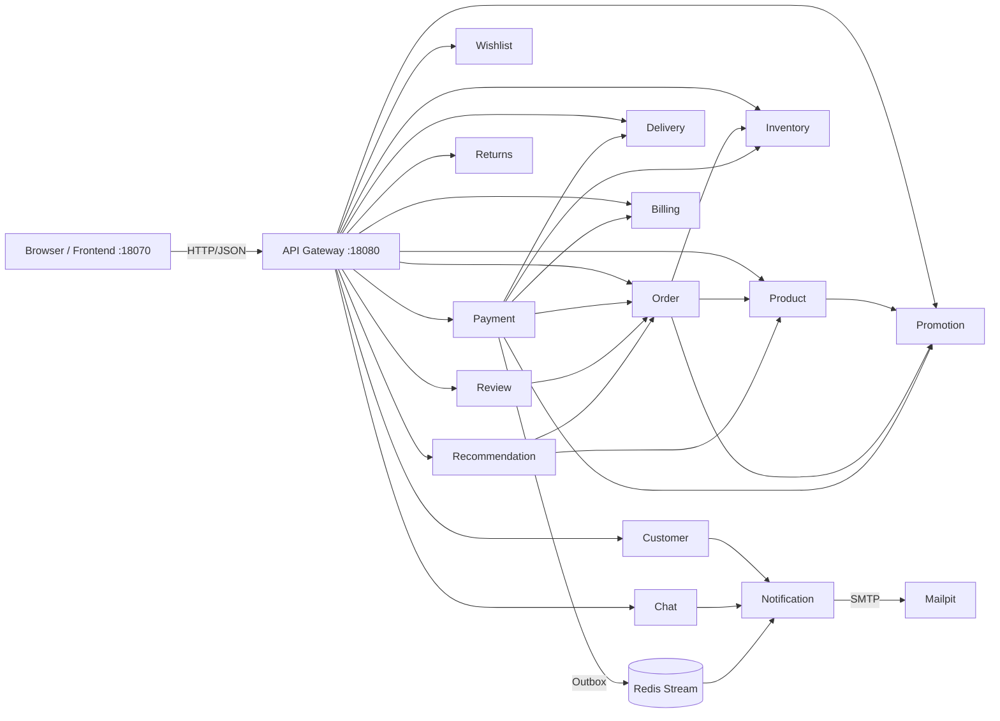
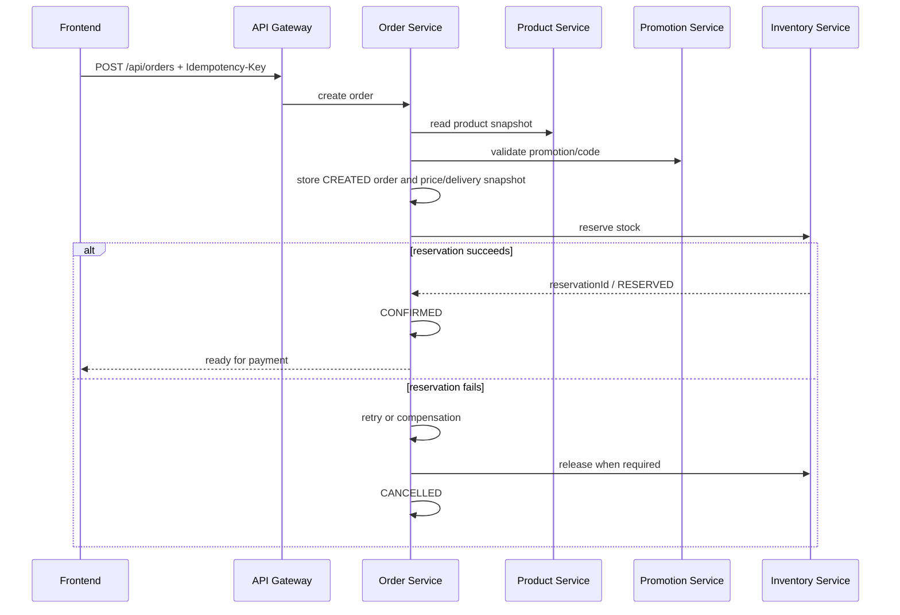
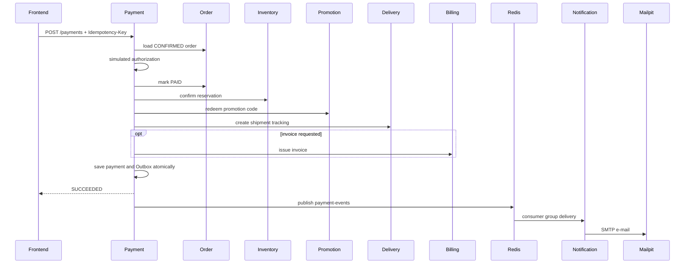
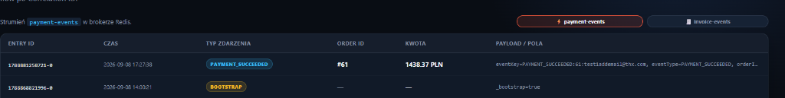

# Mini Order Platform — General Instruction

> **Environment status:** only the local `dev` and `test` profiles are
> available. The `prod` profile cannot currently be started from Control
> Center. Kubernetes, OpenBao, and TLS templates remain in the repository for a
> future production deployment.

> Polish version: [General_Instruction.md](General_Instruction.md)
>
> Complete Control Center manual:
> [Microservices_Central_Instruction_EN.md](Microservices_Central_Instruction_EN.md)

This manual describes the project architecture, application flow, business
features, local setup, tests, security, and troubleshooting. Control Center
commands are included where they help explain a workflow; its complete menu
and command reference is kept in the separate Central manual.

Local secrets, private keys, certificates, kubeconfig files, backups, test
artifacts, and logs must be stored outside tracked source files. Runtime
artifacts generated by this project are placed under `gitIgnoreOwn/`, which is
ignored by Git.

## Contents

- [Start here: Control Center](#start-here-control-center)
- [Project entry points](#project-entry-points)
- [Architecture and components](#architecture-and-components)
- [Requirements before the first start](#requirements-before-the-first-start)
- [Profiles and secrets](#profiles-and-secrets)
- [Starting dev or test](#starting-dev-or-test)
- [Application flow](#application-flow)
- [Service reference](#service-reference)
- [Security](#security)
- [Resilience and consistency](#resilience-and-consistency)
- [Frontend](#frontend)
- [Testing](#testing)
- [Monitoring and DLQ](#monitoring-and-dlq)
- [Backups and continuity](#backups-and-continuity)
- [IntelliJ IDEA](#intellij-idea)
- [GitHub preparation](#github-preparation)
- [Docker, Kubernetes, OpenBao, and production preparation](#docker-kubernetes-openbao-and-production-preparation)
- [Daily workflow](#daily-workflow)

---

## Start here: Control Center

Control Center is the recommended local operator interface. It starts a dark,
local web dashboard from WSL and retains the original terminal application as
a compatibility view. Linux and macOS are also supported. It can:

- validate the host and project prerequisites;
- switch between `dev` and `test`;
- create, edit, validate, and load SOPS + age secrets;
- start and stop PostgreSQL, Redis, Mailpit, monitoring, applications, and the
  frontend;
- show health, ports, processes, logs, Swagger URLs, streams, and DLQ entries;
- run unit, integration, contract, security, load, Playwright, smoke, App
  Verify, and full E2E tests;
- create backups and run a restore test;
- perform local operator actions for JWT, promotions, delivery tracking,
  reviews, chat, returns, invoices, and inventory.

Start the graphical dashboard from the project root:

```bash
bash ./scripts/start.sh
```

It is available only on `http://127.0.0.1:18100`. Use
`bash ./scripts/start.sh --cli` for the original terminal menu, or manage the web server in the background via
`bash scripts/control-center/control-center.sh web-start|web-stop|web-status`. The dashboard
offers service health (with real-time RAM/CPU container metrics), allow-listed operations, business data exploration
(orders, invoices with sequential numbers and Model A credit note sub-rows, bulk ZIP export, inventory restock, customers),
asynchronous messaging & DLQ inspection (Redis streams `payment-events` & `invoice-events`, Transactional Outbox, DLQ replay),
a Failure Simulator (Chaos Engineering), an embedded AI Assistant (which operates by default in offline mode powered by top prompt chips with frequently asked questions; full conversational chat requires connecting an external LLM agent in AI Settings), customer chat replies, tests,
job logs, and an embedded WSL terminal for interactive SOPS/Vim workflows.

First-time secret setup is also available in the browser: start the dashboard,
choose `Operations → Profiles and secrets → Create DEV secrets` or `Create TEST
secrets`, enter the required values, and confirm creation. The form creates
missing age keys, encrypts the profile with SOPS, and does not start services
automatically. Run validation and `infra-up` separately after setup.

Direct commands can be used without opening the interactive menu:

```bash
bash scripts/control-center/control-center.sh doctor
bash scripts/control-center/control-center.sh profile-show
bash scripts/control-center/control-center.sh health all
```

Inside the interactive panel:

- enter an option number and press Enter;
- enter `0` to return to the previous menu;
- enter `exit` to close the panel;
- press Enter after an operation to return to the current menu.

The panel language is changed under `Settings → Language`. Polish is the
default; English is available as the second option.

---

## Project entry points

| Component | Address | Purpose |
|---|---|---|
| Store frontend | `http://127.0.0.1:18070` | customer-facing UI |
| API Gateway | `http://127.0.0.1:18080/api` | public backend entry point |
| Swagger UI (Aggregated) | `http://127.0.0.1:18080/swagger-ui.html` | interactive API documentation for all 15 services |
| Mailpit UI | `http://127.0.0.1:18025` | captured dev/test e-mails |
| Prometheus | `http://127.0.0.1:19090` | metrics and target status |
| Grafana | `http://127.0.0.1:13000` | provisioned dashboards |

Every Spring Boot application also exposes:

- `/actuator/health` — minimal health response;
- `/actuator/health/liveness` — process liveness;
- `/actuator/health/readiness` — traffic readiness;
- `/actuator/prometheus` — Micrometer metrics;
- `/swagger-ui.html` — Swagger UI;
- `/v3/api-docs` — OpenAPI JSON.

Actuator health details are intentionally restricted. A public caller receives
status information without internal component names, database details, or
credentials.

---

## Architecture and components

Mini Order Platform is a Maven monorepo containing 15 independently runnable
Spring Boot applications: API Gateway and 14 domain services. Every domain
service owns a separate PostgreSQL database. API Gateway has no database.

### Applications

| Alias | Port | Responsibility |
|---|---:|---|
| `gateway` | 18080 | routing, CORS, correlation IDs, rate limiting |
| `product` | 18081 | product catalog, specifications, images, base prices |
| `order` | 18082 | orders, price snapshots, saga, history, bestsellers |
| `inventory` | 18083 | stock, reservations, confirmation, release, sold count |
| `payment` | 18084 | payment simulation, idempotency, outbox orchestration |
| `notification` | 18086 | e-mail, retries, Redis consumer, durable DLQ |
| `customer` | 18087 | accounts, profile, JWT, refresh, MFA, reset, audit |
| `delivery` | 18088 | delivery methods, quotations, dates, shipment tracking |
| `promotion` | 18089 | daily rotation, price history, promotion codes |
| `wishlist` | 18090 | customer-to-product favorites |
| `review` | 18091 | verified reviews and moderation |
| `recommendation` | 18092 | similar and customer-specific recommendations |
| `chat` | 18093 | support chat and operator replies |
| `returns` | 18094 | returns and complaints workflow |
| `billing` | 18095 | demo VAT invoices |

Port `18085` is intentionally unused.

### Infrastructure

| Component | Host port | Notes |
|---|---:|---|
| Order PostgreSQL | 15432 | `order_db`, user `order_app` |
| Product PostgreSQL | 15433 | `product_db`, user `product_app` |
| Inventory PostgreSQL | 15434 | `inventory_db`, user `inventory_app` |
| Payment PostgreSQL | 15435 | `payment_db`, user `payment_app` |
| Notification PostgreSQL | 15436 | `notification_db`, user `notification_app` |
| Customer PostgreSQL | 15437 | `customer_db`, user `customer_app` |
| Delivery PostgreSQL | 15438 | `delivery_db`, user `delivery_app` |
| Promotion PostgreSQL | 15439 | `promotion_db`, user `promotion_app` |
| Wishlist PostgreSQL | 15440 | `wishlist_db`, user `wishlist_app` |
| Review PostgreSQL | 15441 | `review_db`, user `review_app` |
| Recommendation PostgreSQL | 15442 | `recommendation_db`, user `recommendation_app` |
| Chat PostgreSQL | 15443 | `chat_db`, user `chat_app` |
| Returns PostgreSQL | 15444 | `returns_db`, user `returns_app` |
| Billing PostgreSQL | 15445 | `billing_db`, user `billing_app` |
| Redis | 16379 | stream broker and short-lived security state |
| Mailpit SMTP | 11025 | local unauthenticated SMTP for dev/test |
| Mailpit UI | 18025 | browser mailbox |

All Compose ports are bound to `127.0.0.1`. They are not exposed on every
network interface.

### Service communication



Synchronous calls use HTTP/JSON and explicit service URLs. The payment event is
asynchronous: Payment writes an Outbox record, publishes it to Redis Stream
`payment-events`, and Notification consumes it through a consumer group.

Each service is the only owner of its database. Services never join tables
from another service database. Cross-domain information is obtained through an
API, and identifiers such as `productId` or `orderId` are stored as business
references rather than cross-database foreign keys.

---

## Requirements before the first start

Recommended local environment:

- WSL 2 with a modern Linux distribution;
- Java/JDK 25 with `java` and `javac` on `PATH`;
- Bash;
- Docker Engine and Docker Compose v2 available from WSL;
- `curl`, `git`, `python3`;
- `sops`, `age`, and `age-keygen`;
- Node.js 20+ and pnpm for Playwright tests; Node.js 22 LTS is recommended.

Docker Desktop is not required if a native Docker Engine is available in WSL.
The project is designed to be operated mainly from the terminal.

Check the environment before changing anything:

```bash
bash scripts/control-center/control-center.sh requirements
bash scripts/control-center/control-center.sh doctor
```

`doctor` verifies commands, Compose files, Maven wrapper, frontend files,
active profile, SOPS files, secrets, JDK, Docker daemon, and Compose
interpolation.

Do not continue to application startup when `doctor` reports missing database
passwords or unavailable Docker. Fix the indicated item and run it again.

### Platform dependency checks

WSL/Linux:

```bash
bash scripts/control-center/control-center.sh platform-info
bash scripts/control-center/control-center.sh requirements
```

macOS:

```bash
bash scripts/control-center/control-center.sh platform-info
bash scripts/control-center/control-center.sh requirements
```

The project scripts discover the platform-specific configuration directory:

```text
WSL/Linux: ~/.config/mini-order-platform/
macOS:     ~/Library/Application Support/mini-order-platform/
```

---

## Profiles and secrets

### Profiles

- `dev` — local development, Mailpit, demo payment and delivery;
- `test` — isolated test configuration and a separate encrypted secret file;
- `prod` — templates only; startup is blocked by Control Center.

Show or change the active profile:

```bash
bash scripts/control-center/control-center.sh profile-show
bash scripts/control-center/control-center.sh profile-set dev
bash scripts/control-center/control-center.sh profile-set test
```

### SOPS + age vault

The local vault is not a continuously running server. SOPS encrypts a dotenv
file, and age protects it with a private key. Control Center decrypts the file
temporarily when a command needs the values.

```text
~/.config/mini-order-platform/
├── keys/
│   ├── dev.agekey
│   └── test.agekey
└── secrets/
    ├── dev.env.sops
    └── test.env.sops
```

Initialize, edit, and validate secrets:

```bash
bash scripts/control-center/control-center.sh secrets-init
bash scripts/control-center/control-center.sh secrets-setup dev
bash scripts/control-center/control-center.sh secrets-setup test
bash scripts/control-center/control-center.sh secrets-edit dev
bash scripts/control-center/control-center.sh secrets-edit test
bash scripts/control-center/control-center.sh secrets-validate dev
bash scripts/control-center/control-center.sh secrets-validate test
bash scripts/control-center/control-center.sh secrets-status
```

Required database secrets:

```text
PRODUCT_DB_PASSWORD
ORDER_DB_PASSWORD
INVENTORY_DB_PASSWORD
PAYMENT_DB_PASSWORD
NOTIFICATION_DB_PASSWORD
CUSTOMER_DB_PASSWORD
DELIVERY_DB_PASSWORD
PROMOTION_DB_PASSWORD
WISHLIST_DB_PASSWORD
REVIEW_DB_PASSWORD
RECOMMENDATION_DB_PASSWORD
CHAT_DB_PASSWORD
RETURNS_DB_PASSWORD
BILLING_DB_PASSWORD
```

Additional required material:

- `GRAFANA_ADMIN_PASSWORD`;
- either `CUSTOMER_JWT_SECRET`, or a complete RS256 set:
  `CUSTOMER_JWT_ACTIVE_KID`, `CUSTOMER_JWT_PRIVATE_KEY_BASE64`, and
  `CUSTOMER_JWT_PUBLIC_KEYS_JSON`.

Mailpit does not require `MAIL_USERNAME` or `MAIL_PASSWORD` in dev/test.
`MAIL_HOST` should be `127.0.0.1`, not an e-mail address. `MAIL_FROM` is the
sender address shown in a message.

The terminal `secrets-setup` wizard remains available as an alternative to the
web form. The browser wizard requires all fourteen database passwords,
`GRAFANA_ADMIN_PASSWORD`, and `CUSTOMER_JWT_SECRET` as Base64 with at least 32
decoded bytes. Other Grafana and Mailpit settings use the local defaults
described in the Control Center manual.

The browser wizard sends values to a dedicated process through standard input
as Base64. Values are not stored in URLs, process arguments, job logs, or API
responses. The plaintext temporary file is removed after SOPS encryption. If
the encrypted profile already exists, the browser wizard refuses to overwrite
it; use the web editor or terminal `secrets-edit` instead.

If PostgreSQL volumes already exist, the password entered into SOPS must match
the password currently stored by PostgreSQL. Changing `POSTGRES_PASSWORD` or a
service-specific `*_DB_PASSWORD` in Compose does not modify an existing
database role.

Never commit decrypted `.env` files, `*.env.sops` files containing real
secrets, age keys, JWT private keys, certificates, kubeconfig files, backups,
or logs.

---

## Starting dev or test

### Recommended sequence

```bash
bash scripts/control-center/control-center.sh secrets-validate dev
bash scripts/control-center/control-center.sh profile-set dev
bash scripts/control-center/control-center.sh infra-up
bash scripts/control-center/control-center.sh broker-up
bash scripts/control-center/control-center.sh mailpit-up
bash scripts/control-center/control-center.sh app-run-all
bash scripts/control-center/control-center.sh frontend-up
bash scripts/control-center/control-center.sh health all
```

`infra-up` starts all PostgreSQL databases, Redis, and Mailpit from
`compose.yaml`. Calling `broker-up` and `mailpit-up` afterwards is safe and
idempotent.

Start monitoring separately when needed:

```bash
bash scripts/control-center/control-center.sh monitoring-up
```

### Functional dependency order for manual IDE startup

1. Infrastructure: PostgreSQL, Redis, Mailpit.
2. Leaf services: Promotion, Delivery, Inventory, Wishlist, Returns, Billing,
   Notification.
3. Product.
4. Order.
5. Customer, Chat, Review, Recommendation.
6. Payment.
7. API Gateway.
8. Frontend.

Most services do not call downstream APIs during Spring startup, so they may
boot in a different order. The order above reduces runtime errors while manual
testing begins.

Status and stop commands:

```bash
bash scripts/control-center/control-center.sh app-status-all
bash scripts/control-center/control-center.sh health all
bash scripts/control-center/control-center.sh app-stop-all
bash scripts/control-center/control-center.sh frontend-down
bash scripts/control-center/control-center.sh infra-down
```

`app-stop-all` only stops processes started by Control Center. It does not stop
database, Redis, Mailpit, or monitoring containers.

---

## Application flow

### Catalog and cart

1. Frontend requests `/api/products` through Gateway.
2. Gateway forwards the call to Product Service and propagates
   `X-Correlation-Id`.
3. Product reads `product_db` and may use Promotion to enrich current prices.
4. Frontend obtains availability from Inventory.
5. Adding a product writes only to browser `localStorage`; it is not a stock
   reservation.
6. Guest and customer carts use separate storage keys. Logging out does not
   expose the previous customer's cart to a guest.

The catalog supports category-specific manufacturer and technical-parameter
filters, search, price range, sorting, product details, comparison, favorites,
daily promotions, new products, and bestsellers.

### Account and authentication

1. Registration creates a disabled account and a BCrypt password hash.
2. Customer stores only the hash of the one-time verification token.
3. Notification sends the verification link through Mailpit.
4. The link is valid for five minutes. Resend is rate-limited and invalidates
   the previous token.
5. Login returns an access JWT and sets a rotating refresh token cookie.
6. The access token stays in frontend memory. The refresh token is `HttpOnly`;
   only its hash is stored in `customer_db`.
7. Refresh rotation restores the session after a page reload. Logout revokes
   the server-side refresh token.

### Checkout and order saga

The current demo permits guest checkout up to PLN 1,000. Above that threshold
the frontend requires an account. A production implementation must enforce the
same rule on the server, not only in JavaScript.

Delivery Service supplies methods, price quotations, and valid dates. The
current local methods are:

- standard courier — PLN 14.99;
- parcel locker — PLN 11.99;
- store pickup — PLN 0.00.

The selected delivery amount is included in gross, net, and VAT totals.



Order status flow:

```text
CREATED -> CONFIRMED -> PAID -> SHIPPED -> COMPLETED
     \          \          \
      +----------+----------+-> CANCELLED
```

Inventory reservation states are `RESERVED`, `CONFIRMED`, and `RELEASED`.
Reservations expire after 15 minutes by default and are checked every minute.

### Payment, outbox, e-mail, delivery, and invoice



Payment is idempotent per order. If the network response is lost after Order
was already marked `PAID`, retrying does not charge the order again. Payment
reconciles its local record and idempotently completes inventory, promotion,
delivery, billing, and notification side effects.

Cash-on-delivery/payment-at-pickup remains `PENDING`; it does not immediately
create an issued invoice.

Promotion-code validation does not consume the code. `redeemedCount` is
incremented atomically only after successful payment, once per order.

---

## Service reference

### API Gateway

Gateway is the public backend entry point. It has no database. It routes
`/api/**` and `/api/v1/**` to services, handles CORS for the local frontend,
generates or propagates `X-Correlation-Id`, applies Redis-backed rate limiting,
and wraps downstream calls with timeouts and resilience policies.

Default routes include products, orders, inventory, payments, notifications,
customers, deliveries, promotions, wishlists, reviews, recommendations, chat,
returns, and invoices.

#### OpenAPI and Swagger UI

Each microservice automatically generates OpenAPI documentation and exposes a Swagger UI interface. All 15 microservices are integrated into **a single aggregated Swagger UI** hosted directly on the API Gateway port:

```text
Main aggregated Swagger UI: http://127.0.0.1:18080/swagger-ui.html
```

The top-right corner of the Swagger UI provides a dropdown menu (*Select a definition*) allowing developers to switch the specification to any platform service (`Product Service`, `Order Service`, `Payment Service`, `Customer Service`, `Billing Service`, `Delivery Service`, `Review Service`, etc.) and test endpoints directly through the gateway without CORS errors.

Individual direct Swagger UI URLs for each microservice:

```text
Gateway      http://127.0.0.1:18080/swagger-ui.html (Aggregated for all 15 services)
Product      http://127.0.0.1:18081/swagger-ui.html
Order        http://127.0.0.1:18082/swagger-ui.html
Inventory    http://127.0.0.1:18083/swagger-ui.html
Payment      http://127.0.0.1:18084/swagger-ui.html
Notification http://127.0.0.1:18086/swagger-ui.html
Customer     http://127.0.0.1:18087/swagger-ui.html
Delivery     http://127.0.0.1:18088/swagger-ui.html
Promotion    http://127.0.0.1:18089/swagger-ui.html
Wishlist     http://127.0.0.1:18090/swagger-ui.html
Review       http://127.0.0.1:18091/swagger-ui.html
Recommend    http://127.0.0.1:18092/swagger-ui.html
Chat         http://127.0.0.1:18093/swagger-ui.html
Returns      http://127.0.0.1:18094/swagger-ui.html
Billing      http://127.0.0.1:18095/swagger-ui.html
```

Raw OpenAPI JSON documents are exposed at `/v3/api-docs`. The `bearerAuth` scheme describes the `Authorization: Bearer <access-token>` header. Protected Customer Service endpoints are flagged with the JWT requirement in documentation. In the `prod` profile, OpenAPI and Swagger UI are disabled via `application-prod.yaml`. They can be toggled using `SPRINGDOC_API_DOCS_ENABLED` and `SPRINGDOC_SWAGGER_UI_ENABLED` in local profiles.

### Product Service

Owns product identity and catalog information: SKU, name, category,
manufacturer, model, technical parameters, image URLs, base price, and active
state. Stock never belongs here. Product may ask Promotion for current offer
data.

Main API:

- `GET /products`;
- `GET /products/{id}`;
- `POST /products`;
- `PATCH /products/{id}`.

### Inventory Service

Owns stock and reservations. It uses pessimistic locking for concurrent
reservations and makes reserve/confirm/release operations idempotent.

Main API:

- `GET /inventory/items/{productId}`;
- `POST /inventory/items`;
- `PATCH /inventory/items/{productId}`;
- `POST /inventory/reservations`;
- `POST /inventory/reservations/{id}/confirm`;
- `POST /inventory/reservations/{id}/release`.

Reset local demo stock:

```bash
bash scripts/control-center/control-center.sh inventory-reset
```

### Order Service

Owns orders, product/price/delivery snapshots, status transitions, order saga,
customer history, and bestseller aggregation. It calls Product, Inventory, and
Promotion.

Main API:

- `POST /orders`;
- `GET /orders`;
- `GET /orders/{id}`;
- `GET /orders/customer/{customerId}`;
- `GET /orders/bestsellers?limit=6`;
- `PATCH /orders/{id}/status`.

`POST /orders` accepts the complete cart in the `items` array. Every item has a
`productId` and `quantity`; the response contains the product snapshots and
line totals. The legacy single-line `productId`/`quantity` fields remain
accepted for compatibility, but the frontend uses the multi-item contract.
One order receives one inventory reservation, one payment, one invoice, and
one confirmation e-mail.

### Payment Service

Owns payment attempts and the Outbox. It coordinates post-payment effects in
Order, Inventory, Promotion, Delivery, and Billing. Simulated failure returns
HTTP 402 and stores `FAILED`; a later successful retry is supported.

Payment states are `PENDING`, `SUCCEEDED`, and `FAILED`. Outbox states are
`PENDING`, `PUBLISHED`, and `FAILED`.

### Notification Service

Consumes payment events from Redis, stores notification state, sends SMTP mail,
retries provider failures with backoff, and writes exhausted failures to a
durable database DLQ. Customer and Chat also call it synchronously for account
and support e-mails.

Mailpit profile defaults:

```text
MAIL_HOST=127.0.0.1
MAIL_PORT=11025
MAIL_SMTP_AUTH=false
MAIL_SMTP_STARTTLS_ENABLE=false
```

### Customer Service

Owns registration, verification, resend, login, refresh rotation, logout,
profile, address, phone, password reset, login lockout, JWT, TOTP, WebAuthn,
refresh-token hashes, and the audit log.

Passwords use BCrypt. Five failed attempts within the configured window lock
the login key in Redis for 15 minutes by default.

### Delivery Service

Owns active methods, quotation rules, valid dates, shipment number, carrier,
and tracking state. Order keeps an immutable delivery snapshot; Payment creates
tracking after a successful online payment.

Tracking states:

```text
LABEL_CREATED
READY_FOR_PICKUP
IN_TRANSIT
OUT_FOR_DELIVERY
DELIVERED
PICKED_UP
CANCELLED
```

### Promotion Service

Owns a UTC daily rotation, discounts, previous and lowest prices, history,
promotion codes, date ranges, minimum order value, maximum discount amount,
redemption limits, and `redeemedCount`.

Local operator commands:

```bash
bash scripts/control-center/control-center.sh promotion-codes
bash scripts/control-center/control-center.sh promotion-code-create
bash scripts/control-center/control-center.sh promotion-smoke
```

### Wishlist Service

Stores idempotent customer-to-product favorite relations. It does not copy the
catalog or modify inventory. Current dev/test identity is supplied by frontend
session state; production must enforce customer ownership from JWT claims.

### Review Service

Calls Order to confirm that the customer owns a paid order containing the
product. New reviews are `PENDING`; local moderation changes them to
`PUBLISHED` or `REJECTED`.

```bash
bash scripts/control-center/control-center.sh review-pending
bash scripts/control-center/control-center.sh review-moderate <id> PUBLISHED "Approved"
```

### Recommendation Service

Reads active products from Product and paid history from Order. It computes
similarity using category, manufacturer, and technical parameters. Its own
database keeps only a technical request log.

### Chat Service

Stores support conversations in `chat_db`. The frontend polls a conversation
every three seconds, giving a lightweight live-chat experience without
WebSocket or SSE. Chat asks Notification to e-mail the support address and the
customer after an operator reply.

```bash
bash scripts/control-center/control-center.sh chat-list 50
bash scripts/control-center/control-center.sh chat-reply 1
bash scripts/control-center/control-center.sh chat-reply 1 "Thank you. We are checking your request."
```

Replies must go through Chat Service. Sending a message manually from Mailpit
does not update `chat_db` and will not appear in the widget.

### Returns Service

Stores return and complaint requests. States are `REQUESTED`, `UNDER_REVIEW`,
`APPROVED`, `REJECTED`, and `COMPLETED`. It intentionally does not refund a
payment or restore inventory automatically in dev/test.

```bash
bash scripts/control-center/control-center.sh returns-list
bash scripts/control-center/control-center.sh returns-status <id> UNDER_REVIEW "Checking documents"
```

### Billing Service

Issues an idempotent demo invoice per `orderId`, with number, buyer data,
net amount, 23% VAT, and gross amount. It stores immutable snapshots of the
purchased products and shows their names, quantities, unit prices and line
totals, together with delivery cost and discount when applicable. A company
invoice requires a separate personal name, company name, and exactly ten NIP
digits. Numbering is continuous and gap-free based on pessimistic locking in
`invoice_sequences`, producing formats `FV/YYYY/nnnnnn` and `KOR/YYYY/nnnnnn`.

Billing Service also supports credit notes / correction invoices (`InvoiceCorrection`),
calculating gross/net/VAT deltas and final amounts after correction. In event-driven
architecture (EDA), Billing Service consumes `payment-events` and publishes both
`INVOICE_ISSUED` and `INVOICE_CORRECTED` to `invoice-events`.

```bash
bash scripts/control-center/control-center.sh orders-list 100
bash scripts/control-center/control-center.sh invoice-show <orderId>
bash scripts/control-center/control-center.sh invoice-pdf <orderId>
bash scripts/control-center/control-center.sh invoices-export-zip
bash scripts/control-center/control-center.sh invoice-correct <invoiceId> "<reason>" <gross_delta>
bash scripts/control-center/control-center.sh corrections-list
```

`orders-list` shows the ID, status, amount, e-mail, invoice-request flag, and
the ordered items with quantities. `invoice-pdf` saves the document under
`gitIgnoreOwn/runtime/invoices/`; this directory is local runtime data and must
not be published to the repository. The PDF is also available through
`GET /api/invoices/order/{orderId}/pdf`. The command `invoice-correct` issues
a credit note (KOR) with the specified delta amount (negative value for discounts/refunds),
and `corrections-list` displays all registered credit notes.

In Control Center Web, operators can navigate to the **Invoices** tab (with expandable
accordion sub-rows for corrections history and interactive modal) as well as the dedicated
**Document Dispatch** tab (`✉️ Wysyłka dokumentów`). The Document Dispatch center allows
filtering documents (`All`, `Invoices FV`, `Credit Notes KOR`), editing recipient emails,
adding an **optional custom note/message for the customer**, and dispatching the document
with its PDF attached directly via SMTP to Mailpit (`127.0.0.1:11025`) with live delivery status tracking.

After a successful payment, Notification Service downloads the PDF from Billing Service
(in Docker via `BILLING_SERVICE_URL: http://billing-service:8080`) and attaches it to the
payment-confirmation e-mail. In Mailpit (`http://127.0.0.1:18025`), messages can be inspected
with their full PDF attachments.

---

## Security

### JWT and refresh flow

- access JWT default lifetime: 900 seconds;
- refresh token default lifetime: 604800 seconds (7 days);
- access token: frontend memory only;
- raw refresh token: `HttpOnly` cookie;
- refresh token database value: hash only;
- logout: server-side revocation;
- refresh: token rotation, new access token, old refresh invalidation.

The storefront also enforces a 30-minute inactivity timeout. It stores only the
last activity timestamp under `minitech-auth:last-activity` in browser
`localStorage`; no token or customer data is stored there. Pointer, touch, or
keyboard activity renews the timestamp. After 30 inactive minutes the frontend
calls `/customers/logout`, clears the local marker, switches to the guest cart,
and requires a new login. Reopening the application does not restore a session
when the marker is missing or older than 30 minutes, even if the refresh cookie
has not reached its seven-day technical expiry.

Control Center can validate and rotate local JWT material:

```bash
bash scripts/control-center/control-center.sh jwt-status
bash scripts/control-center/control-center.sh jwt-smoke user@example.com
bash scripts/control-center/control-center.sh jwt-rotate dev
```

### TOTP

TOTP uses a shared Base32 secret and a current six-digit code from an
Authenticator application. The frontend displays both the text secret and a QR
code. The setup code must contain exactly six digits. The account security
dialog can enable and disable TOTP.

### Passkey / WebAuthn

Passkeys use public-key credentials managed by the browser or device. The
private key never leaves the authenticator. Local testing must use
`http://localhost:18070` because WebAuthn origin and relying-party ID must
match. Opening the frontend as `127.0.0.1` while the RP ID is `localhost` may
produce `This is an invalid domain`.

Default local values:

```text
CUSTOMER_WEBAUTHN_RP_ID=localhost
CUSTOMER_WEBAUTHN_ALLOWED_ORIGINS=http://localhost:18070
```

### Password reset and verification

Both flows use short-lived one-time token hashes and Mailpit links. Reset
requests do not reveal whether an e-mail address exists. Verification resend
has a minimum interval and an hourly attempt limit.

### Rate limiting and lockout

Gateway uses Redis-backed request windows. Customer uses Redis TTL keys for
failed-login counters and temporary locks. Redis failure behavior in the local
Gateway is configurable and defaults to fail-open to preserve development
availability.

### Audit

Customer records authentication and security events such as login success,
failure, lock, refresh, logout, MFA setup, and MFA verification. Inspect the
local audit log through Control Center.

---

## Resilience and consistency

### HTTP resilience

Key inter-service clients use:

- connect and read timeouts;
- bounded retry with exponential backoff;
- Circuit Breaker with open and half-open states;
- Bulkhead concurrency limits.

At the API Gateway boundary, automatic retry is limited to read-only `GET`,
`HEAD`, and `OPTIONS` requests. State-changing requests are not replayed by the
proxy because the downstream service may have committed the operation before
the response was lost. A client may safely repeat such an operation only with
the same `Idempotency-Key`. The Gateway read timeout is 15 seconds in local
profiles so checkout orchestration can finish without spawning overlapping
payment attempts.

Validation errors (`400`), authentication failures (`401`), and ordinary
missing resources (`404`) are not fixed by retry. Retry is for transient
network and `5xx` failures.

### Saga and compensation

Order cannot use one SQL transaction across `order_db` and `inventory_db`.
Instead it stores saga state, retries reservation work, and releases inventory
or cancels the order when compensation is required.

### Idempotency

Order creation, payment, inventory reserve/confirm/release, promotion redeem,
tracking creation, invoice issue, and notifications are protected against
duplicate execution by idempotency keys or business uniqueness constraints.

### Correlation ID

Gateway accepts a valid `X-Correlation-Id` or generates one. It is forwarded to
downstream services, returned to the caller, and included in log patterns as
`[corr=...]`.

### Outbox and DLQ

Payment and its Outbox event are stored in one PostgreSQL transaction. A
publisher later writes to Redis Stream. Notification uses a consumer group and
stores provider failures. After the configured retries, a durable DLQ entry can
be inspected and replayed.

### BOOTSTRAP Initialization Event in Redis Streams

When inspecting Redis streams (e.g. `payment-events` or `invoice-events`), a technical initialization entry marked as **`BOOTSTRAP`** may appear alongside business events (`PAYMENT_SUCCEEDED`, `INVOICE_ISSUED`).



#### Why does the BOOTSTRAP event occur?
In Redis Streams, executing `XGROUP CREATE payment-events billing-service 0-0` fails with `ERR no such key` if the target stream key does not exist yet (e.g. on fresh startup before any customer checkout).

#### Microservice implementation details
Consumer services (`Notification Service` and `Billing Service`) handle this in their `ensureConsumerGroup()` initialization routine:
1. **Emit technical seed record:** The service adds a minimal `{"_bootstrap": "true"}` record to the stream, ensuring Redis allocates the stream structure.
2. **Create consumer group:** Once the stream key exists, `XGROUP CREATE` succeeds without error.
3. **Idempotent acknowledgment (ACK):** The consumer processor immediately acknowledges (`XACK`) and skips records where `_bootstrap=true` without triggering any notifications or invoices (which is why *ORDER ID* and *AMOUNT* display dashes `—`).

Control Center Web recognizes the `_bootstrap: true` payload and styles it with a prominent yellow **`BOOTSTRAP`** badge to distinguish technical seed entries from business domain events.

---

## Frontend

The frontend is plain HTML/CSS/JavaScript and is served by a small no-cache
Python server. No Node build is required for normal runtime.

Main views and features:

- home page with hero rotation, daily promotions, Hot Shot, new products, and
  bestsellers;
- separate full catalog with category-specific filters;
- product details, technical specification, stock, reviews, recommendations;
- responsive header search and category navigation;
- hover/click cart preview and a dedicated same-tab cart page;
- cart → delivery and payment → summary progress flow;
- account, profile, orders, order details, invoices, tracking, returns;
- favorites and product comparison;
- login, registration, verification, resend, reset, TOTP, passkey;
- support chat widget.

The cart and comparison list are stored in browser `localStorage`. Access JWT
is kept only in memory; session restoration uses the HttpOnly refresh cookie.
The hero banner is populated from the same Product/Promotion Service daily UTC
rotation as the promotion and new-product sections. Its product, local image,
price, stock note, and detail link are refreshed automatically just after UTC
midnight, so every user sees the same banner selection for a given day.

Start and inspect the frontend:

```bash
bash scripts/control-center/control-center.sh frontend-up
bash scripts/control-center/control-center.sh frontend-status
bash scripts/control-center/control-center.sh frontend-logs
bash scripts/control-center/control-center.sh frontend-down
```

Override Gateway for diagnostics:

```text
http://127.0.0.1:18070/?api=http://127.0.0.1:18080/api
```

---

## Testing

### Preparation

Before infrastructure-dependent tests:

```bash
bash scripts/control-center/control-center.sh doctor
bash scripts/control-center/control-center.sh secrets-validate dev
bash scripts/control-center/control-center.sh infra-up
bash scripts/control-center/control-center.sh broker-up
bash scripts/control-center/control-center.sh mailpit-up
bash scripts/control-center/control-center.sh app-run-all
bash scripts/control-center/control-center.sh frontend-up
bash scripts/control-center/control-center.sh health all
```

Tests that create real orders, accounts, e-mails, promotion redemptions, or
stock changes modify local dev/test data. Use a dedicated profile or reset demo
inventory when appropriate.

### Unit and Spring context tests

Entire monorepo:

```bash
./mvnw test
```

One service and required Maven modules:

```bash
./mvnw -pl payment-service -am test
```

From Control Center:

```bash
bash scripts/control-center/control-center.sh app-test product
bash scripts/control-center/control-center.sh app-test-all
```

### Integration tests

Integration coverage includes repository/migration behavior, PostgreSQL where
required, Redis stream/outbox behavior, Mailpit scenarios, security, and
cross-service clients. Some module tests use H2 in PostgreSQL compatibility
mode; Testcontainers tests require a working Docker daemon.

### Smoke test

Smoke is a fast availability and minimal contract check. It proves that the
critical routes answer and basic Gateway routing works. It does not prove the
complete business transaction.

```bash
bash scripts/control-center/control-center.sh smoke
```

Use smoke after startup or a small configuration change.

### App Verify

App Verify runs a practical order/payment/inventory/e-mail scenario through
Gateway. It reads a product and stock, quotes delivery, creates an order,
reserves stock, pays it, verifies order/payment/reservation/inventory state, and
checks Notification/Mailpit when applicable.

```bash
bash scripts/control-center/control-center.sh app-verify
```

### Full E2E

The full E2E scenario includes account registration and confirmation, JWT
login/refresh/logout, customer checkout, payment, inventory, delivery,
promotion, and e-mail. It creates real local data.

```bash
bash scripts/control-center/control-center.sh e2e
```

### Playwright UI tests

Requirements: Node.js 20+, pnpm, Playwright browser binaries. Install through
Control Center:

```bash
bash scripts/control-center/control-center.sh ui-test-status
bash scripts/control-center/control-center.sh ui-test-install
```

Commands:

```bash
# three critical mocked UI scenarios
bash scripts/control-center/control-center.sh ui-test-smoke

# full mocked Chromium regression
bash scripts/control-center/control-center.sh ui-test

# real backend + Mailpit checkout
bash scripts/control-center/control-center.sh ui-test-system

# all configured browsers and mobile emulation
bash scripts/control-center/control-center.sh ui-test-all

# interactive/debug variants
bash scripts/control-center/control-center.sh ui-test-headed
bash scripts/control-center/control-center.sh ui-test-ui
bash scripts/control-center/control-center.sh ui-test-debug

# open/serve the last HTML report
bash scripts/control-center/control-center.sh ui-test-report
```

Artifacts are written to `gitIgnoreOwn/runtime/playwright/`.

### Contract, security, load, and DAST

```bash
bash scripts/control-center/control-center.sh contract-test
bash scripts/control-center/control-center.sh security-test
bash scripts/control-center/control-center.sh load-test
bash scripts/control-center/control-center.sh zap-dast
```

- contract tests protect public API v1 structures;
- security tests check authentication, ownership, validation, and information
  exposure expectations;
- load tests exercise Gateway under concurrent traffic;
- OWASP ZAP performs a dynamic scan and writes local reports under
  `gitIgnoreOwn/runtime/zap/`.

### Last verified local baseline

The Polish source manual records the dated local baseline. At the latest
documented run, Maven, App Verify, full E2E, API security regression, ZAP, and
22 Chromium Playwright scenarios passed. Treat this as historical evidence,
not a guarantee for untested future changes.

---

## Monitoring and DLQ

Monitoring uses a separate Compose file:

```bash
bash scripts/control-center/control-center.sh monitoring-up
bash scripts/control-center/control-center.sh monitoring-status
bash scripts/control-center/control-center.sh monitoring-urls
```

Images:

- `prom/prometheus:v3.5.0`;
- `grafana/grafana:12.1.1`.

Prometheus scrapes application Micrometer endpoints through
`host.docker.internal`. Grafana provisioning loads the project data source and
dashboard.

Notification DLQ:

```bash
bash scripts/control-center/control-center.sh dlq-list
bash scripts/control-center/control-center.sh dlq-replay <id>
```

Redis diagnostics:

```bash
bash scripts/control-center/control-center.sh stream-info
bash scripts/control-center/control-center.sh stream-read 20
```

---

## Backups and continuity

Backups are stored outside tracked files, normally under `gitIgnoreOwn/`.
Control Center supports manual backup, backup of all databases, listing,
retention cleanup, and restore verification.

```bash
bash scripts/control-center/control-center.sh db-backup product
bash scripts/control-center/control-center.sh db-backup-all
bash scripts/control-center/control-center.sh db-backup-list
bash scripts/control-center/control-center.sh db-backup-verify product
bash scripts/control-center/control-center.sh db-backup-retention
```

The restore test must use an isolated temporary database/container. It must not
overwrite the active development database.

Existing local Compose volumes are persistent. `docker compose down` does not
remove them unless volume removal is explicitly requested.

---

## IntelliJ IDEA

### Full environment configuration

The shared `MiniTechStoreEnvironment` configuration calls the shell wrapper,
sets the profile, loads SOPS secrets, starts infrastructure and applications,
and keeps the process attached so the red Stop button can shut down processes
started by the wrapper.

### Individual service logs

To see every service in its own Run tab, create Shell Script configurations
that call:

```text
scripts/control-center/ide-run.sh <alias> dev
```

Examples:

```text
scripts/control-center/ide-run.sh promotion dev
scripts/control-center/ide-run.sh inventory dev
scripts/control-center/ide-run.sh order dev
scripts/control-center/ide-run.sh payment dev
scripts/control-center/ide-run.sh gateway dev
```

The wrapper exports `SPRING_PROFILES_ACTIVE`, decrypts the correct secrets, and
sets the selected database password. Running a Spring class directly without
these variables commonly causes PostgreSQL authentication errors.

Recommended individual order is the dependency order documented under
[Starting dev or test](#starting-dev-or-test).

---

## GitHub preparation

Before the first commit:

```bash
bash scripts/control-center/control-center.sh github-check
```

Do not commit:

```text
.env.dev
.env.test
.env.prod
real *.env.sops files
age private keys
JWT private keys
private certificates
kubeconfig files
database backups
runtime logs
Playwright/ZAP reports
target/
node_modules/
.idea/
.m2/
.mini-order-platform/
```

The root `.gitignore` and `gitIgnoreOwn/` structure are prepared for these
rules. Service README files are short pointers to the main manual. The root
README is the English GitHub landing page.

Generated `target/` directories may be safely rebuilt with Maven and should be
removed before reviewing repository contents for publication.

---

## Docker, Kubernetes, OpenBao, and production preparation

The platform container architecture relies on strictly isolated Docker images built in compliance with cloud-native security best practices (non-root execution, minimal footprint, and zero build toolchains in runtime images).

### 1. Backend Microservices (`deploy/docker/service.Dockerfile`)

All 15 Spring Boot microservices (API Gateway and 14 domain services) share **a single generic Dockerfile template** utilizing the **Multi-Stage Build** pattern:

* **Stage 1 — Builder (`maven:3.9-eclipse-temurin-25 AS build`):**
  * Accepts the `--build-arg SERVICE_MODULE=<service-name>` parameter (e.g. `product-service`, `order-service`), enabling monorepo-wide reusability.
  * Copies root `pom.xml`, wrapper `./mvnw`, and all submodule `pom.xml` descriptors, enabling Maven to resolve multi-module reactor dependencies correctly.
  * Copies the source code strictly for the specified service (`${SERVICE_MODULE}/src`).
  * Utilizes Docker BuildKit caching (`--mount=type=cache,target=/root/.m2/repository`) so that downloaded Maven artifacts are persisted across builds.
  * Compiles the production executable JAR (`./mvnw package -DskipTests`) and stores it at `/tmp/app.jar`.
* **Stage 2 — Runtime (`eclipse-temurin:25-jre`):**
  * Starts from a clean, lightweight Java 25 JRE base — **no Java compiler (`javac`), no source code, and no Maven binaries**. This shrinks image size from ~900 MB to under 200 MB and substantially minimizes the CVE attack surface.
  * Installs `fonts-dejavu-core` required by Billing Service for headless PDF invoice generation (OpenPDF engine).
  * Copies only the final compiled artifact `app.jar` from the build stage.
  * **Principle of Least Privilege (Non-Root):** Runs under dedicated unprivileged credentials (`USER 10001:10001`).
  * **Memory Safeguards:** Enforces `JAVA_TOOL_OPTIONS="-XX:MaxRAMPercentage=75.0 -XX:+ExitOnOutOfMemoryError"` to prevent silent container termination by Linux kernel OOM killer.

### 2. Store Frontend (`deploy/docker/frontend.Dockerfile`)

The frontend container is **fundamentally different** from the backend:
* **Base Image:** `nginx:1.29-alpine` — an ultralight Alpine Linux distribution running an optimized Nginx HTTP server (~30-40 MB total).
* **Zero Java / Node.js Dependencies:** Because the storefront is built with Vanilla JS (pure HTML5, CSS3, and standard ECMAScript without heavy bundlers), no runtime compiler or Node engine is required.
* **Image Contents:** Copies static assets from `frontend/` straight into `/usr/share/nginx/html/` and injects [deploy/docker/nginx.frontend.conf](file:///c:/Dysk%20D/stuff/Mini%20Order%20Platform/deploy/docker/nginx.frontend.conf) to manage SPA routing, gzip compression, and security headers.

### 3. Container Platform Overview

| Category | Base Image | Role & Contents | Privileges | Internal Port | Host Port |
|---|---|---|:---:|:---:|:---:|
| **15 Backend Microservices** | `eclipse-temurin:25-jre` | Compiled Spring Boot JAR (`app.jar`) + DejaVu fonts | `10001:10001` (non-root) | `8080` | `18080`–`18095` |
| **Store Frontend** | `nginx:1.29-alpine` | Nginx HTTP server + static HTML/CSS/JS | `nginx` | `8080` | `18070` |
| **14 PostgreSQL DBs** | `postgres:16-alpine` | Isolated relational database engine per service | `postgres` | `5432` | `15432`–`15446` |
| **Redis Broker** | `redis:7-alpine` | Redis Streams (`payment-events`, `invoice-events`) + cache | `redis` | `6379` | `16379` |
| **Mailpit Server** | `axllent/mailpit` | SMTP catch-all mail server & dev web mailbox | `mailpit` | `1025` / `8025` | `18025` |
| **Telemetry (Prometheus / Grafana)** | `prom/prometheus` / `grafana/grafana` | Micrometer metrics scraping & visual dashboards | `nobody` / `grafana` | `9090` / `3000` | `19090` / `13000` |

### 4. Image Build & Internal Networking

Build local application images:

```bash
bash scripts/control-center/control-center.sh images-build
```

Custom registry prefix and tags can be specified:

```bash
IMAGE_PREFIX=ghcr.io/<organization>/mini-order-platform \
IMAGE_TAG=dev \
bash scripts/deploy/build-images.sh
```

Inside the Docker Compose network bridge (`compose.apps.yaml`), all microservices listen on internal port `8080` and resolve each other via internal container DNS hostnames (e.g. `http://product-service:8080`, `http://order-service:8080`). External port bindings (`18070` for frontend, `18080` for API Gateway, and `18081`–`18095` for domain services) expose endpoints to the host system for debugging and testing.

The repository contains Dockerfiles and Kubernetes manifests with Services,
ConfigMaps, Ingress, rolling updates, readiness/liveness probes, and secret
references. CI/CD is prepared to test, scan with Trivy, sign with Cosign through
GitHub OIDC, and publish images to GHCR.

Production is intentionally not deployable as a one-click local profile. A real
deployment still requires:

- a Kubernetes cluster or another orchestrator;
- a container registry and versioned image tags;
- production PostgreSQL topology and backups;
- authenticated/high-availability Redis;
- TLS domains and certificates;
- initialized OpenBao with policies and Kubernetes authentication;
- KMS/HSM or another safe auto-unseal design;
- production e-mail provider integration;
- administrative authorization and audit retention;
- monitoring, alerting, recovery objectives, and tested restore procedures.

OpenBao is the planned production secret store. Applications must not receive a
root token. Workloads should authenticate through Kubernetes Auth and receive
only their own KV v2 paths through CSI/operator integration.

Control Center exposes only production-preparation validation; it does not
start the production cluster.

---

## Daily workflow

Recommended start:

```bash
bash scripts/control-center/control-center.sh doctor
bash scripts/control-center/control-center.sh profile-set dev
bash scripts/control-center/control-center.sh infra-up
bash scripts/control-center/control-center.sh app-run-all
bash scripts/control-center/control-center.sh frontend-up
bash scripts/control-center/control-center.sh health all
```

Recommended quick verification after code changes:

```bash
./mvnw test
bash scripts/control-center/control-center.sh smoke
bash scripts/control-center/control-center.sh ui-test-smoke
```

Recommended full verification before publishing:

```bash
bash scripts/control-center/control-center.sh app-verify
bash scripts/control-center/control-center.sh e2e
bash scripts/control-center/control-center.sh ui-test
bash scripts/control-center/control-center.sh contract-test
bash scripts/control-center/control-center.sh security-test
bash scripts/control-center/control-center.sh zap-dast
bash scripts/control-center/control-center.sh github-check
```

Recommended shutdown:

```bash
bash scripts/control-center/control-center.sh app-stop-all
bash scripts/control-center/control-center.sh frontend-down
bash scripts/control-center/control-center.sh monitoring-down
bash scripts/control-center/control-center.sh infra-down
```

For a complete command-by-command operator reference, continue with
[Microservices_Central_Instruction_EN.md](Microservices_Central_Instruction_EN.md).
