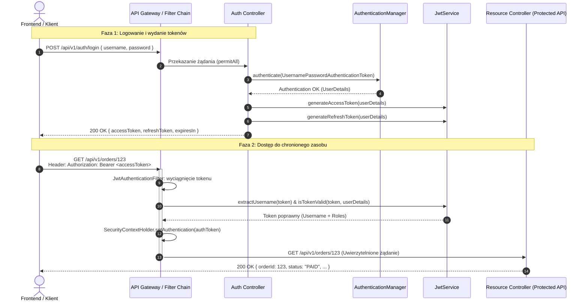

# Architektura Bezpieczeństwa: Spring Security i JWT (JSON Web Token)

> Podręcznik implementacyjny, koncepcje architektoniczne, wzorce w Spring Boot 3.x oraz kompendium pytań rekrutacyjnych na podstawie materiałów edukacyjnych (YouLearn / Spring Security Masterclass).

---

## Spis treści

1. [Wprowadzenie i podstawowe pojęcia](#1-wprowadzenie-i-podstawowe-pojęcia)
   - [Autentykacja vs Autoryzacja](#autentykacja-authentication-vs-autoryzacja-authorization)
   - [Dlaczego architektura bezstanowa (Stateless)?](#dlaczego-architektura-bezstanowa-stateless)
2. [Architektura wewnętrzna Spring Security](#2-architektura-wewnętrzna-spring-security)
   - [Łańcuch filtrów (Security Filter Chain)](#łańcuch-filtrów-security-filter-chain)
   - [SecurityContext i SecurityContextHolder](#securitycontext-i-securitycontextholder)
   - [AuthenticationManager, AuthenticationProvider i ProviderManager](#authenticationmanager-authenticationprovider-i-providermanager)
   - [UserDetailsService i UserDetails](#userdetailsservice-i-userdetails)
   - [Bezpieczeństwo haseł i PasswordEncoder](#bezpieczeństwo-haseł-i-passwordencoder)
3. [Kompletny przewodnik po JWT (JSON Web Token)](#3-kompletny-przewodnik-po-jwt-json-web-token)
   - [Czym jest JWT i jak działa?](#czym-jest-jwt-i-jak-działa)
   - [Struktura tokenu (Header, Payload, Signature)](#struktura-tokenu-header-payload-signature)
   - [Claims (Zarejestrowane, Publiczne, Prywatne)](#claims-zarejestrowane-publiczne-prywatne)
   - [Podpis symetryczny (HMAC/HS256) vs asymetryczny (RSA/RS256)](#podpis-symetryczny-hmachs256-vs-asymetryczny-rsars256)
   - [Strategia Access Token vs Refresh Token](#strategia-access-token-vs-refresh-token)
4. [Przepływ uwierzytelniania i autoryzacji (Flow)](#4-przepływ-uwierzytelniania-i-autoryzacji-flow)
   - [Diagram sekwencji](#diagram-sekwencji)
   - [Krok po kroku](#krok-po-kroku)
5. [Implementacja referencyjna w Spring Boot 3.x (Spring Security 6.x)](#5-implementacja-referencyjna-w-spring-boot-3x-spring-security-6x)
   - [Zależności Maven (`pom.xml`)](#zależności-maven-pomxml)
   - [Klasa pomocnicza `JwtService`](#klasa-pomocnicza-jwtservice)
   - [Filtr uwierzytelniający `JwtAuthenticationFilter`](#filtr-uwierzytelniający-jwtauthenticationfilter)
   - [Główna konfiguracja `SecurityFilterChain`](#główna-konfiguracja-securityfilterchain)
   - [Obsługa wyjątków: `AuthenticationEntryPoint` i `AccessDeniedHandler`](#obsługa-wyjątków-authenticationentrypoint-i-accessdeniedhandler)
6. [Autoryzacja na poziomie metod (Method-Level Security)](#6-autoryzacja-na-poziomie-metod-method-level-security)
   - [`@EnableMethodSecurity`](#enablemethodsecurity)
   - [`@PreAuthorize` i SpEL (Spring Expression Language)](#preauthorize-i-spel-spring-expression-language)
   - [Role vs Uprawnienia (Authorities)](#role-vs-uprawnienia-authorities)
7. [Kwestie bezpieczeństwa i pułapki produkcyjne](#7-kwestie-bezpieczeństwa-i-pułapki-produkcyjne)
   - [CSRF – kiedy wyłączać, a kiedy włączać?](#csrf--kiedy-wyłączać-a-kiedy-włączać)
   - [CORS (Cross-Origin Resource Sharing)](#cors-cross-origin-resource-sharing)
   - [Gdzie bezpiecznie przechowywać tokeny (LocalStorage vs HttpOnly Cookies)?](#gdzie-bezpiecznie-przechowywać-tokeny-localstorage-vs-httponly-cookies)
   - [Problem unieważniania tokenów (Revocation / Blacklist)](#problem-unieważniania-tokenów-revocation--blacklist)
8. [Najważniejsze pytania rekrutacyjne (Interview Q&A)](#8-najważniejsze-pytania-rekrutacyjne-interview-qa)

---

## 1. Wprowadzenie i podstawowe pojęcia

### Autentykacja (Authentication) vs Autoryzacja (Authorization)

W bezpieczeństwie aplikacji te dwa pojęcia pełnią odmienne, dopełniające się role:

| Pojęcie | Definicja | Przykładowe pytanie | Mechanizm w Spring Security |
| :--- | :--- | :--- | :--- |
| **Autentykacja (Uwierzytelnianie)** | Proces weryfikacji **tożsamości** podmiotu (użytkownika, serwisu). Odpowiedź na pytanie: *Kim jesteś?* | "Czy podany login i hasło lub token są poprawne?" | `AuthenticationManager`, `AuthenticationProvider`, `JwtAuthenticationFilter` |
| **Autoryzacja (Uprawnienia)** | Proces weryfikacji **praw dostępu** uwierzytelnionego podmiotu do określonego zasobu lub akcji. Odpowiedź na pytanie: *Co masz prawo zrobić?* | "Czy użytkownik z rolą `ROLE_USER` może usunąć zamówienie innego klienta?" | `AuthorizationManager`, `@PreAuthorize`, `SecurityFilterChain.authorizeHttpRequests()` |

---

### Dlaczego architektura bezstanowa (Stateless)?

Tradycyjne aplikacje webowe opierały się na **sesjach stanowych** (`HttpSession`, cookie `JSESSIONID`):
- Serwer przechowywał stan sesji w pamięci RAM lub sesyjnej bazie danych.
- Każde żądanie od klienta było kojarzone z obiektem sesji po identyfikatorze `JSESSIONID`.

**Problemy ze stanem w systemach rozproszonych / mikrousługach:**
1. **Skalowalność pozioma:** Dodanie nowej instancji serwisu wymaga tzw. *sticky sessions* na Load Balancerze lub synchronizacji pamięci sesyjnej (np. Redis Spring Session).
2. **Zużycie zasobów:** Utrzymywanie milionów aktywnych obiektów sesji w pamięci obciąża infrastrukturę.
3. **Mikrousługi (Microservices):** W architekturze opartej na wielu niezależnych mikroserwisach (np. `order-service`, `payment-service`, `delivery-service`), przekazywanie stanu sesyjnego jest nieefektywne.

**Podejście bezstanowe (Stateless z JWT):**
- Serwer nie przechowuje stanu sesji w pamięci (`SessionCreationPolicy.STATELESS`).
- Cały kontekst tożsamości, ról i uprawnień jest zaszyfrowany/podpisany wewnątrz tokena przesłanego przez klienta w każdym zapytaniu HTTP (`Authorization: Bearer <token>`).
- Każdy mikroserwis może niezależnie zweryfikować token za pomocą klucza publicznego lub wspólnego sekretu bez odpytywania bazy danych o sesję.

---

## 2. Architektura wewnętrzna Spring Security

Spring Security opiera się na **wzorcu łańcucha filtrów (Filter Chain)** przechwytującym przychodzące żądania HTTP przed dotarciem do kontrolerów Spring MVC.

```
                  ┌────────────────────────────────────────────────────────┐
                  │                    Servlet Container                   │
                  │                                                        │
HTTP Request ───► │  [DelegatingFilterProxy]                                │
                  │           │                                            │
                  │           ▼                                            │
                  │  [FilterChainProxy] (Spring Managed)                   │
                  │           │                                            │
                  │           ▼ (SecurityFilterChain)                      │
                  │  ┌──────────────────────────────────────────────────┐  │
                  │  │ 1. CorsFilter / HeaderWriterFilter               │  │
                  │  │ 2. CsrfFilter (lub wyłączony dla API)            │  │
                  │  │ 3. JwtAuthenticationFilter (Custom)              │  │
                  │  │ 4. UsernamePasswordAuthenticationFilter          │  │
                  │  │ 5. AnonymousAuthenticationFilter                 │  │
                  │  │ 6. AuthorizationFilter                           │  │
                  │  └──────────────────────────────────────────────────┘  │
                  │           │                                            │
                  └───────────┼────────────────────────────────────────────┘
                              ▼
                    DispatcherServlet ───► Controller
```

### Łańcuch filtrów (Security Filter Chain)

- **`DelegatingFilterProxy`**: Standardowy filtr serwletowy zarejestrowany w kontenerze (np. Tomcat). Nie zarządza bezpośrednio logiką, lecz deleguje zadania do beana Springa o nazwie `springSecurityFilterChain`.
- **`FilterChainProxy`**: Główny punkt wejścia do Spring Security. Zawiera listę skonfigurowanych łańcuchów filtrów (`SecurityFilterChain`) i przekazuje żądanie do odpowiedniego łańcucha na podstawie reguł URL (`RequestMatcher`).
- **`SecurityFilterChain`**: Interfejs definiujący zestaw filtrów Spring Security wykonywanych sekwencyjnie.

---

### SecurityContext i SecurityContextHolder

Centralnym miejscem przechowywania informacji o zalogowanym użytkowniku w trakcie trwania żądania jest **`SecurityContextHolder`**.

```
SecurityContextHolder
   └── SecurityContext
          └── Authentication
                 ├── Principal (zazwyczaj obiekt UserDetails lub username)
                 ├── Credentials (hasło lub token - często zerowane po autentykacji)
                 └── Authorities (kolekcja GrantedAuthority - np. ROLE_ADMIN, order:read)
```

- **Strategia wątku (`MODE_THREADLOCAL`):** Domyślnie `SecurityContextHolder` przechowuje `SecurityContext` w zmiennej typu `ThreadLocal`. Oznacza to, że dane uwierzytelnienia są dostępne w dowolnym miejscu kodu wykonującego się w ramach tego samego wątku roboczego żądania HTTP.
- **Pobieranie użytkownika w kodzie:**
  ```java
  Authentication authentication = SecurityContextHolder.getContext().getAuthentication();
  String currentUsername = authentication.getName();
  ```

---

### AuthenticationManager, AuthenticationProvider i ProviderManager

```
                       ┌─────────────────────────┐
                       │  AuthenticationManager  │
                       └────────────┬────────────┘
                                    │ (Interfejs)
                       ┌────────────▼────────────┐
                       │     ProviderManager     │
                       └────────────┬────────────┘
                                    │ deleguje do
         ┌──────────────────────────┼──────────────────────────┐
         ▼                          ▼                          ▼
┌──────────────────┐      ┌──────────────────┐      ┌──────────────────┐
│DaoAuthentication │      │JwtAuthentication │      │  OAuth2Resource  │
│    Provider      │      │    Provider      │      │ ServerProvider   │
└────────┬─────────┘      └──────────────────┘      └──────────────────┘
         │
         ├──► UserDetailsService (ładowanie użytkownika z bazy)
         └──► PasswordEncoder (weryfikacja hasła BCrypt)
```

1. **`AuthenticationManager`**: Główny interfejs odpowiedzialny za przeprowadzenie autentykacji. Przyjmuje niezweryfikowany obiekt `Authentication` i zwraca w pełni uwierzytelniony obiekt.
2. **`ProviderManager`**: Domyślna implementacja `AuthenticationManager`. Zawiera listę `AuthenticationProvider` i pyta po kolei każdego dostawcę, czy obsługuje dany typ uwierzytelnienia (`supports(Class<?> authentication)`).
3. **`AuthenticationProvider`**: Realizuje konkretną strategię weryfikacji (np. `DaoAuthenticationProvider` sprawdza login i hasło w bazie danych, inne providery obsługują LDAP, SAML, JWT itp.).

---

### UserDetailsService i UserDetails

- **`UserDetails`**: Reprezentuje profil użytkownika w formacie zrozumiałym dla Spring Security (zawiera metody: `getUsername()`, `getPassword()`, `getAuthorities()`, `isAccountNonExpired()`, `isEnabled()` itp.).
- **`UserDetailsService`**: Interfejs funkcyjny zawierający jedną kluczową metodę:
  ```java
  UserDetails loadUserByUsername(String username) throws UsernameNotFoundException;
  ```
  Służy do pobierania danych użytkownika z repozytorium (PostgreSQL, MongoDB itp.) podczas logowania.

---

### Bezpieczeństwo haseł i PasswordEncoder

Hasła w bazie danych **nigdy** nie mogą być zapisywane w formie jawnej (Plaintext) ani przy użyciu algorytmów podatnych na kolizje (MD5, SHA-1).

Spring Security wymusza użycie interfejsu `PasswordEncoder`:
```java
public interface PasswordEncoder {
    String encode(CharSequence rawPassword);
    boolean matches(CharSequence rawPassword, String encodedPassword);
    default boolean upgradeEncoding(String encodedPassword) { return false; }
}
```

- **`BCryptPasswordEncoder` (Rekomendowany standard):**
  - Wykorzystuje algorytm haszujący Blowfish z wbudowaną losową solą (**Salt**).
  - Posiada parametr kosztu (ang. *work factor* / *strength*, domyślnie 10), regulujący czas obliczeń, co zabezpiecza przed atakami *Brute-Force* oraz użyciem tablic tęczowych (*Rainbow Tables*).
- **Inne bezpieczne implementacje:** `Argon2PasswordEncoder`, `Pbkdf2PasswordEncoder`, `SCryptPasswordEncoder`.

---

## 3. Kompletny przewodnik po JWT (JSON Web Token)

### Czym jest JWT i jak działa?

**JSON Web Token (RFC 7519)** to kompaktowy, bezpieczny dla URL format przesyłania deklaracji (*claims*) pomiędzy dwiema stronami. Token jest podpisany cyfrowo, dzięki czemu odbiorca może zweryfikować jego integralność i autentyczność bez konieczności odpytywania bazy danych.

---

### Struktura tokenu (Header, Payload, Signature)

Token JWT składa się z trzech części rozdzielonych kropkami: `xxxxx.yyyyy.zzzzz`

```
┌─────────────────────────┐ . ┌─────────────────────────┐ . ┌─────────────────────────┐
│         HEADER          │   │         PAYLOAD         │   │        SIGNATURE        │
│                         │   │                         │   │                         │
│ {                       │   │ {                       │   │ HMACSHA256(             │
│   "alg": "HS256",       │   │   "sub": "john_doe",    │   │   base64UrlEncode(head) │
│   "typ": "JWT"          │   │   "roles": ["ADMIN"],   │   │   + "." +               │
│ }                       │   │   "exp": 1740000000     │   │   base64UrlEncode(pay), │
│                         │   │ }                       │   │   secretKey             │
│                         │   │                         │   │ )                       │
└─────────────────────────┘   └─────────────────────────┘   └─────────────────────────┘
```

1. **Header (Nagłówek):** Informuje o typie tokenu (`JWT`) oraz użytym algorytmie kryptograficznym (np. `HS256`, `RS256`).
2. **Payload (Ładunek / Claims):** Zawiera faktyczne dane (deklaracje) o użytkowniku oraz metadane tokenu (np. czas wygaśnięcia).
3. **Signature (Podpis):** Tworzony przez zahaszowanie połączonego Base64Url nagłówka i payloadu za pomocą klucza prywatnego lub sekretu. Zapewnia, że nikt nie zmodyfikował zawartości tokenu.

> [!WARNING]
> Dane w Header i Payload są kodowane w Base64Url, a **nie szyfrowane**. Każdy, kto przechwyci token, może odczytać jego zawartość. **Nigdy nie umieszczaj haseł, numerów kart kredytowych ani poufnych danych w payloadzie JWT!**

---

### Claims (Zarejestrowane, Publiczne, Prywatne)

- **Zarejestrowane (Registered Claims):** Standardowe nazwy zalecane przez RFC 7519:
  - `sub` (*subject*): Identyfikator podmiotu (np. ID użytkownika lub username).
  - `iss` (*issuer*): Podmiot wydający token (np. `auth.minitech.com`).
  - `exp` (*expiration time*): Znacznik czasu uniksowego (w sekundach), po którym token traci ważność.
  - `iat` (*issued at*): Czas utworzenia tokenu.
  - `nbf` (*not before*): Czas, przed którym token nie może być przetwarzany.
- **Prywatne / Niestandardowe Claims (Custom Claims):** Własne pola dodane przez aplikację, np.:
  - `"roles": ["ROLE_ADMIN", "ROLE_CUSTOMER"]`
  - `"email": "user@example.com"`
  - `"tenantId": "org-451"`

---

### Podpis symetryczny (HMAC/HS256) vs asymetryczny (RSA/RS256)

| Cecha | Symetryczny (HMAC - HS256) | Asymetryczny (RSA / ECDSA - RS256) |
| :--- | :--- | :--- |
| **Klucze** | Pojedynczy tajny klucz (Shared Secret). | Para kluczy: Klucz Prywatny (Private) + Klucz Publiczny (Public). |
| **Generowanie tokenu** | Za pomocą klucza tajnego. | Wyłącznie za pomocą **Klucza Prywatnego** (Serwis Auth). |
| **Weryfikacja tokenu** | Wymaga znajomości tego samego klucza tajnego. | Dowolny serwis może zweryfikować podpis za pomocą **Klucza Publicznego**. |
| **Zastosowanie** | Monolity lub małe systemy o zaufanym środowisku. | **Mikrousługi i systemy rozproszone** (OAuth2 / OpenID Connect). |

---

### Strategia Access Token vs Refresh Token

Ze względów bezpieczeństwa pojedynczy token o długim czasie życia jest ryzykowny (brak możliwości łatwego unieważnienia w przypadku kradzieży).

```
┌─────────────────────────┐                 ┌─────────────────────────┐
│      ACCESS TOKEN       │                 │      REFRESH TOKEN      │
├─────────────────────────┤                 ├─────────────────────────┤
│ • Krótki czas życia     │                 │ • Długi czas życia      │
│   (np. 5 - 15 minut)    │                 │   (np. 7 - 30 dni)      │
│ • Przesyłany w nagłówku │                 │ • Przechowywany bezpiecz-│
│   HTTP `Authorization`  │                 │   nie (np. HttpOnly)    │
│ • Wykorzystywany do     │                 │ • Służy wyłącznie do    │
│   autoryzacji żądań API │                 │   generowania nowego AT │
└─────────────────────────┘                 └─────────────────────────┘
```

**Rotacja Refresh Tokenów (Refresh Token Rotation):**
Podczas każdego użycia Refresh Tokena serwer unieważnia stary RT i wydaje parę: nowy Access Token + nowy Refresh Token. Jeśli skradziony RT zostanie użyty powtórnie, system wykrywa anomalię i unieważnia całą sesję użytkownika.

---

## 4. Przepływ uwierzytelniania i autoryzacji (Flow)

### Diagram sekwencji



---

## 5. Implementacja referencyjna w Spring Boot 3.x (Spring Security 6.x)

### Zależności Maven (`pom.xml`)

```xml
<dependencies>
    <!-- Spring Boot Starter Security -->
    <dependency>
        <groupId>org.springframework.boot</groupId>
        <artifactId>spring-boot-starter-security</artifactId>
    </dependency>

    <!-- Spring Boot Starter Web -->
    <dependency>
        <groupId>org.springframework.boot</groupId>
        <artifactId>spring-boot-starter-web</artifactId>
    </dependency>

    <!-- Biblioteka do obsługi JWT (JJWT: Java JWT) -->
    <dependency>
        <groupId>io.jsonwebtoken</groupId>
        <artifactId>jjwt-api</artifactId>
        <version>0.12.6</version>
    </dependency>
    <dependency>
        <groupId>io.jsonwebtoken</groupId>
        <artifactId>jjwt-impl</artifactId>
        <version>0.12.6</version>
        <scope>runtime</scope>
    </dependency>
    <dependency>
        <groupId>io.jsonwebtoken</groupId>
        <artifactId>jjwt-jackson</artifactId>
        <version>0.12.6</version>
        <scope>runtime</scope>
    </dependency>
</dependencies>
```

---

### Klasa pomocnicza `JwtService`

Odpowiedzialna za generowanie, parsowanie i walidację tokenów JWT:

```java
package org.demo.security;

import io.jsonwebtoken.Claims;
import io.jsonwebtoken.Jwts;
import io.jsonwebtoken.security.Keys;
import org.springframework.beans.factory.annotation.Value;
import org.springframework.security.core.GrantedAuthority;
import org.springframework.security.core.userdetails.UserDetails;
import org.springframework.stereotype.Service;

import javax.crypto.SecretKey;
import java.nio.charset.StandardCharsets;
import java.util.Date;
import java.util.HashMap;
import java.util.Map;
import java.util.function.Function;

@Service
public class JwtService {

    @Value("${application.security.jwt.secret-key:404E635266556A586E3272357538782F413F4428472B4B6250645367566B5970}")
    private String secretKey;

    @Value("${application.security.jwt.expiration:900000}") // 15 minut
    private long jwtExpiration;

    @Value("${application.security.jwt.refresh-token.expiration:604800000}") // 7 dni
    private long refreshExpiration;

    public String extractUsername(String token) {
        return extractClaim(token, Claims::getSubject);
    }

    public <T> T extractClaim(String token, Function<Claims, T> claimsResolver) {
        final Claims claims = extractAllClaims(token);
        return claimsResolver.apply(claims);
    }

    public String generateToken(UserDetails userDetails) {
        Map<String, Object> extraClaims = new HashMap<>();
        extraClaims.put("roles", userDetails.getAuthorities().stream()
                .map(GrantedAuthority::getAuthority)
                .toList());
        return buildToken(extraClaims, userDetails, jwtExpiration);
    }

    public String generateRefreshToken(UserDetails userDetails) {
        return buildToken(new HashMap<>(), userDetails, refreshExpiration);
    }

    private String buildToken(Map<String, Object> extraClaims, UserDetails userDetails, long expiration) {
        return Jwts.builder()
                .claims(extraClaims)
                .subject(userDetails.getUsername())
                .issuedAt(new Date(System.currentTimeMillis()))
                .expiration(new Date(System.currentTimeMillis() + expiration))
                .signWith(getSignInKey())
                .compact();
    }

    public boolean isTokenValid(String token, UserDetails userDetails) {
        final String username = extractUsername(token);
        return (username.equals(userDetails.getUsername())) && !isTokenExpired(token);
    }

    private boolean isTokenExpired(String token) {
        return extractExpiration(token).before(new Date());
    }

    private Date extractExpiration(String token) {
        return extractClaim(token, Claims::getExpiration);
    }

    private Claims extractAllClaims(String token) {
        return Jwts.parser()
                .verifyWith(getSignInKey())
                .build()
                .parseSignedClaims(token)
                .getPayload();
    }

    private SecretKey getSignInKey() {
        byte[] keyBytes = secretKey.getBytes(StandardCharsets.UTF_8);
        return Keys.hmacShaKeyFor(keyBytes);
    }
}
```

---

### Filtr uwierzytelniający `JwtAuthenticationFilter`

Filtr dziedziczący po `OncePerRequestFilter`, gwarantujący wykonanie dokładnie jeden raz na żądanie:

```java
package org.demo.security;

import jakarta.servlet.FilterChain;
import jakarta.servlet.ServletException;
import jakarta.servlet.http.HttpServletRequest;
import jakarta.servlet.http.HttpServletResponse;
import org.springframework.lang.NonNull;
import org.springframework.security.authentication.UsernamePasswordAuthenticationToken;
import org.springframework.security.core.context.SecurityContextHolder;
import org.springframework.security.core.userdetails.UserDetails;
import org.springframework.security.core.userdetails.UserDetailsService;
import org.springframework.security.web.authentication.WebAuthenticationDetailsSource;
import org.springframework.stereotype.Component;
import org.springframework.web.filter.OncePerRequestFilter;

import java.io.IOException;

@Component
public class JwtAuthenticationFilter extends OncePerRequestFilter {

    private final JwtService jwtService;
    private final UserDetailsService userDetailsService;

    public JwtAuthenticationFilter(JwtService jwtService, UserDetailsService userDetailsService) {
        this.jwtService = jwtService;
        this.userDetailsService = userDetailsService;
    }

    @Override
    protected void doFilterInternal(
            @NonNull HttpServletRequest request,
            @NonNull HttpServletResponse response,
            @NonNull FilterChain filterChain
    ) throws ServletException, IOException {
        
        final String authHeader = request.getHeader("Authorization");
        final String jwt;
        final String userEmail;

        // 1. Sprawdzenie obecności i formatu nagłówka Authorization
        if (authHeader == null || !authHeader.startsWith("Bearer ")) {
            filterChain.doFilter(request, response);
            return;
        }

        // 2. Wyodrębnienie tokenu z nagłówka
        jwt = authHeader.substring(7);
        userEmail = jwtService.extractUsername(jwt);

        // 3. Jeśli token zawiera username i użytkownik nie jest jeszcze uwierzytelniony w kontekście
        if (userEmail != null && SecurityContextHolder.getContext().getAuthentication() == null) {
            UserDetails userDetails = this.userDetailsService.loadUserByUsername(userEmail);

            // 4. Walidacja podpisu i daty ważności tokenu
            if (jwtService.isTokenValid(jwt, userDetails)) {
                UsernamePasswordAuthenticationToken authToken = new UsernamePasswordAuthenticationToken(
                        userDetails,
                        null,
                        userDetails.getAuthorities()
                );
                authToken.setDetails(new WebAuthenticationDetailsSource().buildDetails(request));
                
                // 5. Ustawienie uwierzytelnionego użytkownika w SecurityContext
                SecurityContextHolder.getContext().setAuthentication(authToken);
            }
        }
        
        // 6. Przekazanie żądania do kolejnego filtra w łańcuchu
        filterChain.doFilter(request, response);
    }
}
```

---

### Główna konfiguracja `SecurityFilterChain`

> [!IMPORTANT]
> W Spring Boot 3.x / Spring Security 6.x klasa `WebSecurityConfigurerAdapter` została całkowicie usunięta. Konfigurację definiuje się jako komponenty `@Bean` dla `SecurityFilterChain`.

```java
package org.demo.security;

import org.springframework.context.annotation.Bean;
import org.springframework.context.annotation.Configuration;
import org.springframework.security.authentication.AuthenticationManager;
import org.springframework.security.authentication.AuthenticationProvider;
import org.springframework.security.authentication.dao.DaoAuthenticationProvider;
import org.springframework.security.config.annotation.authentication.configuration.AuthenticationConfiguration;
import org.springframework.security.config.annotation.method.configuration.EnableMethodSecurity;
import org.springframework.security.config.annotation.web.builders.HttpSecurity;
import org.springframework.security.config.annotation.web.configuration.EnableWebSecurity;
import org.springframework.security.config.annotation.web.configurers.AbstractHttpConfigurer;
import org.springframework.security.config.http.SessionCreationPolicy;
import org.springframework.security.core.userdetails.UserDetailsService;
import org.springframework.security.crypto.bcrypt.BCryptPasswordEncoder;
import org.springframework.security.crypto.password.PasswordEncoder;
import org.springframework.security.web.SecurityFilterChain;
import org.springframework.security.web.authentication.UsernamePasswordAuthenticationFilter;

@Configuration
@EnableWebSecurity
@EnableMethodSecurity // Włącza wsparcie dla @PreAuthorize i @Secured
public class SecurityConfig {

    private final JwtAuthenticationFilter jwtAuthFilter;
    private final UserDetailsService userDetailsService;
    private final CustomAuthenticationEntryPoint authenticationEntryPoint;
    private final CustomAccessDeniedHandler accessDeniedHandler;

    public SecurityConfig(
            JwtAuthenticationFilter jwtAuthFilter,
            UserDetailsService userDetailsService,
            CustomAuthenticationEntryPoint authenticationEntryPoint,
            CustomAccessDeniedHandler accessDeniedHandler
    ) {
        this.jwtAuthFilter = jwtAuthFilter;
        this.userDetailsService = userDetailsService;
        this.authenticationEntryPoint = authenticationEntryPoint;
        this.accessDeniedHandler = accessDeniedHandler;
    }

    @Bean
    public SecurityFilterChain securityFilterChain(HttpSecurity http) throws Exception {
        http
            // Wyłączenie CSRF (zbędne dla bezstanowych tokenów JWT w nagłówku Authorization)
            .csrf(AbstractHttpConfigurer::disable)
            
            // Konfiguracja uprawnień do endpointów
            .authorizeHttpRequests(auth -> auth
                .requestMatchers(
                    "/api/v1/auth/**",
                    "/v3/api-docs/**",
                    "/swagger-ui/**",
                    "/swagger-ui.html",
                    "/actuator/health"
                ).permitAll()
                .requestMatchers("/api/v1/admin/**").hasRole("ADMIN")
                .anyRequest().authenticated()
            )
            
            // Bezstanowa sesja (brak tworzenia sesji HTTP)
            .sessionManagement(session -> session
                .sessionCreationPolicy(SessionCreationPolicy.STATELESS)
            )
            
            // Obsługa błędów autoryzacji i autentykacji (401 i 403)
            .exceptionHandling(exceptions -> exceptions
                .authenticationEntryPoint(authenticationEntryPoint)
                .accessDeniedHandler(accessDeniedHandler)
            )
            
            .authenticationProvider(authenticationProvider())
            // Rejestracja filtra JWT przed standardowym UsernamePasswordAuthenticationFilter
            .addFilterBefore(jwtAuthFilter, UsernamePasswordAuthenticationFilter.class);

        return http.build();
    }

    @Bean
    public AuthenticationProvider authenticationProvider() {
        DaoAuthenticationProvider authProvider = new DaoAuthenticationProvider();
        authProvider.setUserDetailsService(userDetailsService);
        authProvider.setPasswordEncoder(passwordEncoder());
        return authProvider;
    }

    @Bean
    public AuthenticationManager authenticationManager(AuthenticationConfiguration config) throws Exception {
        return config.getAuthenticationManager();
    }

    @Bean
    public PasswordEncoder passwordEncoder() {
        return new BCryptPasswordEncoder(12); // Siła haszowania 12
    }
}
```

---

### Obsługa wyjątków: `AuthenticationEntryPoint` i `AccessDeniedHandler`

Domyślnie Spring Security przy braku uprawnień może przekierować na stronę logowania HTML (302) lub zwrócić pustą stronę błędu. W REST API należy zwracać ustrukturyzowany format JSON:

1. **`AuthenticationEntryPoint` (HTTP 401 Unauthorized)** – gdy brak tokenu lub token jest nieprawidłowy/wygasły:
   ```java
   @Component
   public class CustomAuthenticationEntryPoint implements AuthenticationEntryPoint {
       @Override
       public void commence(HttpServletRequest request, HttpServletResponse response, AuthenticationException authException)
               throws IOException {
           response.setContentType(MediaType.APPLICATION_JSON_VALUE);
           response.setStatus(HttpServletResponse.SC_UNAUTHORIZED);
           
           Map<String, Object> body = Map.of(
               "status", 401,
               "error", "Unauthorized",
               "message", "Wymagane pełne uwierzytelnienie: " + authException.getMessage(),
               "path", request.getServletPath()
           );
           new ObjectMapper().writeValue(response.getOutputStream(), body);
       }
   }
   ```

2. **`AccessDeniedHandler` (HTTP 403 Forbidden)** – gdy użytkownik jest poprawnie zalogowany, ale nie ma wymaganej roli/uprawnień:
   ```java
   @Component
   public class CustomAccessDeniedHandler implements AccessDeniedHandler {
       @Override
       public void handle(HttpServletRequest request, HttpServletResponse response, AccessDeniedException accessDeniedException)
               throws IOException {
           response.setContentType(MediaType.APPLICATION_JSON_VALUE);
           response.setStatus(HttpServletResponse.SC_FORBIDDEN);
           
           Map<String, Object> body = Map.of(
               "status", 403,
               "error", "Forbidden",
               "message", "Brak uprawnień do tego zasobu: " + accessDeniedException.getMessage(),
               "path", request.getServletPath()
           );
           new ObjectMapper().writeValue(response.getOutputStream(), body);
       }
   }
   ```

---

## 6. Autoryzacja na poziomie metod (Method-Level Security)

### `@EnableMethodSecurity`

W Spring Security 6 włącza się zabezpieczenia metod za pomocą adnotacji `@EnableMethodSecurity` umieszczonej w klasie konfiguracyjnej.

---

### `@PreAuthorize` i SpEL (Spring Expression Language)

Umożliwia weryfikację uprawnień przed wykonaniem metody biznesowej na poziomie serwisu lub kontrolera:

```java
@RestController
@RequestMapping("/api/v1/orders")
public class OrderController {

    // Tylko użytkownicy z rolą ADMIN lub MANAGER
    @PreAuthorize("hasAnyRole('ADMIN', 'MANAGER')")
    @GetMapping("/all")
    public List<OrderResponse> getAllOrders() {
        return orderService.findAll();
    }

    // Sprawdzenie, czy zalogowany użytkownik jest właścicielem zamówienia
    @PreAuthorize("hasRole('ADMIN') or #customerId == authentication.principal.username")
    @GetMapping("/customer/{customerId}")
    public List<OrderResponse> getOrdersByCustomer(@PathVariable String customerId) {
        return orderService.findByCustomerId(customerId);
    }

    // Weryfikacja konkretnego uprawnienia (Authority)
    @PreAuthorize("hasAuthority('order:delete')")
    @DeleteMapping("/{id}")
    public ResponseEntity<Void> deleteOrder(@PathVariable Long id) {
        orderService.delete(id);
        return ResponseEntity.noContent().build();
    }
}
```

---

### Role vs Uprawnienia (Authorities)

W Spring Security:
- **Uprawnienie (Authority / Privilege):** Granularne prawo do wykonania konkretnej akcji, np. `READ_ORDER`, `WRITE_PAYMENT`, `DELETE_USER`.
- **Rola (Role):** Grupa uprawnień biznesowych. Konwencja Spring Security wymaga prefiksu `ROLE_` (np. `ROLE_ADMIN`, `ROLE_CUSTOMER`).
  - Metoda `hasRole("ADMIN")` automatycznie sprawdza uprawnienie `ROLE_ADMIN`.
  - Metoda `hasAuthority("order:write")` sprawdza dokładnie podany ciąg znaków bez dodawania prefiksu.

---

## 7. Kwestie bezpieczeństwa i pułapki produkcyjne

### CSRF – kiedy wyłączać, a kiedy włączać?

- **Wyłączamy (`csrf.disable()`):**
  - Gdy API jest **bezstanowe (Stateless)**, a tokeny JWT są przesyłane w nagłówku `Authorization: Bearer <token>`.
  - Przeglądarka internetowa nie dołącza automatycznie nagłówków `Authorization` do obcych żądań cross-site (w przeciwieństwie do ciasteczek).
- **Włączamy CSRF:**
  - Gdy aplikacja przechowuje token JWT w **przeglądarkowych ciasteczkach (Cookies)**. Atakujący może wówczas stworzyć złośliwą stronę wysyłającą żądanie pod nasz adres, a przeglądarka automatycznie dołączy ciasteczko z sesją.

---

### CORS (Cross-Origin Resource Sharing)

Gdy aplikacja Frontendowa (np. React na `http://localhost:3000`) łączy się z backendem (np. Spring Boot na `http://localhost:8080`), przeglądarka wysyła żądanie wstępne (**Preflight OPTIONS**).

Jeśli Spring Security nie jest poprawnie skonfigurowany pod kątem CORS, żądanie `OPTIONS` zostanie zablokowane z kodem 401 lub 403 przed dotarciem do właściwego kontrolera.

**Konfiguracja CORS Bean:**
```java
@Bean
public CorsConfigurationSource corsConfigurationSource() {
    CorsConfiguration configuration = new CorsConfiguration();
    configuration.setAllowedOrigins(List.of("http://localhost:3000", "https://app.minitech.com"));
    configuration.setAllowedMethods(List.of("GET", "POST", "PUT", "PATCH", "DELETE", "OPTIONS"));
    configuration.setAllowedHeaders(List.of("Authorization", "Content-Type", "X-Correlation-Id"));
    configuration.setExposedHeaders(List.of("X-Correlation-Id"));
    configuration.setAllowCredentials(true);
    
    UrlBasedCorsConfigurationSource source = new UrlBasedCorsConfigurationSource();
    source.registerCorsConfiguration("/**", configuration);
    return source;
}
```

---

### Gdzie bezpiecznie przechowywać tokeny (LocalStorage vs HttpOnly Cookies)?

| Miejsce zapisu | Podatność na XSS | Podatność na CSRF | Rekomendacja |
| :--- | :--- | :--- | :--- |
| **`localStorage` / `sessionStorage`** | **Wysoka**: Złośliwy skrypt JavaScript (XSS) ma bezpośredni dostęp do tokenu i może go wykraść. | **Brak**: Przeglądarka nie dołącza tokenu automatycznie. | Dopuszczalne dla tokenów o bardzo krótkim czasie życia (np. 5 min) lub w aplikacjach mobilnych. |
| **Ciasteczko `HttpOnly + Secure + SameSite=Strict`** | **Brak**: JavaScript nie ma dostępu do ciasteczka (`HttpOnly`). | **Wymaga ochrony**: Należy włączyć ochronę CSRF lub użyć `SameSite=Strict/Lax`. | **Najbezpieczniejsza opcja dla aplikacji webowych (SPA)**. |

---

### Problem unieważniania tokenów (Revocation / Blacklist)

Ponieważ JWT jest bezstanowy, serwer po jego wydaniu nie może go łatwo "unieważnić" przed upływem czasu `exp`.

**Rozwiązania problemu wylogowania / unieważnienia:**
1. **Krótki czas życia Access Tokena (np. 5-15 min):** Po wylogowaniu token wygaśnie samoczynnie w krótkim czasie.
2. **Czarna lista tokenów w Redis (Blacklisting):**
   - Podczas wylogowania identyfikator tokenu (`jti` - JWT ID) jest zapisywany w pamięci Redis z czasem TTL równym pozostałemu czasowi życia tokenu.
   - W filtrze `JwtAuthenticationFilter` sprawdzamy, czy `jti` znajduje się w Redis.
3. **Wersjonowanie tokenów użytkownika:**
   - W bazie danych przechowujemy pole `tokenVersion` lub `passwordChangedAt`.
   - Gdy użytkownik zmieni hasło lub kliknie "Wyloguj ze wszystkich urządzeń", inkrementujemy `tokenVersion`. Tokeny ze starszą wersją są natychmiast odrzucane.

---

## 8. Najważniejsze pytania rekrutacyjne (Interview Q&A)

### P1: Jaka jest różnica między Autentykacją a Autoryzacją?
> **Odpowiedź:** Autentykacja to weryfikacja tożsamości (*Kim jesteś?* — np. sprawdzenie loginu i hasła lub podpisu tokenu). Autoryzacja to sprawdzenie uprawnień zalogowanego użytkownika (*Co możesz zrobić?* — np. weryfikacja, czy użytkownik ma rolę `ROLE_ADMIN` lub uprawnienie `order:delete`).

---

### P2: Jak działa łańcuch filtrów (Filter Chain) w Spring Security?
> **Odpowiedź:** Każde przychodzące żądanie HTTP trafia do kontenera serwletów, gdzie `DelegatingFilterProxy` przekazuje je do zarządzanego przez Springa `FilterChainProxy`. Ten dopasowuje żądanie do odpowiedniego `SecurityFilterChain`, który składa się z sekwencji filtrów (np. CORS, CSRF, JWT Filter, UsernamePasswordAuthenticationFilter, AuthorizationFilter). Każdy filtr wykonuje logikę weryfikacji i przekazuje sterowanie dalej za pomocą `filterChain.doFilter(request, response)`.

---

### P3: Czym jest `SecurityContextHolder` i w jaki sposób zarządza kontekstem w aplikacjach wielowątkowych?
> **Odpowiedź:** `SecurityContextHolder` to klasa przechowująca informacje o aktualnym kontekście bezpieczeństwa (`SecurityContext`) i zalogowanym użytkowniku (`Authentication`). Domyślnie działa w trybie `MODE_THREADLOCAL`, co oznacza, że dane są izolowane na poziomie pojedynczego wątku obsługującego żądanie HTTP. W przypadku asynchronicznego przetwarzania (`@Async`) można zmienić tryb na `MODE_INHERITABLETHREADLOCAL` lub użyć `DelegatingSecurityContextAsyncTaskExecutor`.

---

### P4: Dlaczego w aplikacjach REST API z tokenami JWT wyłącza się ochronę CSRF (`csrf.disable()`)?
> **Odpowiedź:** Atak CSRF (Cross-Site Request Forgery) bazuje na automatycznym dołączaniu przez przeglądarkę ciasteczek (cookies) do żądań wysyłanych na zaufaną domenę. Gdy token JWT jest przesyłany w nagłówku `Authorization: Bearer <token>`, przeglądarka nie doda go automatycznie przy żądaniu z obcej domeny, co uniemożliwia przeprowadzenie ataku CSRF. Ochronę CSRF należy jednak zachować, jeśli JWT jest przechowywany w ciasteczkach przeglądarki.

---

### P5: Jaka jest rola `PasswordEncoder` i dlaczego stosuje się `BCryptPasswordEncoder`?
> **Odpowiedź:** `PasswordEncoder` służy do jednostronnego haszowania haseł oraz ich weryfikacji (`matches()`). `BCryptPasswordEncoder` implementuje algorytm oparty na szyfrze Blowfish, który automatycznie generuje losową sól (Salt) dla każdego hasła i pozwala regulować koszt obliczeniowy (work factor / strength). Dzięki temu hasła są odporne na ataki słownikowe, tablice tęczowe (rainbow tables) oraz próby brute-force.

---

### P6: Z jakich części składa się token JWT i do czego służy podpis (Signature)?
> **Odpowiedź:** JWT składa się z 3 części rozdzielonych kropkami:
> 1. **Header:** Typ tokenu (`JWT`) oraz algorytm podpisu (np. `HS256`, `RS256`).
> 2. **Payload:** Deklaracje (*claims*) zawierające dane użytkownika (np. `sub`, `roles`, `exp`).
> 3. **Signature:** Kryptograficzny podpis wyliczony z zakodowanego nagłówka, payloadu i klucza tajnego/prywatnego. Podpis zapobiega manipulacji danymi – jeśli ktokolwiek zmieni treść payloadu (np. zmieni rolę na ADMIN), serwer natychmiast odrzuci token z powodu niezgodności podpisu.

---

### P7: Czym różni się podpis symetryczny (HMAC) od asymetrycznego (RSA) w kontekście mikrousług?
> **Odpowiedź:** W podpisie symetrycznym (np. HS256) ten sam klucz tajny służy do podpisywania i weryfikacji tokenu, co oznacza, że każdy mikroserwis musiałby znać ten klucz (ryzyko wycieku). W podpisie asymetrycznym (np. RS256) tylko dedykowany serwis autoryzacji (Auth Server) posiada **Klucz Prywatny** do generowania tokenów, a pozostałe mikroserwisy weryfikują tokeny za pomocą **Klucza Publicznego**, którego ujawnienie nie zagraża bezpieczeństwu całego systemu.

---

### P8: W jaki sposób zaimplementować unieważnianie (revocation) tokenów JWT?
> **Odpowiedź:** Ponieważ JWT jest bezstanowy, standardowe mechanizmy obejmują:
> 1. Stosowanie bardzo krótkiego czasu życia Access Tokena (np. 5-15 min) i odświeżanie go za pomocą Refresh Tokena.
> 2. Implementację czarnej listy (Blacklist) unieważnionych tokenów w pamięci podręcznej o wysokiej wydajności (np. **Redis**) z czasem wygaśnięcia TTL równym czasowi ważności tokenu.
> 3. Przechowywanie wersji tokena (`tokenVersion`) w bazie danych użytkownika i odrzucanie tokenów z nieaktualnym numerem wersji przy wylogowaniu globalnym.

---

### P9: Jaka jest różnica między `hasRole('ADMIN')` a `hasAuthority('ADMIN')` w Spring Security?
> **Odpowiedź:** `hasRole('ADMIN')` automatycznie dodaje konwencjonalny prefiks `ROLE_` i sprawdza, czy użytkownik posiada uprawnienie `ROLE_ADMIN`. Z kolei `hasAuthority('ADMIN')` weryfikuje dokładnie przekazany ciąg znaków bez dodawania prefiksu `ROLE_`.

---

### P10: Co się zmieniło w Spring Boot 3.x w konfiguracji Spring Security w porównaniu do Spring Boot 2.x?
> **Odpowiedź:**
> 1. Usunięto klasę bazową `WebSecurityConfigurerAdapter` – konfigurację realizuje się poprzez tworzenie beana `SecurityFilterChain`.
> 2. Zastąpiono metody `authorizeRequests()` i `antMatchers()` nowoczesnym `authorizeHttpRequests()` oraz `requestMatchers()`.
> 3. Zrezygnowano z wielokrotnego łańcuchowania metod `and()` na rzecz konfiguracji opartej na wyrażeniach lambda (`Customizer.withDefaults()` lub `session -> session...`).
> 4. Zastąpiono adnotację `@EnableGlobalMethodSecurity` przez `@EnableMethodSecurity` (która ma domyślnie włączone wsparcie dla `@PreAuthorize`).
